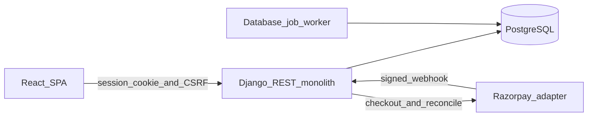
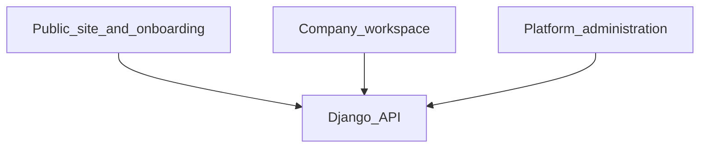
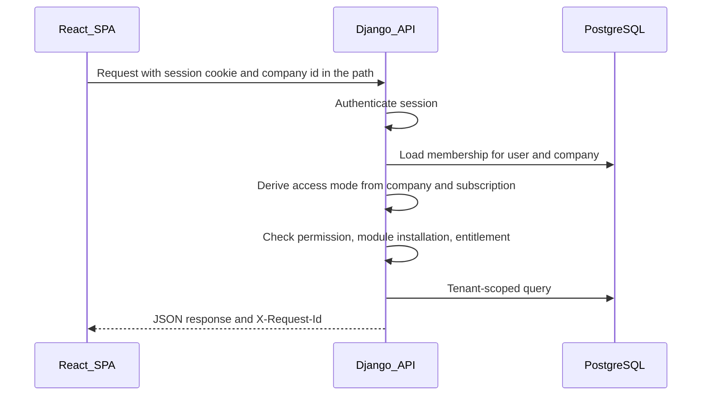

# 01 — System Architecture

Status: approved planning baseline.

## 1. Architecture summary

Pulse is a modular monolith:

- One Django REST Framework application owns all business rules.
- One PostgreSQL database is the system of record.
- One React and TypeScript single-page application is the client.
- OpenAPI generated from the backend is the API contract.
- A database-backed worker sends email, processes installation follow-up, and runs billing maintenance.
- Razorpay is the proposed first payment adapter behind a provider-neutral billing interface.

Microservices, Kubernetes, and independently deployed plugins are out of scope until a measured operational need exists.

## 2. Runtime components

| Component | Responsibility |
| --- | --- |
| React SPA | Public pages, onboarding, company workspace, Dashboard Studio, platform console. |
| Django API | Identity, tenancy, authorization, billing, modules, dashboards, platform queries. |
| PostgreSQL 16 | Transactional data, invoice snapshots, audit log, job queue. |
| Job worker | Same codebase, separate process, claims rows from `background_tasks`. |
| Payment provider | Checkout, recurring authorization, refunds, webhooks. The domain talks only to the provider interface. |
| Mail transport | Verification, invitation, and billing notices. The provider is configured at implementation time. |

Local development, when implementation starts, is a documented Python environment, a PostgreSQL instance, and the Vite dev server. That setup is not created in this planning phase.

Dependency versions are pinned at implementation start. The intended lines are Python 3.12, Django 5.2 LTS, Django REST Framework, drf-spectacular, PostgreSQL 16, current stable React, TypeScript, and Vite.

## 3. Three product surfaces

- Public and onboarding routes do not require a company membership until the company exists.
- Workspace routes are under `/api/v1/companies/{company_id}/...`.
- Platform routes are under `/api/v1/platform/...` and require a platform grant.

The SPA mirrors those surfaces at `/`, `/onboarding`, `/app/:companySlug`, and `/platform`.

## 4. Request path

The company id in the URL is a lookup key. Membership, access mode, permission, installation, and entitlement are loaded on the server.

## 5. Domain modules inside the monolith

Future Django apps, documented in [02-project-structure.md](02-project-structure.md):

- `identity` — users, verification, password reset, sessions.
- `tenants` — companies, memberships, invitations, onboarding, settings.
- `organization` — departments and people.
- `authorization` — permissions, roles, platform grants.
- `billing` — plans, subscriptions, invoices, taxes, provider interface.
- `billing_razorpay` — Razorpay adapter only. No other app imports Razorpay types.
- `modules_registry` — catalog and company installations.
- `dashboards` — definitions, versions, assignments, widget data routing.
- `notifications`, `audit`, `platform_admin`.
- `hrms` — optional Leave module.

Core apps call module code only through the registry contract in [07-modular-plugin-architecture.md](07-modular-plugin-architecture.md).

## 6. Tenancy

Shared database, shared schema, explicit `company_id`. Details, composite foreign keys, and Row-Level Security prerequisites are in [03-database-design.md](03-database-design.md) and [06-multi-tenancy-and-security.md](06-multi-tenancy-and-security.md).

Application enforcement is the control implemented with each feature. RLS is mandatory defense in depth before the first production customer and is not claimed as done inside the four-week MVP.

## 7. Billing placement

Billing is a core platform capability. Subscription status, invoice status, payment status, refund status, and company lifecycle status are stored separately. Workspace access is derived. The rules are defined once in [08-subscriptions-and-billing.md](08-subscriptions-and-billing.md).

Paid access changes only inside the webhook processor after signature verification, idempotent event storage, and a provider read-back of the payment where the adapter supports it.

## 8. Module placement

Optional modules are trusted source code deployed with the monolith. Company installation is a row in `company_module_installations` plus subscription eligibility. Installing a module does not grant user permissions. Schema for every trusted module ships in normal Django migrations at deploy time. Installation does not run DDL.

## 9. Dashboard placement

Widget definitions are code-registered and stored in `widget_definitions`. Layout JSON is validated. Each widget data endpoint enforces tenant scope, permission, module installation, and entitlement again. The dashboard document does not grant data access.

## 10. Cross-cutting services

- **Error format and pagination** — [04-api-design.md](04-api-design.md).
- **Correlation** — accept or generate `X-Request-Id` and store it on audit rows.
- **Audit** — append-only `audit_logs` for security-sensitive and financial actions.
- **Usage** — `usage_records` compared with `billing_plan_entitlements` on write paths.
- **Jobs** — `background_tasks` with attempts, locking, and failure visibility in platform admin.

## 11. What this architecture deliberately avoids

- A tenant id header trusted on its own.
- JWT access tokens stored in browser local storage.
- Provider status strings stored as the domain status.
- Floating-point currency.
- Per-tenant databases or schemas in the MVP.
- Dynamic Python uploaded by customers.
- A second source of truth for MRR outside billing tables.

## 12. Deployment shape for the MVP

One API process, one worker process, one PostgreSQL instance, and the static SPA. HTTPS terminates in front of both the SPA and the API. Session cookies are set for the API site with `Secure`, `HttpOnly`, and `SameSite=Lax`. CORS allows only the SPA origin.

Horizontal scale of the API is possible later because tenant state lives in PostgreSQL, not in process memory. That scale-out is not part of the MVP design work.
