# 05 — Identity and Authorization

Status: planning baseline with Phase 0 implementation notes. Permission codes here are the **target catalog** the `permissions` table and API should share. Where code differs, [14-implementation-status.md](14-implementation-status.md) and `backend/apps/authorization/catalog.py` describe what is seeded today.

## 1. Five separate decisions

Every protected action passes five questions. A yes to one does not imply the others.

| Question | Record |
| --- | --- |
| Authentication: who is the caller? | `users` and the session |
| Membership: which company may they enter? | `company_memberships` |
| Authorization: which permission codes do they hold? | `membership_role_assignments` joined to `company_role_permissions` |
| Entitlement: which paid capabilities does the company have? | current `subscriptions` plan entitlements and active `subscription_items` |
| Installation: which modules are enabled? | `company_module_installations.status = installed` |

Platform administration replaces membership and company roles with `platform_permission_grants`. It does not union them with company permissions.

```mermaid
flowchart TD
  request[Request]
  authn[Authenticate_session]
  platform{Platform_route}
  grant[Require_platform_grant]
  member[Load_active_membership]
  access[Derive_access_mode]
  perm[Require_permission_code]
  module[Require_installation_and_entitlement]
  object[Load_object_in_company]
  request --> authn
  authn --> platform
  platform -->|yes| grant
  platform -->|no| member
  member --> access
  access --> perm
  perm --> module
  module --> object
```

The frontend may hide a link. The API still runs this sequence.

## 2. Authentication

**Recommendation:** Django session cookies for the browser. Cookie flags: `HttpOnly`, `Secure`, `SameSite=Lax`. CSRF is required for unsafe methods. Passwords use Argon2 via Django's password hashers.

Email verification is mandatory before company creation, invitations acceptance, and checkout. Login is allowed before verification so the user can request a new message, and `GET /api/v1/onboarding` shows the unverified step.

Password reset tokens and verification tokens are random, stored only as hashes, single-use, and expiring. Planning recommendation: verification tokens expire in 24 hours, reset tokens in 1 hour.

Account deactivation sets `users.is_active = false` and ends sessions. It does not delete memberships, people, or invoices. An inactive user receives the same login failure as a bad password.

There is no JWT in browser storage in the MVP, and there are no API keys yet.

### 2.1 Mandatory security requirements

- Throttle registration, login, verification resend, and password reset by IP and by email.
- Do not reveal whether an email is registered on reset or login failure.
- Rotate the session key on login.
- Store only token hashes.

## 3. Membership

A user may hold many `company_memberships`. The company id in the URL is accepted only when that pair has status `active`. `invited`, `suspended`, and `removed` do not authorize workspace routes.

Accepting an invitation creates or reactivates the membership for the verified email on the invitation. The invitation can attach an existing `people` row in that company. Creating a person remains a separate action when the invite does not already reference one.

Company creation creates the owner membership immediately. It also creates a `people` row for the founder and links that person on the membership, so employee counts include the owner. The person and the user remain different rows.

## 4. Permission catalog

Company scope:

| Code | Allows |
| --- | --- |
| `company.view` | Read the company and workspace bootstrap. |
| `company.update` | Update display name and timezone. |
| `membership.view` | List memberships. |
| `membership.invite` | Create and revoke invitations. |
| `membership.update` | Suspend a membership or link a person. |
| `membership.remove` | Remove a membership. |
| `people.view` | List and read people in the company. |
| `people.create` | Create a person, subject to `max_people`. (**As built:** entitlement is seeded; create-path enforcement not verified as implemented.) |
| `people.update` | Update a person, with the department-manager object rule. (**As built:** action permission only; object rule not enforced.) |
| `people.deactivate` | Set a person inactive. |
| `departments.view` | List departments. |
| `departments.manage` | Create, update, and delete empty departments. (**As built:** create/update; delete semantics may differ.) |
| `roles.view` | List roles. |
| `roles.manage` | Create roles, edit permissions, assign roles. |
| `modules.view` | View the catalog and installation state. |
| `modules.install` | Install, retry, and upgrade. (**As built:** install and retry; upgrade service Missing.) |
| `modules.configure` | Update installation config. (**As built:** permission seeded; service Missing.) |
| `modules.uninstall` | Uninstall without deleting business data. (**As built:** permission seeded; service Missing.) |
| `billing.view` | View subscription, invoices, payments, and refunds. (**As built:** subscription summary; full invoice/payment surfaces Missing.) |
| `billing.manage` | Change plan, cancel, add or schedule removal of module items, edit the billing profile. (**As built:** billing profile and plan select paths Partial.) |
| `dashboards.view` | View an assigned dashboard. |
| `dashboards.manage` | Create, edit, publish, restore, and assign dashboards. |
| `notifications.view` | Read the caller's notifications. (**Documented / not seeded** in `catalog.py`. Inbox currently gated with `company.view`.) |
| `custom_entities.manage` | Create and archive custom entities and their fields. (**Seeded in code.**) |
| `custom_entities.view` | List and view custom entity records. (**Seeded.**) |
| `custom_entities.create` | Create custom entity records. (**Seeded.**) |
| `custom_entities.update` | Update custom entity records. (**Seeded.**) |
| `custom_entities.delete` | Archive custom entity records. (**Seeded.**) |
| `audit.view` | Read the company audit log. |
| `hrms.leave.view` | Read leave policies and requests the caller is allowed to see. (**As built:** lists all company requests for any holder of this code.) |
| `hrms.leave.request` | Create a leave request for the caller's linked person. |
| `hrms.leave.decide` | Approve or reject requests. (**Docs formerly said “create policies”; policy CRUD API Missing. Decide path Implemented.**) |

Platform scope, stored only in `platform_permission_grants`:

| Code | Allows |
| --- | --- |
| `platform.companies.view` | Company counts, lifecycle, and usage summaries. |
| `platform.companies.manage` | Suspend, reactivate, and close a company. |
| `platform.users.view` | Global user and membership metrics. |
| `platform.users.manage` | Create and update platform users and permission grants. (**Seeded in code.**) |
| `platform.billing.view` | Subscriptions, invoices, payments, refunds, and MRR. |
| `platform.billing.manage` | Execute a refund. |
| `platform.modules.manage` | Module adoption, failures, and catalog operations. |
| `platform.operations.view` | Failed webhooks, failed tasks, and health. |
| `platform.audit.view` | Platform audit stream. |

Company role APIs reject platform codes. Seeding a company role with a platform code is a defect, not a feature.

## 5. Role templates

Templates are copied into `company_roles` when the company is created. Later edits to a template do not silently rewrite companies. Custom roles are additional `company_roles` with `is_system = false`.

| Template | Permission set |
| --- | --- |
| Owner | Every company-scope permission, including HRMS codes. `is_owner_role = true`. |
| Administrator | Every company-scope permission. Not an owner, so this role cannot be the last protected owner. |
| HR Manager | As in `authorization/catalog.py`: people, invitations, departments, leave view/request/decide, `dashboards.view`. Does **not** currently include `notifications.view` (that code is not seeded). |
| Department Manager | As in catalog: people view/update, departments view, leave view/decide, `dashboards.view`. No `notifications.view`. |
| Employee | As in catalog: `company.view`, `people.view`, `dashboards.view`, `hrms.leave.view`, `hrms.leave.request`. No `notifications.view`. |

Checks use codes. Code may test `is_owner_role` only for the last-owner rule and the owner permission floor. It must not authorize with string comparisons such as `role.name == "HR Manager"`.

### 5.1 Owner floor and last owner

The owner role always retains `company.update`, `roles.manage`, `billing.manage`, `membership.invite`, and (**as built**) `custom_entities.manage`. An update that removes those codes returns `409`.

At least one `active` membership must hold a role with `is_owner_role`. Removing that membership, suspending it, or unassigning that role returns `409` when it would leave zero owners.

### 5.2 Object-level rules

- A department manager's `people.update` **should** apply only to people whose `department_id` equals the manager person's department. Administrators and owners are not limited that way. (**As built:** specified here; **not enforced** in person update services—action permission only. Completing record scopes is part of ADR-021.)
- `hrms.leave.request` creates a request only for the person linked to the caller's membership. (**Implemented.**)
- `hrms.leave.view` **should** respect “allowed to see” scopes. (**As built:** any holder sees all company leave requests.)
- `people.view` in the MVP is company-wide for anyone who holds it. Hiding the directory from employees is a later change to the Employee template, not a second authorization mechanism.
- Billing, module, and dashboard detail routes load the row with `company_id` in the query. A foreign id is `404`.

### 5.3 Revocation

Revocation deletes rows in `membership_role_assignments` or `company_role_permissions`, or sets the membership to `suspended` or `removed`. The next request recomputes permissions. There is no permission cache that outlives the request in the MVP.

## 6. Entitlement and installation

`modules.install` is necessary and not sufficient.

- If `included_module_slugs` on the current plan contains `hrms`, installation may proceed during `trialing` or `active`.
- Otherwise the company needs a `subscription_items` row of type `module`, slug `hrms`, status `active`, on the same interval and currency as the subscription.
- A `pending` module item does not entitle installation.
- Installation does not insert role permissions. An owner who already has the HRMS codes from the template can use the module. An employee can use only the codes they already have.
- Uninstall or a canceled module item removes entitlement. It does not delete `hrms_leave_requests`.

People creation **should** check `max_people` against active people inside the same transaction. Pending invitations that will create a new person **should** count toward the same limit. (**As built:** Growth entitlement seeds `max_people`; create-path enforcement not verified as implemented.)

## 7. Access mode and authorization

Access mode is applied before the permission check. A caller with `people.create` in `billing_only` still receives `403` `access_restricted`. Billing view and billing manage remain available in `billing_only` and `grace`. The matrix is defined in [08-subscriptions-and-billing.md](08-subscriptions-and-billing.md) and is not restated with different values here.

**As built (Unresolved):** `require_permission` currently treats `grace` similarly to `full` for non-billing company codes. Either align code with the billing matrix or update the matrix/docs—do not assume which is correct without a decision.

Platform `suspended` and `closed` resolve to `blocked` for company routes, including billing. The operator uses platform routes to unsuspend.

## 8. Platform grants

The first operator is a normal `users` row that also has `platform_permission_grants`. Nothing in company onboarding creates those rows. A company owner who knows the platform URL receives `403` `permission_denied`.

Grant changes are audited with `company_id` null and action `platform.grant.changed`.

The MVP has no impersonation grant. Support that needs customer data uses exports or a screen designed later, with its own audit, and is not added silently to `platform.companies.manage`.

## 9. Automated checks required with the feature

- A membership in company A receives `404` for company B's person, invoice, role, and leave request.
- A company role update that includes `platform.billing.view` returns `400`.
- Removing the last owner returns `409`.
- A user with `modules.install` and without entitlement receives `422`.
- After install, a user without `hrms.leave.request` receives `403` on leave creation.
- A platform metric route without a platform grant returns `403` even for a company owner.
