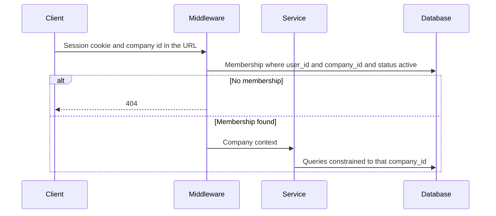

# 06 — Multi-Tenancy and Security

Status: approved planning baseline. Application-level isolation ships with each feature. PostgreSQL Row-Level Security is a mandatory defense-in-depth control before the first production customer and is specified here so it is not redesigned later.

## 1. Tenant model

One PostgreSQL database and one shared schema. Every tenant-owned row carries `company_id`. Global rows are users, permission catalog, role templates, module definitions, plan catalog, platform supplier profile, platform tax rates, platform settings, and provider event storage before a company is resolved.

A global user is not a tenant. Memberships attach that user to companies. People belong to one company. The same human who works at two companies has one `users` row, two memberships, and two person rows.

**Assumption:** users may belong to multiple companies in the MVP data model. The onboarding UI can still feel like a single company. The API never infers the tenant from the user id alone.

## 2. Request context

The client-supplied company id is a key. It is valid only after the membership lookup. Query parameters, JSON bodies, and headers are not a second source of tenant identity. If a body contains `company_id`, it must match the path or the request is `400`.

Services that read or write tenant data take an explicit company context object. A tenant queryset that is evaluated without that context raises in application code. Raw SQL in tenant apps is reviewed the same way and includes `company_id`.

Background tasks copy `company_id` onto `background_tasks` and set the same context before touching tenant tables. A tenant task without a company id fails.

## 3. Cross-tenant integrity

Composite foreign keys in [schema.dbml](schema.dbml) reject a child that names another company's parent. Examples: a person and their department, a membership and its person, an invoice line and its subscription item, a leave request and its policy.

Unique constraints that must not be global are scoped: department name, employee code, role name, and one pending invitation per email, all per `company_id`. Email on `users` stays globally unique because login identity is global.

Object reads use the company id in the `WHERE` clause and then check permission. A miss is `404`, including when the object exists in another company.

## 4. Row-Level Security

**Mandatory security requirement before the first production customer.** RLS is not the control the four-week MVP is required to finish, and production onboarding of a real customer waits until the prerequisites below are met.

### 4.1 Why it is justified

Application queries are the primary control and the one developers exercise every day. A missing filter is still possible. RLS makes PostgreSQL return no tenant row when the session variable does not match, including for a buggy queryset, a shell snippet, or a job that forgot to set context.

### 4.2 Policy shape

For each tenant-owned table:

- `ENABLE ROW LEVEL SECURITY`.
- `FORCE ROW LEVEL SECURITY` so the table owner does not skip policies by accident. Migrations use a separate role that is not the application role.
- Policy `tenant_isolation` for `SELECT`, `INSERT`, `UPDATE`, `DELETE`: `company_id = current_setting('app.company_id', true)::uuid`.
- Platform reads use a second policy that allows access only when `current_setting('app.platform_access', true) = 'on'`, and only for the database role used by platform query services. Company request connections do not set that variable.
- `WITH CHECK` on insert and update repeats the company match so a row cannot be written into another tenant.

`app.company_id` is unset by default. `current_setting(..., true)` returns null, the comparison fails, and the policy fails closed.

Tables without `company_id` do not get a tenant policy. Provider events are inserted by the webhook role and selected by the platform operations role. They are not readable through a company connection.

### 4.3 Implementation prerequisites

- Every tenant table has `company_id NOT NULL` except the documented nullable cases (`notifications`, `audit_logs`, `background_tasks`). Nullable tables need a policy that allows null only for the platform role.
- The application role is neither a superuser nor the table owner. Superusers bypass RLS.
- Each request runs `SET LOCAL app.company_id = '...'` inside the transaction after membership is confirmed, and clears it when the transaction ends. `SET LOCAL` is required so a pooled connection cannot leak tenant context.
- If PgBouncer is introduced later, it must run in transaction pooling mode together with `SET LOCAL`, or session pooling must be rejected. A session-level `SET` on a pooled connection is a cross-tenant defect.
- The worker sets the variable per task and resets it afterward.
- Migrations run as the migration role, not the application role.
- Automated tests connect as the application role, set the variable, and prove that company B's rows are invisible. A second test leaves the variable unset and expects zero tenant rows.
- Platform screens set `app.platform_access` only in code paths that already checked a platform grant.

### 4.4 Migration risks

- Enabling RLS on a populated table without policies, or with a policy and no setting, makes the application see empty lists. Ship policies and the `SET LOCAL` wiring in the same release, behind a staging drill.
- `FORCE ROW LEVEL SECURITY` will also hide rows from ad-hoc owner sessions. Operators need a documented break-glass role. Break-glass use is audited outside the application if it bypasses policies, and it is not granted to the app.
- Django's test runner and schema editor often connect as a privileged role. Tests that claim to prove RLS must use the restricted role or they provide false confidence.
- Composite foreign keys remain necessary. RLS does not replace them if a bug sets `app.company_id` to the attacker's company and still writes another company's parent id. Both controls stay.
- Adding a new tenant table without a policy is a release checklist item. A migration test can fail when a table has `company_id` and RLS is not enabled.
- Performance: the policy predicate must be indexable. `company_id` indexes already required by the application queries serve that predicate. Cast failures on a malformed setting should error rather than scan.

Until RLS is on, the mandatory substitute is the tenant queryset, composite foreign keys, and the cross-tenant tests in section 8.

## 5. Threat model and required controls

| Threat | Control before the first customer |
| --- | --- |
| Cross-tenant reads or writes | Membership check, tenant queryset, composite foreign keys, `404` for foreign ids, automated isolation tests. RLS before production customers. |
| Insecure direct object reference | Detail routes filter by `company_id` and permission. UUIDs reduce guessing and are not the control. |
| Company admin grants themselves platform access | Platform codes are a different scope and a different table. API rejects them on company roles. |
| Stolen session | `HttpOnly` `Secure` cookies, CSRF, session rotation on login, server-side revocation by deactivating the user. |
| CSRF | Django CSRF on unsafe cookie-authenticated requests. CORS allowlist is the SPA origin only. Credentialed CORS is not combined with a wildcard origin. |
| Injection and bad input | Serializer validation, database checks, parameterized queries, JSON schema for module config and widget config. |
| Credential stuffing | Throttles on register, login, verification, and reset. |
| Password reset takeover | Hashed single-use short-lived tokens. Reset does not reveal whether the email exists. |
| Payment spoofing | No client route activates a paid subscription. Webhook signature, timestamp tolerance where the provider supports it, unique event id, and provider read-back before capture is trusted. |
| Webhook replay | Unique `(provider, provider_event_id)`. Replays return the stored outcome and do not apply twice. |
| Duplicate charges | Unique idempotency key per provider and checkout. Subscription item changes lock the current subscription row. |
| Concurrent subscription edits | Transaction with a row lock on the current subscription. A second plan change waits or returns `409` if the status moved. |
| Concurrent module install | PostgreSQL advisory lock on `(company_id, module_slug)` plus the unique `(company_id, module_slug)` constraint. |
| Audit gaps | Append-only `audit_logs` for membership, role, billing, module, platform grant, suspension, and refund actions. Application role cannot update or delete audit rows. |
| Secret leakage | Environment-injected secrets. No provider secret in the repository, the SPA, or invoice payloads. Webhook payloads stored for reconciliation are restricted to the platform operations role. |
| Backup loss | Daily base backup and WAL archiving before production, plus a restore drill. One database holds billing and tenant data so a restore stays consistent. |
| Job leakage | Jobs carry `company_id` and fail closed without it. Failures are visible on the platform task list. |
| Migration damage | Expand-contract migrations. No destructive column drop in the same release that stops writing it. Backups taken before production migrations. |

## 6. Data export and deletion

The MVP supports operator-driven company closure (`companies.status = closed`) and user deactivation. It does not include a self-serve export ZIP or an automated erasure API.

Planning retention, pending legal confirmation:

- Issued invoices, payments, refunds, and subscription events: at least eight years.
- Audit logs for security and billing: at least two years.
- Verification and reset tokens: purge 30 days after expiry.
- Succeeded background tasks: purge after 30 days.
- Read notifications: purge after 180 days.

A future erasure workflow must keep invoice snapshots required for tax and must detach or tombstone a person without breaking composite history. That workflow is deferred.

## 7. Secrets and configuration

`SECRET_KEY`, database URL, Razorpay key id, Razorpay key secret, webhook secret, and email credentials come from the process environment. Local development uses an untracked file that this planning phase does not create.

Provider public key ids may appear in checkout payloads. Secrets must not.

## 8. Verification expected while building

Each feature that reads or writes a tenant table adds tests that:

1. User in company A cannot read or update company B's object.
2. A composite write that pairs company A's child with company B's parent fails.
3. The permission failure is `403` and the foreign object is `404`.
4. Where the feature changes billing or roles, an audit row exists with the request id.

Payment features add tests for an invalid signature, a duplicate event id, and an out-of-order event that must not move `active` back to `incomplete`.

RLS tests are added in the production-hardening task that enables policies, using the restricted database role. They do not replace the application tests above.
