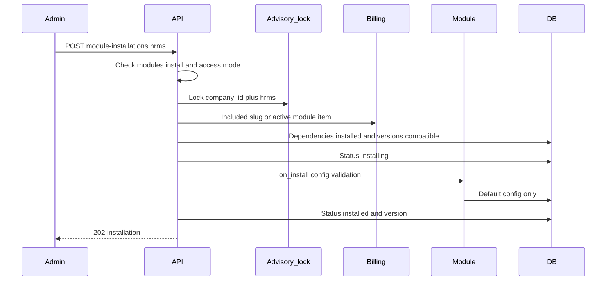

# 07 — Modular Plugin Architecture

Status: approved planning baseline. "Plugin" here means a trusted Django app in this repository, registered with Pulse. It does not mean customer-uploaded code or a separately deployed service.

## 1. Decision

Optional products are normal Django applications shipped in the same release as the core. `INSTALLED_APPS` lists them. Their migrations run at deploy time for the whole database. A company installation is a row in `company_module_installations`, not a schema change and not an import of untrusted Python.

HRMS Leave is the first optional module. CRM and Commerce may later follow the same contract. They have no MVP tables and no MVP routes.

This avoids a plugin marketplace, remote code execution, and per-tenant migration graphs. The cost is that a module's schema exists before a company installs it. Empty tables are acceptable. Company data appears only after authorized use.

## 2. What stays in the core

Authentication, sessions, companies, memberships, people, departments, roles, permissions, billing, entitlements, audit, notifications, dashboard storage, and the module registry are core. HRMS must call those services. It must not create a second user table or a second invoice table.

People and departments remain core because every company needs an organization even when HRMS is not installed.

## 3. Module contract

Each trusted module exposes one manifest. The manifest is code and is mirrored into `module_definitions` by a seed command.

| Field | Meaning |
| --- | --- |
| `slug` | Stable id, primary key of `module_definitions`. HRMS uses `hrms`. |
| `display_name` | Catalog label. |
| `version` | Version deployed in this release, stored on the installation when it succeeds. |
| `min_platform_version` | Oldest Pulse release that can load this module. |
| `django_app_label` | App that owns models and migrations. |
| `dependencies` | Other slugs that must already be `installed`. HRMS has none. |
| `permissions` | Company-scope codes this module adds, such as `hrms.leave.view`. |
| `api_mount` | URL prefix under `/api/v1/companies/{company_id}/`. |
| `frontend` | Route and nav manifest described in [02-project-structure.md](02-project-structure.md). |
| `widgets` | Widget definition codes, each with `required_permission` and `config_schema`. |
| `config_schema` | JSON Schema for `company_module_installations.config`. |
| `entitlement` | How a company becomes eligible: included slug, or paid `subscription_items` row. |
| `on_install` | Idempotent function that writes default company configuration. It does not grant roles. |
| `on_upgrade` | Idempotent data transform from the previously installed version to the manifest version. |
| `on_uninstall` | Marks the module uninstalled. Must not drop tables or delete business rows. |

Permission rows are seeded into `permissions` with `module_slug = hrms`. Role templates that should have those codes are updated in the same seed. Existing companies receive new codes only through an explicit template-sync or by an administrator editing roles. Install does not perform that grant.

## 4. Catalog versus installation

`module_definitions` is global and identical for every company. `company_module_installations` is the company's state. `billing_module_prices` and `billing_plan_entitlements` decide whether the company may install. `company_role_permissions` decide whether a user may call the module. Those four concerns are stored separately so a billing change, a permission change, and an install failure can be explained independently.

Installation status values: `pending`, `installing`, `installed`, `failed`, `upgrading`, `uninstalling`, `uninstalled`.

A failed install keeps `last_error` and is visible to company admins with `modules.view` and to platform operators. Retry starts from `failed` only.

## 5. Installation flow

The advisory lock and the unique `(company_id, module_slug)` pair stop two installs from interleaving. The service updates status in the same transaction as `on_install`. If `on_install` raises, the transaction rolls back and a new transaction records `failed` and `last_error`.

Uninstall sets `uninstalled` and `uninstalled_at`. Leave policies and leave requests stay. Subsequent HRMS routes return `404` so an uninstalled module is not enumerable by people who never had it. Platform operators can still see the installation row.

Upgrade compares `installed_version` with the running manifest. The MVP ships one version, so upgrade is the state machine and the hook, exercised by a test double, not a second HRMS release.

## 6. How Django stays manageable

- All module models live in their app and use ordinary migrations.
- Core code depends on the registry interface, not on HRMS models. HRMS may depend on core models.
- Removing a module from a company does not remove it from `INSTALLED_APPS`.
- A breaking schema change uses expand-contract migrations: add columns, backfill, switch reads, then drop later.
- Compatibility is the manifest `version` plus `min_platform_version`. The installer refuses a module when the running platform version is older.
- There is no per-company migration history. That is a deliberate rejection of dynamic plugins.
- Tests for HRMS run in the main suite and include a company that has not installed HRMS.

## 7. Security boundaries

Customer-uploaded Python, zip files, or admin-entered code are out of scope and must not be added as a shortcut. Module config is validated JSON only.

Module views use the same tenant context, permission class, and entitlement check as core views. A widget registered by HRMS follows [09-dashboard-studio.md](09-dashboard-studio.md): the widget definition does not authorize the data endpoint.

Installing HRMS does not install or require CRM or Commerce.

## 8. HRMS Leave slice

The module adds:

- Tables `hrms_leave_policies` and `hrms_leave_requests`.
- Permissions `hrms.leave.view`, `hrms.leave.request`, `hrms.leave.decide`.
- Routes in [04-api-design.md](04-api-design.md).
- One widget, `hrms.leave.pending`, requiring `hrms.leave.view`, showing the count of pending requests in the caller's allowed scope.
- Empty `config_schema` for the MVP, stored as `{}`.

No accrual engine, holiday calendar, or balance ledger is included. Those can be later migrations in the same app.

## 9. Future modules

CRM and Commerce should add their own apps, manifests, permissions, prices, and tables when they are actually built. They should store `company_id` and composite foreign keys the same way. They should bill as subscription items on the company's current interval unless a later decision changes that rule.

Until then, no placeholder CRM or Commerce tables are created.
