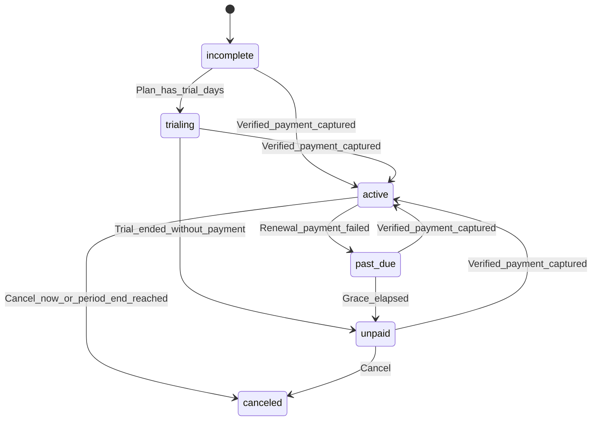
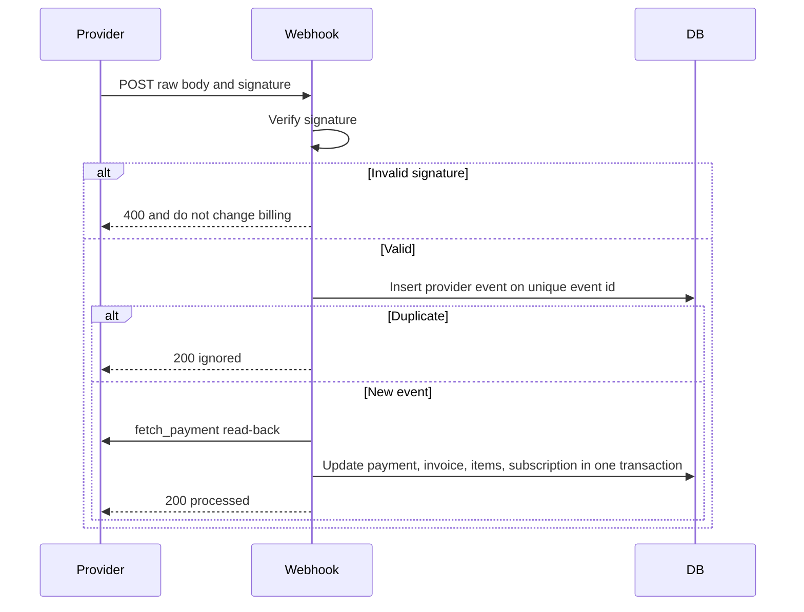

# 08 — Subscriptions and Billing

Status: approved planning baseline. INR is the first currency. Razorpay is the proposed first adapter. The billing domain does not depend on Razorpay types or Razorpay status strings.

## 1. Commercial model

A company has one current subscription, stored as the non-canceled row in `subscriptions`. Canceled rows remain as history.

The subscription has one billing interval, `month` or `year`, and one currency. In the MVP the currency check is `INR`. Amounts are `bigint` paise. A catalog price of ₹2,499.00 is `249900`.

Subscription items are the plan fee and any optional modules. Module prices are selected from `billing_module_prices` for the same interval and currency. A monthly company cannot hold an annual module item, and the reverse is also true. Independent module billing cycles are deferred until a documented business requirement exists.

Plan entitlements (`max_people`, `max_installed_modules`, `included_module_slugs`, `dashboards_enabled`) come from the plan on the current subscription. A module slug in `included_module_slugs` does not need a paid module item. Any other module needs an `active` module item before installation.

Trials exist when `billing_plans.trial_days` is greater than zero. The planning recommendation is 14 days and no provider mandate during the trial. That recommendation is unresolved in section 8 because Razorpay recurring products often authorize a mandate at checkout.

## 2. Money rules

- Persist minor units only. Do not use `float` or binary floating-point types for stored money. Calculation inside a service uses integers. If a decimal type is used in memory, it is quantized to paise before save.
- Rounding of proration is half up, implemented with integers: for a positive amount, `(amount_minor * numerator + denominator / 2) / denominator`.
- Catalog rows (`billing_plan_prices`, `billing_module_prices`) may be closed by setting `effective_to`. Open subscription items and issued invoices keep the `unit_amount_minor`, description, currency, and tax snapshots they already stored.
- Every invoice copies billing name, address, GSTIN, place of supply, supplier identity, SAC code if known, period, line descriptions, line amounts, and tax components at issuance. Later profile edits do not update those columns.
- Provider receipt ids are references. They are not a substitute for `invoices`.

## 3. Provider interface

`billing` defines the operations. `billing_razorpay` is the only implementation planned for the first adapter. A later provider adds another package and does not change subscription services.

| Operation | Responsibility |
| --- | --- |
| `create_checkout` | Start a hosted or client checkout for a known Pulse subscription and invoice. Return a public payload and provider references. |
| `verify_payment` | Confirm a payment by asking the provider, not by trusting the browser. |
| `create_or_update_subscription` | Create or change the provider-side recurring object when the merchant account supports it. |
| `cancel_subscription` | Cancel at period end or immediately, matching the Pulse timing flag. |
| `create_refund` | Request a refund against a captured payment. |
| `verify_webhook` | Validate the signature and return a normalized event. |
| `fetch_payment` | Reconciliation read of amount, currency, and provider status. |

The adapter maps provider statuses onto Pulse payment statuses (`pending`, `authorized`, `captured`, `failed`, `refunded`, `partially_refunded`) and then discards the provider string. Domain code persists only Pulse statuses.

Normalized events the domain understands: `payment_captured`, `payment_failed`, `subscription_halted`, `refund_processed`, `ignored`.

## 4. Lifecycle

Company lifecycle is not this diagram. `companies.status` moves from `draft` to `active` when the subscription first becomes `trialing` or `active`. Operator suspension sets `suspended`. Closure sets `closed`. Those values do not overwrite `subscriptions.status`.

Invoice status moves from `draft` to `issued` when the number is allocated, then to `paid` when a captured payment covers `total_minor`. `void` and `uncollectible` are operator or dunning outcomes. Payment status and refund status stay on their own tables.

### 4.1 Derived workspace access

This is the only access matrix. Other documents refer here.

| Condition | Access mode |
| --- | --- |
| Company `suspended` or `closed` | `blocked` |
| No current subscription, or status `incomplete`, while company is `draft` | `onboarding_only` |
| Status `incomplete` after the company has been `active` | `billing_only` |
| Status `trialing` or `active` | `full` |
| Status `past_due` and the current time is before `grace_ends_at` | `grace` |
| Status `past_due` after grace, or `unpaid`, or `canceled` | `billing_only` |

`full` allows the caller's permissions. `grace` allows billing routes and read-only workspace GETs. Other writes return `403` `access_restricted`. `billing_only` allows `company.view`, the workspace bootstrap, `billing.view`, and `billing.manage`. `onboarding_only` allows onboarding and checkout. `blocked` allows no company route.

`grace_period_days` lives in `platform_settings`. The planning recommendation is 7. When a renewal payment fails, the service sets `past_due_since` and `grace_ends_at` from that setting. A job moves `past_due` to `unpaid` after grace.

Paid status `active` is written only by the webhook processor after the steps in section 6. Checkout creation and the browser return URL do not write it. Trial status `trialing` is written by plan selection because it is not paid access and it does not mark an invoice paid.

## 5. Changes, proration, and refunds

Period bounds on the subscription are the proration window. Annual subscriptions use the real `current_period_end - current_period_start`, not an assumed 365, and the charged amount is the full annual snapshot, not the monthly equivalent used for MRR.

### 5.1 Upgrade

`timing = now` locks the subscription row.

- Unused old plan amount becomes a `proration_credit` line.
- The new plan for the same unused time becomes a `proration_charge` line.
- Both lines snapshot description, currency, and period.
- If the invoice `total_minor` is positive, the new plan item stays `pending` and higher entitlements wait for `payment_captured`.
- If the total is zero, the service may activate the new item in that same transaction because no payment is required.
- A tax invoice is issued only when section 7 can resolve tax. A zero-total document can exist without tax components.

### 5.2 Downgrade

MVP timing is `period_end`. The current plan item becomes `cancel_scheduled` and remains in committed MRR until it is `canceled`. A replacement plan item stores the new price snapshot, status `pending`, and `effective_at = current_period_end`. The pending replacement is not part of MRR yet. A scheduled job applies it at that time and writes a `subscription_status_events` row. Entitlements drop then. If active people exceed the new `max_people`, creates stay blocked and existing people remain.

There is no automatic cash refund on downgrade.

### 5.3 Interval change

Monthly to annual, or annual to monthly, is allowed only at period end so one subscription never mixes intervals. At the boundary, every renewed item copies the then-active catalog price for the new interval into a new snapshot. Items do not keep the old interval's amount.

### 5.4 Module add and remove

Add selects the module price for the subscription's interval and currency. The item is `pending` and the invoice prorates from now until `current_period_end`. Installation treats the module as entitled only after the item is `active`, unless the plan's `included_module_slugs` already contains it.

Removal at period end sets `cancel_scheduled`, keeps the item in committed MRR, and keeps entitlement until the period ends. Removal now sets `canceled`, drops entitlement immediately, and does not create a refund. A cash refund, when granted, is a `refunds` row.

### 5.5 Cancellation and renewal

Cancel at period end sets `cancel_at_period_end` and leaves status `active` until the period ends, then `canceled`. Cancel now sets `canceled` immediately and access becomes `billing_only` unless the company is suspended. Neither path creates a refund by itself.

Renewal builds the next invoice from active item snapshots and the supplier and customer billing snapshots current at issuance. The charge for a year interval is the full annual `unit_amount_minor`, not the monthly MRR contribution.

### 5.6 Refunds

Company billing users can list refunds and cannot create them. `platform.billing.manage` creates a refund with an idempotency key. The amount cannot exceed the captured payment minus succeeded refunds. The original invoice totals stay as issued. Refunds are excluded from MRR. A GST credit note is not generated until accounting confirms the document. The refund row is the cash record until then.

## 6. Webhooks, idempotency, and reconciliation

Rules:

- Signature verification uses the raw body and the webhook secret.
- The unique key is `(provider, provider_event_id)`.
- A replay returns the stored result and does not capture twice.
- `fetch_payment` must agree on currency, amount, and a capturable status before the subscription becomes `active` or an invoice becomes `paid`.
- If the subscription is already `active` and a late authorization event arrives, the event is `ignored`.
- Processing is one database transaction from the payment row through `subscription_status_events`.
- Failures leave `payment_provider_events.processing_status = failed` and the previous billing state intact.
- Checkout creation uses `Idempotency-Key`, stored as `payment_transactions.idempotency_key`.

**Mandatory security requirement:** a frontend success redirect never activates a paid subscription.

## 7. Indian tax and invoices

The schema is ready for GST components without assuming a rate.

At issuance the service:

1. Copies `platform_supplier_profile` and `company_billing_profiles` onto the invoice.
2. Compares supplier `state_code` with `place_of_supply_state_code` to choose `intra_state` or `inter_state`.
3. Loads active `platform_tax_rates` for that scope and the issue date.
4. Writes one `invoice_tax_components` row per applicable code with `tax_rate_bps`, taxable paise, and tax paise.
5. Refuses to issue a positive tax invoice when no active rate matches. It does not fall back to 18 percent or to any other constant.
6. Allocates `invoice_number` from `invoice_sequences` inside the same transaction.

Pulse invoice rows remain the product record even if Razorpay shows its own invoice or payment page.

### 7.1 Decisions that need accounting or legal confirmation

These block production tax invoices. They do not block the schema or a zero-amount trial.

- Whether the operator is GST-registered and must issue a tax invoice.
- Supplier GSTIN, state, and invoice series, including financial year.
- SAC code for the SaaS supply.
- Which components apply (CGST, SGST, IGST, cess) and their basis-point rates.
- Place-of-supply treatment for this category of online supply.
- Rounding rule if it must differ from the half-up paise rule above.
- Whether refunds require a GST credit note, and the credit-note series.
- Treatment of customers outside India. The MVP sells INR subscriptions and does not implement export-of-services rules.
- Whether Razorpay fees and GST on those fees appear anywhere on the customer invoice. The planning position is that they do not; they are merchant settlement costs.

Until those answers exist, `platform_tax_rates.is_active` stays false and paid tax invoices are blocked. Trial access can still be `trialing`.

## 8. Razorpay evaluation and unresolved merchant requirements

Razorpay is the proposed first Indian adapter because it supports INR cards, UPI, netbanking, and recurring products used by Indian SaaS. The domain interface stays provider-neutral so a different adapter can replace it.

Do not treat every Indian payment method as capable of recurring billing:

- One-time UPI, many wallets, and some netbanking flows can pay a single invoice and cannot renew a subscription.
- UPI Autopay has amount limits, bank coverage, and app coverage that change, and it is not universal.
- Domestic card recurring and e-mandate products depend on RBI-compliant mandates and on the merchant account being enabled for them.
- Razorpay Subscriptions, when enabled, can represent monthly and yearly periods. Whether this merchant account is allowed to create yearly plans must be confirmed before the adapter is coded.
- Settlements arrive on the merchant balance and bank account on the provider's settlement schedule. Settlement is not `invoices.status = paid`. Paid means a captured customer payment reconciled to the Pulse invoice.
- Razorpay-generated invoices do not replace Pulse GST snapshots.

If the Subscriptions product is unavailable, the same interface is implemented by creating an order or payment link each cycle from `background_tasks`, with Pulse still owning the subscription row. That choice is an adapter implementation detail made after merchant eligibility is known. It is not a second billing model.

### 8.1 Unresolved before implementation

1. Merchant account status, business category approval, and whether Subscriptions are enabled.
2. Which methods will actually be offered at checkout, knowing that not all of them recur.
3. Trial without a mandate (recommended) versus mandate authorization on day one. Recommended approach: Pulse sets `trialing` locally, and the provider subscription or first order is created only at conversion. Confirm before coding the adapter.
4. The tax questions in section 7.1.
5. Refund policy window. Execution stays with `platform.billing.manage` regardless.
6. Production invoice number format.

## 9. Failure and concurrency

- Failed renewal: payment `failed`, subscription `past_due`, grace set, access `grace`, notification enqueued.
- After grace: status `unpaid`, access `billing_only`.
- Two plan changes lock `subscriptions`. The second waits or receives `409` if the first committed a conflicting status.
- Webhook and plan-change transactions lock the same subscription row so they cannot activate different items blindly.
- The reconciliation job lists `payment_provider_events` in `failed` and payments stuck in `pending`, refetches provider state, and repairs only when `fetch_payment` is authoritative. Repair writes an audit row.

## 10. Relationship to MRR

Committed MRR, MRR at risk, residuals, collected cash, and the treatment of discounts, taxes, failures, cancellations, and refunds are defined once in [10-platform-administration.md](10-platform-administration.md). Billing services do not store a second MRR balance.
