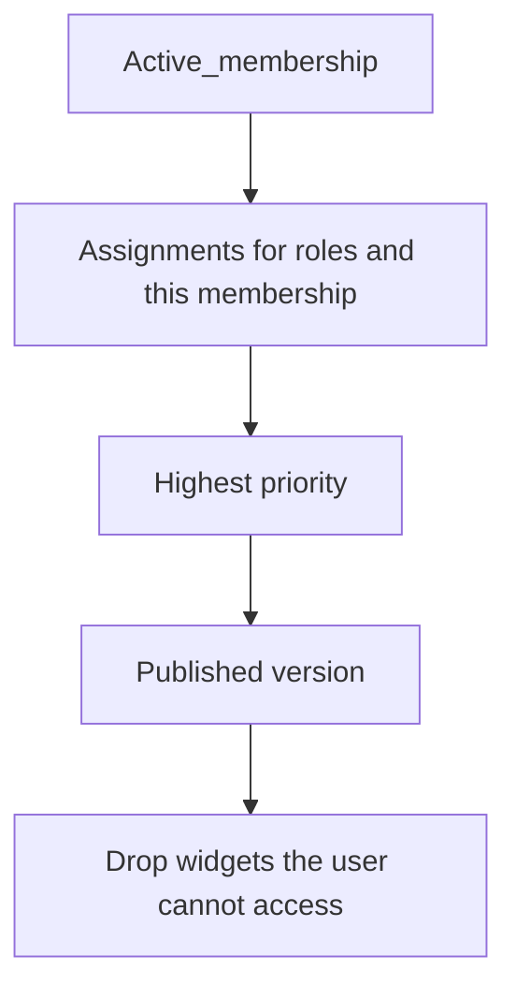

# 09 — Dashboard Studio

Status: approved planning baseline. Dashboard Studio is a controlled catalog of trusted widgets and validated layouts. It is not a scripting environment.

## 1. Concepts

| Concept | Stored as | Role |
| --- | --- | --- |
| Dashboard definition | `dashboards` | Named company dashboard and pointer to the published version. |
| Version | `dashboard_versions` | Immutable draft, published, or superseded configuration. |
| Assignment | `dashboard_assignments` | Binds a dashboard to one company role or one membership. |
| Widget definition | `widget_definitions` | Global trusted widget, its permission, and its config schema. |
| Widget instance | `dashboard_widgets` | Placement and config on one version. |
| Widget data | widget endpoint | Computed on read. Not stored on the dashboard. |

A published dashboard is what employees can resolve. A draft version is visible to callers with `dashboards.manage` and is not served by `GET /dashboards/me`.

## 2. Who can do what

Company administrators, or anyone holding the permission, can:

- Create a dashboard.
- Save a draft version with a validated layout and widget instances.
- Preview the draft through the studio API, which still calls widget data endpoints with the previewer's own permissions.
- Publish a version.
- Assign the dashboard to roles or individual memberships, with a priority.
- Restore an earlier published version by copying it forward as a new version and publishing that copy. Old versions stay for audit.

Employees with `dashboards.view` receive `GET /dashboards/me`. They do not edit layouts.

Access mode must be `full` to edit and `full` or `grace` to read. Entitlement `dashboards_enabled` must be true. A missing entitlement returns `422` even if the permission is present.

Navigation to a module widget also requires that module's installation status to be `installed`. The workspace bootstrap lists installed modules; the widget data route checks again.

## 3. Resolution

Priority is the integer on `dashboard_assignments`. A membership assignment and a role assignment are compared together. Ties break by newest `created_at`, then by id, so the result is stable.

If nothing matches, the API returns `200` with a null dashboard rather than another company's default.

Archived dashboards are not candidates. Superseded versions are not candidates. Restore is how an old layout becomes current again.

## 4. Layout and validation

`layout` is JSON with a fixed column count. The MVP value is 12. Each widget instance stores `grid_x`, `grid_y`, `grid_w`, and `grid_h` as integers inside the checks in the schema.

`config` must validate against `widget_definitions.config_schema` before the version is saved. Unknown widget codes are rejected. Config is data: titles, date ranges from an allowlist, and similar fields. It is not a query language, a template language, or JavaScript.

Invalid drafts are not partially saved. The version insert, including its widget rows, is one transaction.

Publishing sets the chosen version to `published`, sets the previous published version to `superseded`, and points `dashboards.published_version_id` at the new version. If publish fails, the previous published version remains.

## 5. Widget catalog for the MVP

| Code | Module | Required permission | Data |
| --- | --- | --- | --- |
| `people.count` | core | `people.view` | Count of active people in the company. |
| `billing.subscription` | core | `billing.view` | Current subscription status, interval, currency, and period end. No card data. |
| `hrms.leave.pending` | `hrms` | `hrms.leave.view` | Count of pending leave requests in the caller's allowed scope. |

Core widgets appear in the catalog whenever dashboards are entitled. `hrms.leave.pending` appears only when HRMS is installed for that company.

Adding a widget later means shipping trusted code, a `widget_definitions` row, a schema, and a data endpoint. Companies cannot upload a widget.

## 6. Data access

**Mandatory security requirement:** a widget instance never grants `required_permission`, a module, or a tenant.

The data endpoint:

1. Authenticates the session.
2. Loads the active membership for the path company.
3. Checks access mode and `dashboards_enabled`.
4. Loads the widget definition.
5. If `module_slug` is set, requires installation status `installed`.
6. Requires `required_permission` for this membership.
7. Runs a tenant-scoped query for that company only.
8. Applies object rules from [05-identity-and-authorization.md](05-identity-and-authorization.md). For `hrms.leave.pending`, a caller who only has employee scope counts their own person's requests; a caller with `hrms.leave.decide` counts the company.

`GET /dashboards/me` may omit widgets the user cannot call, so the page does not show broken cards. That omission is not what protects the data. A direct call to the widget URL without the permission returns `403`. A direct call with another company's id returns `404`.

Preview uses the same data endpoints as the employee view. An administrator previewing a widget they are not allowed to query sees an authorization error for that card, not someone else's data.

## 7. Recovery

- Draft save can be repeated. Each save creates a new `dashboard_versions` row with the next `version_number`.
- Publish is idempotent for the same version: publishing an already published version returns `200` and does not create a second current pointer.
- Restore copies widgets and layout into a new version, then publishes it. It does not mutate the historical version.
- Archive sets `dashboards.status = archived` and removes it from resolution. Assignments can remain. Unarchive is a status change back to `published` if `published_version_id` is still set.
- Broken config from an old client fails validation and leaves the last saved version untouched.

## 8. What is deferred

- Freeform visual programming, calculated fields, and customer-authored queries.
- Per-widget schedules and emailed dashboard PDFs.
- Sharing a dashboard across companies.
- Widget marketplace.

The MVP studio is enough for an owner to publish one role dashboard and for an employee to see only the widgets their permissions allow.
