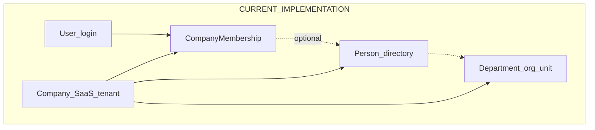
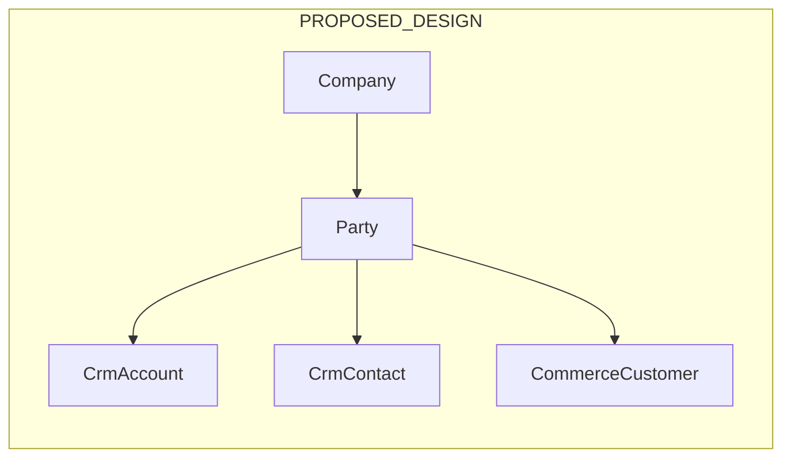

# 15 — Shared Domain Model (Phase 1 Design Freeze)

Status: **Proposed design** freeze. Complements ADR-019 and ADR-020. Does **not** authorize implementation. No final Django fields, migrations, or SQL are approved here.

Labels used below:

| Label | Meaning |
| --- | --- |
| **Current implementation** | Exists in the repository today ([14-implementation-status.md](14-implementation-status.md)). |
| **Approved direction** | Product/architecture law (ADR index). |
| **Proposed design** | Phase 1 freeze detail; still needs implementation review before coding. |
| **Unresolved** | Open question; do not invent a silent answer in code. |

## 1. Identity and tenancy (preserve)

| Concept | Ownership | Notes |
| --- | --- | --- |
| User | `apps.identity` | Global login. **Current implementation.** |
| Company | `apps.tenants` | SaaS tenant only. **Approved direction** unchanged. |
| CompanyMembership | `apps.tenants` | Workspace access; optional link to Person. **Current implementation.** |
| Person | `apps.organization` | Internal directory identity—not employment. **Current implementation.** |
| Department / OrganizationUnitType | `apps.organization` | Hierarchy via parent unit. **Current implementation.** |

**Do not conflate:** User ≠ Membership ≠ Person ≠ Employment ≠ Party ≠ Company.

## 2. LegalEntity

**Approved direction (ADR-019):** optional LegalEntity children of Company (statutory / books boundary).

**Proposed design:**

- Ownership: provisional under **`apps.tenants`** initially (subject to later split only with explicit approval).
- Cardinality: Company 1 → 0..N LegalEntity.
- Tenant boundary remains Company; LegalEntity never replaces Company in URLs or memberships.
- Cross-legal-entity visibility of business records: **denied by default**; any future sharing must be explicit and auditable (see [17-authorization-and-tenant-integrity.md](17-authorization-and-tenant-integrity.md)).

**Unresolved:** exact attributes (name, GSTIN placement vs billing profile, uniqueness rules), default LegalEntity creation for single-entity SMEs, UI placement.

## 3. Branch / location (v1 decision)

**Phase 1 decision:** reuse the existing **organization-unit** approach for v1. **No dedicated Branch model** yet.

**Proposed design:** represent sites/branches as `OrganizationUnitType` keys and/or Department units (and optional custom fields), consistent with demo-data practice.

**Unresolved:** when (if ever) a first-class Branch/Location model is required (likely Inventory warehouses / multi-site commerce)—defer until that module design.

## 4. Employment and concurrent employment

**Approved direction (ADR-019):** Employment links Person to LegalEntity; concurrent employment across legal entities within one tenant must be supported.

**Proposed design:**

- Ownership: **`apps.hrms`** (HRMS module), not core org.
- Employment is the HR relationship (status, dates, reporting, LE assignment). Person remains the human directory row.
- Membership continues to link User ↔ Person for login-to-directory; Membership does not become Employment.
- Multiple Employment rows per Person (different LegalEntities and/or sequential careers) are allowed by design; uniqueness and “one active per LE” rules are **Unresolved** pending implementation review.
- Manager relationships should eventually reference Employment (or Person with LE context)—**Unresolved** detail; do not invent columns here.

**Sequencing (Phase 1 decision):**

1. Harden **Person-based** Leave first (scopes, balances, uninstall, tests)—see [18-module-boundaries-and-roadmap.md](18-module-boundaries-and-roadmap.md).
2. **Design** Employment now (this document).
3. Migrate Leave (and related HRMS facts) onto Employment in a **separate, reviewed, backward-compatible** slice—not the same coding slice as Leave harden.

## 5. Shared Party (external partners)

**Approved direction (ADR-020):** shared Party for external organizations and people; never reuse Pulse Company as CRM Account / customer.

**Proposed design:**

- Ownership: provisional new shared core app **`apps.parties`**, subject to repository-convention validation before coding (INSTALLED_APPS placement, import rules, tests layout).
- Scope: every Party row is owned by a Company (tenant). Parties are not global across tenants.
- Subtypes (conceptual): organization Party vs person Party—exact discrimination mechanism **Unresolved** (type column vs separate tables)—choose at implementation design review.
- CRM Account / Contact, Commerce Customer, Procurement supplier, Support requester **reference** Party rather than duplicating identity.
- Optional link from a person-Party to an internal Person when the same human is also an employee—optional association, not identity merge.

**Unresolved:** merge/dedup, external ids, address ownership (Party vs module), naming validation of `apps.parties`.

## 6. HRMS Leave relationships (current vs target)

| Aspect | Current implementation | Target after Employment migration |
| --- | --- | --- |
| LeavePolicy | Company-scoped | Company-scoped; optional LE scope **Unresolved** |
| LeaveRequest | FK to Person (+ Policy, Company) | FK to **Employment** (+ Policy, Company) |
| Balances | Missing | Proposed on Employment in later HRMS slices |
| List scope | All company requests if `hrms.leave.view` | Own vs manage via record scopes ([17](17-authorization-and-tenant-integrity.md)) |

Leave remains owned by **`apps.hrms`**. Install still must not grant permissions.

## 7. How modules reference shared records

| Module | References | Must not |
| --- | --- | --- |
| HRMS | Person, LegalEntity, Employment, org units | Create a second user table |
| Projects | Membership/Person for members; nullable Party / CRM opportunity refs | Duplicate customer as Project-only identity |
| CRM | Party; optional Person link | Use Company tenant as Account |
| Commerce | Party (customer); Product (commerce-owned or later shared catalog) | Reuse SaaS `Subscription` / billing tables for storefront payments |
| Future Finance | LegalEntity | Post journals without LE once Finance ships |

When a referenced module is uninstalled: retain stored foreign keys where present; hide UI and refuse module APIs with 404 (HRMS pattern); do not cascade-delete shared Parties or People.

## 8. Custom entities vs first-class models

**Current implementation:** custom fields on system entities; custom entities/records ([13-dynamic-data-model.md](13-dynamic-data-model.md)).

**Proposed design guidance:**

- First-class Django models for cross-module identities and high-query domains (Party, LegalEntity, Employment, Project, Task, Lead, Opportunity, Order, Product).
- Custom entities for tenant-specific niche objects that do not need hard FKs from other modules.
- Do not implement core CRM/Projects as custom entities only.

## 9. Explicit non-goals

- Remote plugin loader / customer-uploaded code.
- SCIM / Zoho One–style conditional app assignment (may be revisited later).
- Treating Branch as mandatory for v1.
- Enabling PostgreSQL RLS as part of this freeze.
- Marking LegalEntity, Employment, or Party as Implemented.
