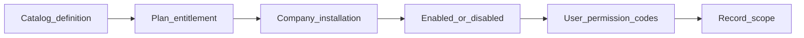

# 16 — Module Platform Contract (Phase 1 Design Freeze)

Status: **Proposed design** freeze for trusted in-repo modules. Extends [07-modular-plugin-architecture.md](07-modular-plugin-architecture.md) and ADR-011. Does **not** authorize implementation of missing hooks.

## 1. Principles (preserve)

- Modules are normal Django apps in this repository—not remote plugins.
- Installation is a **data transition**, not DDL and not customer code upload.
- **Install does not grant permissions** (ADR-011). **Current implementation** matches this for HRMS.
- Navigation hiding is not security; APIs re-check membership, access mode, permission, entitlement, and installation.

## 2. Lifecycle layers (distinct)

| Layer | Meaning | Current implementation |
| --- | --- | --- |
| Catalog | Module exists in `module_definitions` / `manifests.py` | Implemented (including non-installable stubs) |
| Entitled | Plan `included_module_slugs` and/or paid subscription item | Partial (included slugs for Growth/HRMS) |
| Installed | `company_module_installations.status = installed` | Implemented for HRMS |
| Enabled / disabled | Soft switch without deleting rows | **Proposed**; may use `config` or status—exact mechanism Unresolved |
| Permission | Caller holds action codes via roles | Implemented |
| Record scope | Which rows the caller may see/act on | **Proposed** ([17](17-authorization-and-tenant-integrity.md)); Leave currently company-wide |

Commerce is **Missing** from the catalog today; add only when the module is designed for build.

## 3. Manifest and metadata

**Target contract** (from doc 07) vs **as built** slim `MODULES` list in `modules_registry/manifests.py`.

**Proposed design:** keep code-owned manifest as source of truth; seed/update `ModuleDefinition` rows from it. Expand toward the full contract over time without requiring all fields on day one of each new module.

Minimum for any new installable module before coding acceptance:

- `slug`, `display_name`, `version`, `django_app_label`, `installation_available`
- `on_install` registered in `INSTALLERS`
- Permission codes listed in `authorization/catalog.py` with `module_slug`
- `NAV_CATALOG` entry with `module_slug` when the module has workspace nav
- Entitlement path documented (included slug and/or paid item)

Still **Proposed / not implemented:** formal manifest embedding of `on_upgrade`, `on_uninstall`, widgets, api_mount, frontend export.

## 4. Dependencies and compatibility

**Current implementation:** `ModuleDependency` model; install refuses missing installed deps; HRMS has none seeded.

**Proposed design:**

- Declare dependencies in registry data (and/or manifest) before enabling `installation_available`.
- Refuse install when `min_platform_version` is newer than the running platform (behavior to verify/complete at implementation).
- No per-tenant migration graphs; module schema ships with the monolith.

## 5. Installation, locking, recovery

**Current implementation (preserve):**

- Permission `modules.install` (when enforced)
- Entitlement check
- Dependency check
- `pg_advisory_xact_lock` + row lock
- Status `installing` → installer → `installed`, or `failed` + `last_error`
- Audit `module.installed`
- Retry from `failed` by re-entering install

**Proposed design:** keep this machine; do not replace with async-only install until `background_tasks` exists (ADR-015 Missing).

## 6. Configuration

Permission `modules.configure` is **seeded** but **service Missing**.

**Proposed design:** validate `company_module_installations.config` against module `config_schema` when configure API is built. Empty schema `{}` is valid (HRMS today).

## 7. Permission registration without auto-grant

**Proposed design (unchanged intent):**

1. Seed new codes into `permissions` (company scope, `module_slug` set).
2. Update **role templates** in catalog for new companies.
3. Existing companies: administrators edit roles, or an explicit template-sync operation runs—**never** silent grant on install.
4. Owner role continues to receive all company codes via `is_owner_role` effective-permission behavior (**Current implementation**).

## 8. Upgrade

Status values include `upgrading`. **Service Missing.**

**Proposed design:** compare `installed_version` to manifest `version`; run idempotent `on_upgrade`; refuse incompatible platform versions; retain business rows; audit success/failure. Exact versioning scheme Unresolved beyond semver-like strings already stored.

## 9. Disable / uninstall and retention

Permissions `modules.uninstall` seeded; **service Missing.**

**Proposed design:**

- Uninstall sets `uninstalled` + `uninstalled_at`; **does not** drop tables or delete business rows (ADR-011).
- Module APIs return **404** when not installed (HRMS `_installed()` pattern—**Current implementation** for leave routes).
- Disable (if distinct from uninstall): keep `installed` but set config/flag so nav and writes stop—**Unresolved** whether v1 needs disable separate from uninstall.
- Reinstall: idempotent `on_install`; must not duplicate unique default config rows.

## 10. Navigation and runtime access checks

**Current implementation:** `dashboards.services.navigation_for` requires permission **and** installed module when `module_slug` is set; frontend filters shell links against server navigation.

**Proposed design:** every new module must follow the same pattern. Runtime order for protected module routes:

1. Authenticated session  
2. Active membership for `company_id`  
3. Derived access mode (billing)  
4. Action permission code  
5. Module installed (and entitled if re-checked)  
6. Record-scope filter on querysets ([17](17-authorization-and-tenant-integrity.md))

## 11. Platform operator surface

**Current implementation:** `platform.modules.manage` exists; platform modules UI/API largely stubs.

**Proposed design:** operators may observe adoption and failures; they must not bypass company permission model for day-to-day module use. Details deferred to platform console work.

## 12. Explicit non-goals

- Marketplace / zip upload / dynamic code execution.
- Automatically enabling Projects/CRM when this contract is documented (ADR-021 gate still applies).
- Treating catalog stubs as installable modules.
