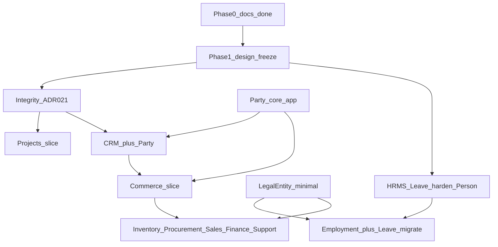

# 18 — Module Boundaries and Roadmap (Phase 1 Design Freeze)

Status: **Proposed design** freeze for ownership, cross-module refs, migration risks, and sequencing. Does **not** authorize coding. ADR-021 integrity gate remains mandatory before Projects/CRM.

## 1. Ownership map

| Concept | Owner | Kind |
| --- | --- | --- |
| User, sessions, tokens | `identity` | Platform core |
| Company, membership, invitation, billing profile, onboarding | `tenants` | Platform core |
| LegalEntity | `tenants` (provisional) | Shared domain — **Approved direction**, not modeled |
| Custom fields / custom entities / in-app notifications | `tenants` (as built) | Platform core |
| Person, Department, OrganizationUnitType | `organization` | Platform core |
| Permissions, roles, platform grants | `authorization` | Platform core |
| Plans, subscriptions, entitlements | `billing` | Platform core (SaaS only) |
| Module definitions / installations | `modules_registry` | Platform core |
| AuditLog | `audit` | Platform core |
| Dashboards / navigation_for | `dashboards` | Platform core |
| Party | `parties` (provisional new core app) | Shared domain — **Approved direction**, not modeled |
| Employment, Leave*, attendance (future) | `hrms` | HRMS module |
| Project, membership, milestone, task, … | future `projects` (or similar) | Projects module — after ADR-021 |
| Lead, Account, Contact, Opportunity, Activity | future `crm` | CRM module — after ADR-021; refs Party |
| Product, cart, order, commerce payments | future `commerce` | Commerce module; refs Party; ≠ SaaS billing |
| Inventory, Procurement, Sales, Finance, Support | later apps | Depend on Party / LegalEntity / Product as applicable |

\*Leave is Person-based in **Current implementation**; Employment is the **target** owner for leave after a separate migration slice.

## 2. First-class versus custom entities

| Prefer first-class models | Prefer custom entities / custom fields |
| --- | --- |
| Party, LegalEntity, Employment | Tenant-only niche objects |
| Project, Task, Lead, Opportunity, Order, Product | One-off SME forms without cross-module FKs |
| Anything other modules must FK | Soft attributes on core rows via `custom_data` |

## 3. Cross-module references (proposed)

| From → To | Style | If target module disabled / absent |
| --- | --- | --- |
| Leave → Person (now) / Employment (later) | Relational | N/A for Person; Employment requires HRMS |
| Project → Person / Membership | Relational | Core always present |
| Project → Party / Opportunity | Nullable FK or integration ref | Keep id; hide CRM UI; no cascade delete |
| CRM → Party | Relational | Party is core; CRM uninstall retains CRM rows + Party |
| Commerce → Party / Product | Relational | Same retention pattern |
| Finance → LegalEntity | Relational (later) | Finance must not ship before LE design exists |

Disabled optional module: installation `uninstalled` → module API 404; data retained ([16](16-module-platform-contract.md)).

## 4. Migration risks (design only)

### 4.1 LegalEntity introduction

- Existing companies have no LE rows; need a reviewed defaulting strategy (create one LE vs allow zero)—**Unresolved**.
- Billing profile GSTIN vs LE tax identity overlap—**Unresolved**.
- Risk: partial LE adoption with orphan HRMS rows if Employment requires LE without backfill plan.

### 4.2 Employment introduction

- Concurrent employment must be representable; uniqueness rules Unresolved.
- Membership↔Person linking must remain valid when multiple Employments exist.
- Reporting manager model may need redesign—Unresolved.

### 4.3 LeaveRequest Person → Employment (future migration design)

This subsection is a **future migration design narrative**. It does **not** authorize implementing Employment, changing LeaveRequest relationships, or running migrations. Sequencing is approved; field lists, SQL, and universal mapping rules are **not**.

**Approved sequencing:**

1. Harden Person-based Leave (scopes, balances, uninstall, tests).  
2. Design Employment (and LegalEntity prerequisites) without cutting over Leave.  
3. Perform a **separate, explicitly approved**, backward-compatible migration later—after implementation design review.

**Expand-contract shape (conceptual only):** add a nullable Employment association → backfill under reviewed rules → switch writes → validate → only then enforce non-null / retire Person FK if approved. **Scripts and columns are Unresolved.**

**Mapping rules (must not guess concurrent employment):**

| Person’s Employment set at cutover | Rule |
| --- | --- |
| **Zero** | Do **not** silently create or assign an Employment during cutover. Leave the request unresolved; define an explicit **exception/remediation path** (operator tool, blocked cutover, or deferred row)—exact UX **Unresolved**. |
| **One** | Candidate for **deterministic** mapping to that Employment, subject to validation gates below. |
| **Multiple** | Require an **explicit selection or mapping rule** (manual, policy, or LE-scoped criterion approved in design review). Never infer solely from Person identity, because concurrent employment across legal entities is supported (ADR-019). |

**Validation gates before cutover is considered complete** (acceptance checks; mechanisms Unresolved):

- Source-to-target **counts** (requests mapped vs remaining).  
- **Unresolved mappings** reported and empty (or explicitly waived with audit).  
- No unexpected **null** Employment references after the enforce step.  
- **Tenant / LegalEntity consistency** (Employment’s company and LE align with the leave row’s company and intended LE scope).  
- **`own` / `manage` authorization behavior** preserved or deliberately re-specified and re-tested (scopes still evaluate correctly for the caller’s Person/Employment).

**Rollback safeguards:**

- Retain the existing **Person** relationship on LeaveRequest until validation passes.  
- Cutover must be **disable-able or reversible** (e.g. dual-read / feature flag / stop writing Employment-only)—exact mechanism **Unresolved**.  
- After any rollback or partial failure, run **consistency checks** (counts, nulls, scope tests) before retrying.

**Unresolved (implementation design review):** final fields; Employment uniqueness; default LE; exception UX for zero Employment; multi-Employment selection policy; dual-read duration; audit of mapping decisions.

Risks if rushed: orphan requests, wrong Employment under concurrent LE jobs, incorrect “own” scope, downtime without expand-contract, historical audit `object_id` values unchanged.

### 4.4 Composite constraints (ADR-021)

- Enabling composite FKs on dirty data fails migrations—audit first.
- Application must set `company_id` consistently on every write.

### 4.5 Permission / template drift

- New codes must not silently rewrite custom company roles.
- Document admin/template-sync explicitly when modules ship.

## 5. Dependency-aware roadmap (vertical slices)

Each slice should be independently testable: APIs + permissions + audit + isolation tests + nav gating. **No** marking future work Implemented.

**Projects ↔ Employment:** There is **no** hard edge from Employment migrate to Projects. ADR-021 acceptance is the hard gate for Projects/CRM. Employment is required only when a specific Projects feature needs employment-linked ownership, assignments, or legal-entity semantics; otherwise Projects may use existing **Person** identity if authorization and tenant-integrity requirements are met.

| Slice | Scope | Prerequisites | Explicit exclusions |
| --- | --- | --- | --- |
| Integrity — Slice A (ADR-021) | Cross-tenant audit; **shared** authorization/tenant-integrity contract and isolation-test foundations; agreed acceptance criteria for record scopes; composite constraint plan/execution as approved | Phase 1 freeze accepted | No Projects/CRM tables; no RLS enablement; does **not** alone ship Leave `own/manage` module behavior |
| HRMS Leave harden — Slice B | **Implements** Person-based Leave `own/manage` using the shared scope contract; balances; uninstall retain+404; module-level tests | Module contract; shared scope contract from Slice A (may iterate in parallel with clear RACI) | No Employment migration; no attendance/payroll; no new permission-suffix scheme |
| LegalEntity minimal | Tenant LE CRUD sufficient for Employment | Integrity progress as required by reviewers | No Finance journals |
| Employment + Leave migrate | Employment model; expand-contract leave retarget per §4.3; concurrent employment | LE minimal; Leave harden done; **separate explicit approval** | No full payroll; not authorized by this freeze alone |
| Party core | `apps.parties` skeleton + APIs as designed | Convention validation | No CRM UI required in same slice if Party ships first |
| Projects | Project…Task FS deps, membership, installable module | **Hard:** ADR-021 complete and accepted. **Soft:** Person for members. **Employment:** only if a reviewed feature needs it | No Gantt/all dependency types; no client portal; **not** blocked on Employment migrate by default |
| CRM | Account/Contact/Lead/Opportunity/Activity + convert; refs Party | **Hard:** ADR-021 complete and accepted; Party available | No full automation/workflow engine |
| Commerce | Catalog, cart, order, commerce payments, addresses | Party; integrity stable | No Inventory hard stock; ≠ SaaS billing |
| Later | Inventory → Procurement/Sales → Finance → Support | LE for Finance; Product sharing rules | — |

**Leave-scope RACI (M3):** Slice A owns the shared authorization/tenant-integrity contract, isolation-test foundations, and agreed acceptance criteria. Slice B owns implementation and module-level tests for Person-based Leave `own/manage`. **Both** Slice A and Slice B relevant checks must pass before the integrity gate is considered satisfied for modules that depend on ADR-021. Do not duplicate scope logic or invent a new permission-code scheme.

**Note:** Slice A and Slice B may proceed in parallel where they do not add Projects/CRM tables; Projects/CRM coding still waits on ADR-021 acceptance (including the Leave-scope RACI above).

## 6. Acceptance criteria before any module coding slice

1. Phase 1 docs 15–18 accepted.  
2. ADR-019/020/021 intent unchanged.  
3. For Projects/CRM slices: ADR-021 checklist completed and accepted.  
4. Implementation design review supplies fields/migrations (not invented in these docs).  
5. RLS not silently enabled.  
6. [14-implementation-status.md](14-implementation-status.md) still reflects code reality after each slice.

## 7. Unresolved issues carried forward

1. Default LegalEntity strategy for existing companies.  
2. Employment uniqueness / active-employment rules.  
3. Role scope metadata storage shape.  
4. Grace access policy alignment (code vs docs).  
5. Disable-vs-uninstall product distinction.  
6. `apps.parties` naming/convention final validation.  
7. When first-class Branch/Location becomes necessary.  
8. Billing/legal production items in ADR §3 (out of this freeze except as blockers for paid go-live).
