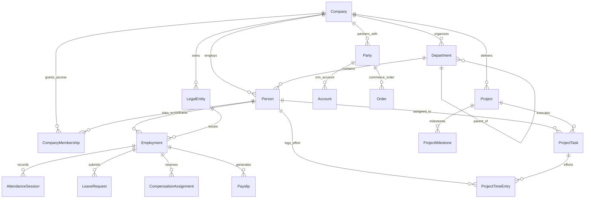

# Pulse ERP — Platform Capability Matrix & Multi-Tenant Blueprint

This document defines the architectural capabilities, module installation rules, and cross-module relationship standards for **Pulse ERP**. It serves as the master specification for all demo datasets, seeding commands, and tenant environment configurations.

---

## 1. Architectural Foundations

Pulse ERP is built on a modular monolith architecture designed for enterprise scalability, strict tenant isolation, and zero redundant identity systems.

```
┌───────────────────────────────────────────────────────────────────────────┐
│                           TENANT SECURITY BOUNDARY                        │
│                               Company (tenants)                           │
└─────┬──────────────────┬──────────────────┬─────────────────┬─────────────┘
      │                  │                  │                 │
┌─────▼────────┐   ┌─────▼────────┐   ┌─────▼────────┐  ┌─────▼─────────────┐
│  Identity    │   │ Organization │   │ Authorization│  │  Parties Master   │
│  User        │   │ Unit / Person│   │ Roles/Scopes │  │  (Shared B2B/B2C) │
└─────┬────────┘   └─────┬────────┘   └──────────────┘  └─────┬─────────────┘
      │                  │                                    │
      └─────────┬────────┘                                    │
                ▼                                             │
      ┌──────────────────┐                                    │
      │  Company Member  │                                    │
      └─────────┬────────┘                                    │
                │                                             │
┌───────────────┼─────────────────────────────────────────────┼─────────────┐
│               ▼                                             ▼             │
│   INSTALLED SPECIALIZED MODULES                 SHARED COMMERCE & CRM     │
│  ┌────────────────────────┐                    ┌────────────────────────┐ │
│  │     HRMS Module        │                    │   CRM & Commerce       │ │
│  │ Employment, Attendance,│                    │ Accounts, Contacts,    │ │
│  │ Leave, Payroll, Docs   │                    │ Leads, Products, Orders│ │
│  └────────────────────────┘                    └────────────────────────┘ │
│  ┌────────────────────────┐                                               │
│  │   Projects & Work      │                                               │
│  │ Projects, Tasks,       │                                               │
│  │ Milestones, Timesheets │                                               │
│  └────────────────────────┘                                               │
└───────────────────────────────────────────────────────────────────────────┘
```

### Core Invariants & Boundaries
1. **Company is the Root Tenant Boundary**: Every domain model includes a foreign key to `tenants.Company` and enforces composite database constraints `UniqueConstraint(fields=["company", "id"])`. No entity or query may span across tenants without explicit elevation.
2. **Separation of Identity, Person, and Employment**:
   - `identity.User`: Global authentication credentials, email verification, passwords, and sessions.
   - `organization.Person`: Shared tenant-level directory record (name, work email, phone, job title, single department FK).
   - `tenants.CompanyMembership`: Tenant access grant binding a `User` to a `Company` with an assigned `Person` and access status.
   - `hrms.Employment`: An employment lifecycle contract within an HR legal entity. A `Person` may have multiple historical or concurrent employments, but never duplicate `Person` records.
3. **Single Source of Truth for Organization Hierarchy**:
   - `organization.Department`: The tree structure (Divisions, Plants, Stores, Departments, Teams, Lines) with cycle detection. Modules reference `Department` rather than creating duplicate organizational tables.
4. **Unified External Business Partner Directory**:
   - `parties.Party`: Shared master table for external organizations and persons (clients, suppliers, vendors, subcontractors, landlords). Both CRM and Commerce link directly to `Party` (ADR-020).

---

## 2. Complete Implemented Feature Inventory

| Django Application | Implementation Status | Data Models & Tables | Functional Capabilities & Workflows |
| :--- | :--- | :--- | :--- |
| **`identity`** | **Implemented & Usable** | `User`, `EmailVerificationToken`, `PasswordResetToken` | Session & JWT authentication, secure password hashing, registration, email token verification, password reset flows. |
| **`tenants`** | **Implemented & Usable** | `Company`, `LegalEntity`, `CompanyMembership`, `CompanyBillingProfile`, `MembershipInvitation`, `CustomField`, `Announcement`, `CompanyNotification`, `NotificationPreference`, `CustomEntity`, `CustomEntityField`, `CustomEntityRecord` | Company onboarding, multi-tenant isolation, dynamic Custom Fields engine (`text`, `number`, `select`, `multi_select`, `date`, `phone`, `email`, `url`, `boolean`, `reference`), Custom Records Studio (up to 20 entities/tenant), invitation workflow, notification center. |
| **`organization`** | **Implemented & Usable** | `OrganizationUnitType`, `Department`, `Person` | Hierarchical department tree (`parent` FK with cycle prevention), custom unit types, Person directory, single-unit department assignment, reporting manager references. |
| **`authorization`** | **Implemented & Usable** | `Permission`, `PlatformPermissionGrant`, `RoleTemplate`, `CompanyRole`, `CompanyRolePermission`, `MembershipRoleAssignment`, `CompanyRoleNavigation` | 68 fine-grained permissions, 5 standard role templates (`owner`, `administrator`, `hr_manager`, `department_manager`, `employee`), custom tenant roles, role-permission assignments, navigation filtering. |
| **`audit`** | **Implemented & Usable** | `AuditLog` | Append-only immutable audit trail capturing actor, company, action, object diffs (`before`/`after` JSON), IP address, and request UUID. |
| **`billing`** | **Implemented & Usable** | `BillingPlan`, `BillingPlanPrice`, `BillingPlanEntitlement`, `Subscription`, `SubscriptionItem`, `SubscriptionStatusEvent` | Multi-tier plans (`starter`, `growth`, `enterprise`), INR pricing models, subscription lifecycle events, entitlement enforcement. |
| **`dashboards`** | **Implemented & Usable** | `WidgetDefinition`, `Dashboard`, `DashboardVersion`, `DashboardWidget`, `DashboardAssignment` | Role-based dashboard studio, published versions, configurable widget layout, role-to-dashboard assignments. |
| **`modules_registry`** | **Implemented & Usable** | `ModuleDefinition`, `ModuleDependency`, `CompanyModuleInstallation` | Enterprise SaaS Module Marketplace, detail flyouts, guided installation wizard, lifecycle install/uninstall hooks. |
| **`parties`** | **Implemented & Usable** | `Party` (`PartyKind.PERSON`, `PartyKind.ORGANIZATION`, `status`) | Centralized external business partner master table shared by CRM, Commerce, and future Procurement. |
| **`hrms`** | **Implemented & Usable** | 35 models: `Employment`, `WorkLocation`, `Designation`, `Shift`, `WorkSchedule`, `AttendancePolicy`, `AttendanceEvent`, `AttendanceSession`, `AttendanceException`, `LeavePolicy`, `LeaveRequest`, `LeaveBalance`, `SalaryStructure`, `PayrollRun`, `Payslip`, `OnboardingTask`, `HRRequest`, etc. | 9-Tab HRMS Workspace: Multi-employment records linked to `Person`, web check-in/out with location/device verification, shift assignments, leave accrual & approvals, payroll runs with Indian statutory rules & payslips, onboarding checklists, internal HR helpdesk. |
| **`projects`** | **Implemented & Usable** | 12 models: `Project`, `ProjectMember`, `ProjectOrganizationUnit`, `ProjectMilestone`, `ProjectTask`, `TaskAssignee`, `TaskDependency`, `TaskComment`, `TaskAttachment`, `TaskActivityLog`, `ProjectTimeEntry`, `ProjectSettings` | 9-Tab Work Management Workspace: Kanban, List, Calendar, and Gantt timeline views, multi-assignee tasks, subtask checklists, threaded comments with @mentions, live start/stop timers, draft submission & approval queues, team workload analytics. |
| **`crm`** | **Partially Implemented** | `Account`, `Contact`, `Lead`, `Opportunity` | Backend models and APIs (`LeadListView`, `LeadConvertView`, `AccountListView`) exist. Basic frontend view at `/app/crm`. Pipeline drag-and-drop and automated cadence tracking are basic. |
| **`commerce`** | **Partially Implemented** | `Product`, `Order`, `OrderLine` | Backend models and APIs (`ProductListView`, `OrderListView`) exist. Basic frontend view at `/app/commerce`. Linked to `parties.Party`. Payment gateway and shipping logistics are not integrated. |
| **`finance`** | **Registered / Planned** | None (`installation_available = False`) | Declared in module marketplace catalog. Financial ledger is not implemented. Demo financial records are modelled through custom entities (`contracts`, `budget` numbers). |
| **`inventory`** | **Registered / Planned** | None (`installation_available = False`) | Declared in module marketplace catalog. Warehouse balances and stock movements are not implemented. Assets are modelled through custom entities (`company-assets`, `machines-and-equipment`). |
| **`procurement`** | **Registered / Planned** | None (`installation_available = False`) | Declared in module marketplace catalog. POs and receipts are not implemented. Suppliers are modelled via `parties.Party` and `custom_entities` (`vendors`). |
| **`sales` / `helpdesk`** | **Registered / Planned** | None (`installation_available = False`) | Sales contracts and external customer helpdesk are registered as coming soon. (Internal employee HR ticketing is fully usable in `hrms`). |

---

## 3. Module Availability and Implementation Status

The module marketplace catalog (`apps.modules_registry.manifests.MODULES`) defines trusted system modules. Pulse strictly distinguishes between module registration and actual installation availability:

```
┌───────────────────────────────────────────────────────────────────────────┐
│                         MODULE MARKETPLACE CATALOG                        │
├───────────────────────────────┬───────────────────────────────────────────┤
│    INSTALLATION AVAILABLE     │          REGISTERED / COMING SOON         │
│  (Complete Backend & Engine)  │     (Manifest Only, Not Installable)      │
├───────────────────────────────┼───────────────────────────────────────────┤
│ • hrms        (v2.5.0)        │ • finance     (v1.0.0 - Planned)          │
│ • projects    (v1.0.0)        │ • inventory   (v1.0.0 - Planned)          │
│ • crm         (v1.0.0)        │ • procurement (v1.0.0 - Planned)          │
│ • commerce    (v1.0.0)        │ • sales       (v1.0.0 - Planned)          │
│                               │ • helpdesk    (v1.0.0 - Planned)          │
└───────────────────────────────┴───────────────────────────────────────────┘
```

> [!IMPORTANT]
> A module registered in the catalog must never be marked as installed unless `installation_available = True` and its underlying Django application and database migrations are present. Seeding commands must only install supported modules.

---

## 4. Three-Company Installation & Configuration Matrix

Pulse ERP is demonstrated through three distinct industry environments, each exercising a realistic combination of modules, organizational topologies, and data flows:

| Attribute / Module | Nimbus Labs | Aether Precision | Lotus Lane |
| :--- | :--- | :--- | :--- |
| **Industry** | Technology (B2B SaaS) | Industrial Manufacturing | Specialty Multi-Store Retail |
| **Tenant Slug** | `nimbus-labs` | `aether-precision` | `lotus-lane` |
| **Headquarters** | Bengaluru (Koramangala) | Pune (Baner & Chakan) | Mumbai (Lower Parel) |
| **Secondary Locations**| Kochi Delivery Centre | Chennai Finishing Plant | Stores: Bandra, Indiranagar, Kochi |
| **Subscription Tier** | **Growth Plan** (₹9,999/mo) | **Enterprise Plan** (₹2,49,999/yr) | **Growth Plan** (₹9,999/mo) |
| **Legal Entity** | Nimbus Labs Private Limited | Aether Precision Components Pvt Ltd | Lotus Lane Retail Private Limited |
| **Base Currency** | INR (₹) | INR (₹) | INR (₹) |
| **Headcount Model** | 16 sample people (48 planned) | 18 sample people (220 plant/office) | 15 sample people (95 retail staff) |
| **Installed Modules** | `hrms`, `projects`, `crm` | `hrms`, `projects`, `crm` | `hrms`, `projects`, `commerce` |
| **HRMS Focus** | Tech workforce, flexible check-in, casual/sick leave, tech salary components, developer onboarding. | Shop-floor shifts (A/B/C), biometric check-in, overtime exceptions, plant worker payroll, safety training. | Retail rosters (Morning/Evening), store attendance, festive leave planning, retail incentive payroll. |
| **Projects Focus** | Software sprints, cloud platform v3, client billable hours, developer live timer. | Plant expansion, machine overhaul, ISO 9001 audit tasks, maintenance checklists. | Store launches, Bandra remodel, Diwali visual merchandising campaign. |
| **CRM Focus** | SaaS enterprise accounts, inbound demo leads, subscription pipeline. | Automotive OEM accounts (Tata, Bajaj), component supply contracts. | *Not installed* (Institutional gifting managed via Parties). |
| **Commerce Focus** | *Not installed* (Subscriptions handled via Billing). | *Not installed* (B2B orders handled via Contracts). | Specialty lifestyle products, retail store orders, wholesale order lines. |
| **Parties Master** | Cloud providers, SaaS tooling vendors. | Steel suppliers, machine tooling vendors. | Brand artisans, mall landlords, logistics. |
| **Custom Records** | `software-environments`, `company-assets`, `vendors` | `production-lines`, `machines-and-equipment`, `quality-inspections`, `contracts` | `retail-stores`, `product-categories`, `store-equipment`, `contracts` |

---

## 5. Cross-Module Entity Relationship Blueprint

Pulse ERP ensures high referential integrity across modules by reusing core primitives rather than duplicating entities:



### Referential Integrity Invariants
1. **`Person` &rarr; `Employment`**: Every `Employment` record must have a valid `person_id` referencing an existing `organization.Person` belonging to the same company.
2. **`Department` &rarr; `Employment`**: Primary and secondary departmental allocations must reference valid `organization.Department` records.
3. **`Employment` &rarr; `AttendanceSession` & `LeaveRequest`**: Attendance events, sessions, leave requests, and compensation assignments must link to a valid `Employment` record.
4. **`Project` &rarr; `Person`**: `owner_person` and `project_manager` must reference valid `Person` records.
5. **`ProjectTask` &rarr; `Person`**: Primary and secondary task assignees and reviewers must reference valid `Person` records.
6. **`ProjectTimeEntry` &rarr; `Person` & `ProjectTask`**: Timesheets track effort for a `Person` on a specific `Project` and optional `ProjectTask`. They are completely decoupled from `AttendanceSession` presence punches.
7. **`Party` &rarr; `CRM Account` & `Commerce Order`**: Customer accounts and order counterparties must reference valid `parties.Party` rows.

---

## 6. Known Implementation Gaps & Roadmap Guardrails

To maintain documentation integrity, the following limitations in the current platform implementation are formally acknowledged:

1. **ERP Modules Not Yet Implemented**:
   - `Finance / General Ledger`: Formal double-entry bookkeeping, chart of accounts, and automated tax reporting are planned. Demo finances use `CustomEntity` (`contracts`) and budget fields.
   - `Inventory & Warehousing`: Multi-warehouse stock balances, bin locations, and stock movements are planned. Assets and equipment are tracked via `CustomEntity` (`company-assets`, `machines-and-equipment`, `store-equipment`).
   - `Procurement`: Formal purchase requisitions, RFQs, purchase orders, and goods receipts are planned. Suppliers are maintained in `parties.Party` and `custom_entities` (`vendors`).
2. **Dynamic Data Model Constraints**:
   - Custom field types support `text`, `number`, `select`, `multi_select`, `date`, `phone`, `email`, `url`, `boolean`, and `reference`. Structured currency formatting, file uploads, and rich text are handled via display logic.
   - Maximum quotas per tenant: 50 custom fields, 20 custom entities, 10,000 custom records.
3. **Database RLS**:
   - Tenant isolation is currently enforced at the application layer via mandatory `company_id` query filtering and composite database unique constraints. Native PostgreSQL Row-Level Security (RLS) is on the technical roadmap.

