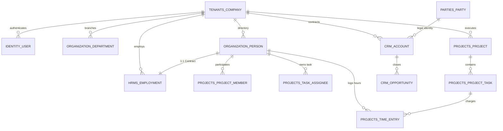
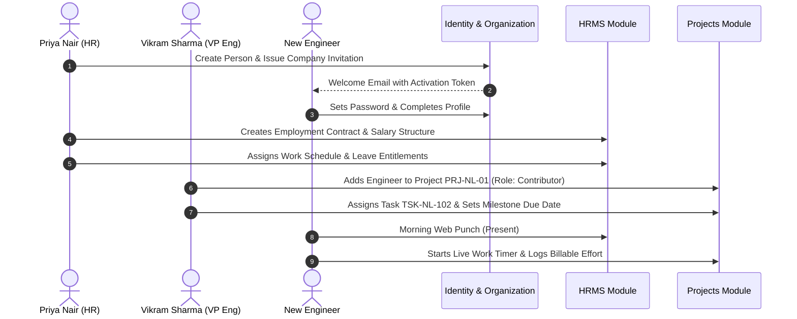

# Demo Data — Technology Company

Independent demo dataset for **Nimbus Labs Private Limited**, a Bengaluru SaaS company.
Use this document to configure custom fields, organization units, people, invitations, memberships, and custom entities in an isolated Pulse company workspace.

All emails use `@nimbuslabs.example`. Phone numbers are synthetic Indian mobiles (10 digits, starting 6–9). Dates are ISO `YYYY-MM-DD`. Money is INR stored as Pulse `number` fields (no currency type exists).

Demo IDs below are stable labels for documentation. In the application, Pulse generates UUIDs; map these labels when seeding or entering data manually.

---

## A. Company Profile

| Attribute | Value |
| --- | --- |
| Demo company ID | `CO-TECH-001` |
| Display name | Nimbus Labs |
| Legal name | Nimbus Labs Private Limited |
| Slug | `nimbus-labs` |
| Industry | Technology (SaaS / B2B software) |
| Company size | 51–200 |
| Website | `https://www.nimbuslabs.example` |
| Founded year | 2018 |
| About | Nimbus Labs builds cloud operations tooling for mid-market Indian enterprises. Product and engineering are based in Bengaluru; customer success runs from Kochi. |
| Support email | `support@nimbuslabs.example` |
| WhatsApp business | `9876501001` |
| Country / timezone | IN / Asia/Kolkata |
| Company status | `active` |
| Business locations | Bengaluru HQ (Koramangala); Kochi delivery centre (Infopark) |
| Approximate headcount | 48 employees in this demo (platform target band 51–200) |

Built-in company columns used: `display_name`, `legal_name`, `slug`, `status`, `country_code`, `timezone`. Profile attributes such as industry and website live in **company `custom_data`**, not first-class columns.

---

## B. Company Custom Fields

Configure on entity `company` for this tenant only (`CustomField.company` + `entity=company`).

| Field name | Key (suggested) | Type | Required | Options / config | Example value | Business purpose |
| --- | --- | --- | --- | --- | --- | --- |
| Industry | `industry` | select | yes | Technology, Manufacturing, Retail, Services, Other | Technology | Segment tenants in reports |
| Company size | `company-size` | select | no | 1-10, 11-50, 51-200, 201-1000, 1000+ | 51-200 | Rough scale |
| Website | `website` | url | no | — | `https://www.nimbuslabs.example` | Public site |
| Founded year | `founded-year` | number | no | validation: integer_only, min 1900, max 2100 | 2018 | Age of company |
| About | `about` | long_text | no | — | (see profile) | Short description |
| Support email | `support-email` | email | no | — | `support@nimbuslabs.example` | External support contact |
| WhatsApp business | `whatsapp-business` | phone | no | validation pattern `indian_mobile` | `9876501001` | Business WhatsApp |
| Primary product | `primary-product` | text | no | — | CloudOps Control Plane | Product focus for demos |
| Deployment model | `deployment-model` | select | no | SaaS, Hybrid, On-prem | SaaS | How customers consume the product |

Do **not** duplicate `display_name`, `legal_name`, `slug`, or `timezone` as custom fields (`RESERVED_KEYS` on company).

---

## C. Organization Structure and Units

### Capabilities used

- Model: `organization.Department` (API/UI: **organization unit**).
- Hierarchy: optional `parent` FK; cycle detection enforced.
- Unit types: company-scoped `OrganizationUnitType`. Defaults seeded as `division`, `department`, `team` when first listed.
- Built-in unit fields: `name`, `key`, `unit_type`, `parent`, `description`, `manager` (Person FK), `status`.
- Location, cost centre, floor, headcount budget, active-from → **organization_unit custom fields** (not built-in columns).
- Each **Person** has at most **one** `department` FK. Multi-unit membership is **not** supported.

### Suggested unit types (optional customization)

Keep defaults, or add:

| Key | Singular | Plural | Allowed parents |
| --- | --- | --- | --- |
| `division` | Division | Divisions | (none / root) |
| `department` | Department | Departments | `division` |
| `team` | Team | Teams | `department` |

### Hierarchy

```
Nimbus Labs (company)
├── Headquarters — Bengaluru          [division]   OU-TECH-HQ
│   ├── Engineering                   [department] OU-TECH-ENG
│   │   ├── Backend Platform          [team]       OU-TECH-BE
│   │   └── Frontend Experience       [team]       OU-TECH-FE
│   ├── Product                       [department] OU-TECH-PROD
│   ├── Human Resources               [department] OU-TECH-HR
│   └── Finance & Admin               [department] OU-TECH-FIN
└── Kochi Delivery Centre             [division]   OU-TECH-COK
    └── Customer Success              [department] OU-TECH-CS
```

### Organization unit custom fields

Entity `organization_unit`:

| Field name | Key | Type | Required | Options | Purpose |
| --- | --- | --- | --- | --- | --- |
| Cost center code | `cost-center-code` | text | no | — | Finance coding |
| Floor / location | `floor-location` | text | no | — | Desk / wing label |
| Headcount budget | `headcount-budget` | number | no | integer_only | Planned seats |
| Unit type tag | `unit-type-tag` | select | no | HQ, Branch, Remote, Support | Soft classification |
| Active from | `active-from` | date | no | — | When unit started |
| Engineering discipline | `engineering-discipline` | select | no | Backend, Frontend, Platform, Full-stack, N/A | Useful on eng teams |
| On-call team | `on-call-team` | boolean | no | — | Whether unit participates in on-call |

### Unit records

| Demo ID | Name | Type | Parent | Manager (person) | Headcount (approx) | Cost center | Floor / location | Headcount budget | Active from | Extra CF |
| --- | --- | --- | --- | --- | --- | --- | --- | --- | --- | --- |
| OU-TECH-HQ | Headquarters — Bengaluru | division | — | P-TECH-001 | 38 | CC-HQ-01 | Koramangala · Floors 4–5 | 50 | 2018-06-01 | tag HQ |
| OU-TECH-ENG | Engineering | department | OU-TECH-HQ | P-TECH-002 | 18 | CC-ENG-01 | Floor 5 · Block A | 22 | 2018-08-01 | discipline N/A |
| OU-TECH-BE | Backend Platform | team | OU-TECH-ENG | P-TECH-004 | 8 | CC-ENG-BE | Floor 5 · A2 | 10 | 2019-01-15 | Backend; on-call yes |
| OU-TECH-FE | Frontend Experience | team | OU-TECH-ENG | P-TECH-005 | 7 | CC-ENG-FE | Floor 5 · A3 | 9 | 2019-03-01 | Frontend; on-call no |
| OU-TECH-PROD | Product | department | OU-TECH-HQ | P-TECH-006 | 5 | CC-PROD-01 | Floor 4 · B1 | 6 | 2018-09-01 | — |
| OU-TECH-HR | Human Resources | department | OU-TECH-HQ | P-TECH-007 | 3 | CC-HR-01 | Floor 4 · B2 | 4 | 2018-07-01 | Support |
| OU-TECH-FIN | Finance & Admin | department | OU-TECH-HQ | P-TECH-008 | 3 | CC-FIN-01 | Floor 4 · B3 | 4 | 2018-07-01 | Support |
| OU-TECH-COK | Kochi Delivery Centre | division | — | P-TECH-009 | 10 | CC-COK-01 | Infopark · Building C | 14 | 2021-02-01 | Branch |
| OU-TECH-CS | Customer Success | department | OU-TECH-COK | P-TECH-010 | 8 | CC-CS-01 | Infopark · C2 | 10 | 2021-03-01 | Support |

### How people relate to units

- Assign each Person’s built-in `department` to exactly one unit (usually a team or leaf department).
- Unit `manager` is a Person reference on the unit; it does **not** automatically grant the Department Manager **application role**.
- Reporting manager for an employee can be modelled with Person custom field `manager` (reference → person, `multiple: false`) if needed; that is separate from unit manager and from roles.

---

## D. People and Employee Custom Fields

### Built-in Person fields

`first_name`, `last_name`, `work_email`, `job_title`, `status` (`active`/`inactive`), `department` (org unit), `custom_data`.

### Person custom fields

| Field name | Key | Type | Required | Options / config | Purpose |
| --- | --- | --- | --- | --- | --- |
| Employee ID | `employee-id` | text | yes | — | HR code |
| Date of joining | `date-of-joining` | date | yes | — | Tenure |
| Employment type | `employment-type` | select | yes | Full-time, Contract, Intern | Contract class |
| Personal phone | `personal-phone` | phone | no | indian_mobile | Personal contact |
| Skills | `skills` | multi_select | no | Python, React, TypeScript, DevOps, Sales, HR, Finance, Customer Success, Product | Capability tags (extended) |
| Manager | `manager` | reference | no | target `person`, multiple false | Reporting line |
| Primary technology | `primary-technology` | select | no | Python, TypeScript, Go, React, Kubernetes, N/A | Eng focus |
| GitHub profile | `github-profile` | url | no | — | Public profile link |
| Work mode | `work-mode` | select | no | Office, Hybrid, Remote | Attendance mode |

### Sample people (16)

| Emp ID | Name | Work email | Joined | Type | Phone | Skills | Org unit | Manager | Job title | Membership role |
| --- | --- | --- | --- | --- | --- | --- | --- | --- | --- | --- |
| EMP-T-001 | Arjun Mehta | `arjun.mehta@nimbuslabs.example` | 2018-06-01 | Full-time | 9876501101 | Product, Sales | OU-TECH-HQ | — | Chief Executive Officer | Owner |
| EMP-T-002 | Kavya Nair | `kavya.nair@nimbuslabs.example` | 2018-08-15 | Full-time | 9876501102 | Python, DevOps | OU-TECH-ENG | EMP-T-001 | VP Engineering | Department Manager |
| EMP-T-003 | Rohan Iyer | `rohan.iyer@nimbuslabs.example` | 2019-01-10 | Full-time | 9876501103 | Finance | OU-TECH-FIN | EMP-T-001 | Head of Finance | Employee |
| EMP-T-004 | Meera Krishnan | `meera.krishnan@nimbuslabs.example` | 2019-02-01 | Full-time | 9876501104 | Python, DevOps | OU-TECH-BE | EMP-T-002 | Backend Tech Lead | Employee |
| EMP-T-005 | Aditya Rao | `aditya.rao@nimbuslabs.example` | 2019-04-01 | Full-time | 9876501105 | React, TypeScript | OU-TECH-FE | EMP-T-002 | Frontend Tech Lead | Employee |
| EMP-T-006 | Sneha Pillai | `sneha.pillai@nimbuslabs.example` | 2019-06-01 | Full-time | 9876501106 | Product | OU-TECH-PROD | EMP-T-001 | Head of Product | Employee |
| EMP-T-007 | Fatima Sheikh | `fatima.sheikh@nimbuslabs.example` | 2019-07-15 | Full-time | 9876501107 | HR | OU-TECH-HR | EMP-T-001 | HR Manager | HR Manager |
| EMP-T-008 | Vikram Desai | `vikram.desai@nimbuslabs.example` | 2020-01-06 | Full-time | 9876501108 | Finance | OU-TECH-FIN | EMP-T-003 | Accounts Executive | Employee |
| EMP-T-009 | Anjali Menon | `anjali.menon@nimbuslabs.example` | 2021-02-01 | Full-time | 9876501109 | Customer Success | OU-TECH-COK | EMP-T-001 | Centre Head — Kochi | Department Manager |
| EMP-T-010 | Nikhil Joseph | `nikhil.joseph@nimbuslabs.example` | 2021-03-15 | Full-time | 9876501110 | Customer Success, Sales | OU-TECH-CS | EMP-T-009 | CS Manager | Employee |
| EMP-T-011 | Priya Banerjee | `priya.banerjee@nimbuslabs.example` | 2020-08-01 | Full-time | 9876501111 | Python | OU-TECH-BE | EMP-T-004 | Senior Backend Engineer | Employee |
| EMP-T-012 | Harish Gupta | `harish.gupta@nimbuslabs.example` | 2021-09-01 | Full-time | 9876501112 | React, TypeScript | OU-TECH-FE | EMP-T-005 | Frontend Engineer | Employee |
| EMP-T-013 | Divya Thomas | `divya.thomas@nimbuslabs.example` | 2022-01-10 | Full-time | 9876501113 | Product | OU-TECH-PROD | EMP-T-006 | Product Manager | Employee |
| EMP-T-014 | Sameer Khan | `sameer.khan@nimbuslabs.example` | 2023-05-02 | Contract | 9876501114 | DevOps, Kubernetes | OU-TECH-BE | EMP-T-004 | DevOps Contractor | Employee |
| EMP-T-015 | Lakshmi Reddy | `lakshmi.reddy@nimbuslabs.example` | 2024-07-01 | Intern | 9876501115 | React | OU-TECH-FE | EMP-T-005 | Frontend Intern | Employee |
| EMP-T-016 | Jose Fernandez | `jose.fernandez@nimbuslabs.example` | 2022-11-01 | Full-time | 9876501116 | Customer Success | OU-TECH-CS | EMP-T-010 | Customer Success Specialist | Employee |

Person demo IDs: `P-TECH-001` … `P-TECH-016` map 1:1 to EMP-T-001 … EMP-T-016.

**Industry CF examples:** EMP-T-011 primary technology Python, GitHub `https://github.com/example-priya`, work mode Hybrid; EMP-T-014 work mode Remote; EMP-T-015 work mode Office.

**Separation of concerns:** job title is Person built-in; org unit is Person.`department`; Pulse role is MembershipRoleAssignment (`Owner`, `Administrator`, `HR Manager`, `Department Manager`, `Employee`). Being a unit manager does not imply Owner/Administrator.

---

## E. Invitations and Invitation Custom Fields

Invitation statuses in code: `pending`, `accepted`, `revoked`, `expired`.

Accepting an invitation sets `accepted_at` and creates/links membership + person; it does **not** copy invitation `custom_data` onto Person or Membership.

Roles are **not** selected on invite create; accept assigns the default member role (`employee`). Change roles later via membership role APIs.

### Invitation custom fields

| Field name | Key | Type | Required | Options |
| --- | --- | --- | --- | --- |
| Invite reason | `invite-reason` | select | no | New hire, Contractor, Partner, Other |
| Start date | `start-date` | date | no | — |
| Suggested role | `suggested-role` | text | no | Informal label only — not a CompanyRole FK |
| Onboarding buddy email | `onboarding-buddy-email` | email | no | — |
| Welcome note | `welcome-note` | long_text | no | — |

### Sample invitations (demo records — do not create real tokens)

| Demo ID | Email | Status | Reason | Start | Suggested role | Buddy | Welcome note |
| --- | --- | --- | --- | --- | --- | --- | --- |
| INV-TECH-01 | `neha.shetty@nimbuslabs.example` | pending | New hire | 2026-11-03 | Employee | `meera.krishnan@nimbuslabs.example` | Welcome to Backend Platform |
| INV-TECH-02 | `contractor.ops@partner.example` | pending | Contractor | 2026-10-20 | Employee | `kavya.nair@nimbuslabs.example` | 3-month SRE contract |
| INV-TECH-03 | `partner.api@acmecloud.example` | revoked | Partner | 2026-09-01 | Employee | `sneha.pillai@nimbuslabs.example` | Integration partner access — revoked |
| INV-TECH-04 | `alumni.dev@nimbuslabs.example` | expired | Other | 2025-12-01 | Employee | `fatima.sheikh@nimbuslabs.example` | Rehire exploration — expired |
| INV-TECH-05 | `jose.fernandez@nimbuslabs.example` | accepted | New hire | 2022-11-01 | Employee | `nikhil.joseph@nimbuslabs.example` | CS hire (historical demo) |

---

## F. Memberships and Membership Custom Fields

Membership statuses: `invited`, `active`, `suspended`, `removed`. Active members link `user` ↔ `company` and optionally `person`.

### Membership custom fields

| Field name | Key | Type | Required | Options |
| --- | --- | --- | --- | --- |
| Access level note | `access-level-note` | select | no | Standard, Elevated, Temporary |
| Probation end date | `probation-end-date` | date | no | — |
| Desk / seat | `desk-seat` | text | no | — |
| Preferred language | `preferred-language` | select | no | English, Hindi, Malayalam, Other |
| Internal notes | `internal-notes` | long_text | no | sensitive recommended |

### Example memberships

| Person | App role(s) | Access level note | Probation end | Desk | Language | Notes |
| --- | --- | --- | --- | --- | --- | --- |
| EMP-T-001 Arjun | Owner | Elevated | — | HQ-CEO | English | Founding owner |
| EMP-T-002 Kavya | Department Manager | Elevated | — | 5-A-01 | English | Eng leader; not Administrator |
| EMP-T-007 Fatima | HR Manager | Elevated | — | 4-B2-02 | Hindi | People ops |
| EMP-T-011 Priya | Employee | Standard | — | 5-A2-14 | English | IC |
| EMP-T-014 Sameer | Employee | Temporary | — | Remote | English | Contractor desk N/A |
| EMP-T-015 Lakshmi | Employee | Standard | 2026-12-31 | 5-A3-08 | English | Intern still in probation window |

---

## G. Custom Entities and Sample Records

All entities are company-scoped (`CustomEntity.company`). Keys are slugs. Records store flat JSON in `data`.

Reference fields may link to `person`, `organization_unit`, `role`, or another `custom_entity` (with `entity_id`).

### Entities chosen for technology

| Entity name | Key | Purpose |
| --- | --- | --- |
| Company Assets | `company-assets` | Laptops/phones inventory |
| Vendors | `vendors` | IT and facilities suppliers |
| Projects | `projects` | Delivery / product initiatives |
| Office Locations | `office-locations` | Physical sites |
| Software Environments | `software-environments` | Dev/stage/prod environments |
| Equipment Assignments | `equipment-assignments` | Asset ↔ person assignments |

Omit generic **Contracts** here to stay under cognitive load; manufacturing/retail demos cover contracts more heavily. Cap is 20 entities/company.

### 1. Company Assets (`company-assets`)

| Field | Key | Type | Required | Options / config | Primary? |
| --- | --- | --- | --- | --- | --- |
| Asset tag | `asset-tag` | text | yes | — | yes |
| Category | `category` | select | yes | Laptop, Phone, Monitor, Other | |
| Serial number | `serial-number` | text | no | — | |
| Status | `status` | select | yes | In use, In storage, Retired | filterable |
| Purchase date | `purchase-date` | date | no | — | |
| Operating system | `operating-system` | select | no | Windows, macOS, Linux, iOS, Android, N/A | |
| Assigned employee | `assigned-employee` | reference | no | person, multiple false | |

Sample records:

| Asset tag | Category | Serial | Status | Purchase | OS | Assigned |
| --- | --- | --- | --- | --- | --- | --- |
| AST-2026-001 | Laptop | SN-MBP-1001 | In use | 2024-03-12 | macOS | EMP-T-011 |
| AST-2026-002 | Laptop | SN-DL-2201 | In use | 2023-11-02 | Linux | EMP-T-004 |
| AST-2026-003 | Phone | SN-IP-3301 | In use | 2025-01-20 | iOS | EMP-T-001 |
| AST-2026-004 | Monitor | SN-MON-4401 | In storage | 2022-08-01 | N/A | — |
| AST-2026-005 | Laptop | SN-MBP-1009 | Retired | 2019-05-01 | macOS | — |

### 2. Vendors (`vendors`)

| Field | Key | Type | Req | Options |
| --- | --- | --- | --- | --- |
| Vendor name | `vendor-name` | text | yes | primary |
| Category | `category` | select | yes | IT, Facilities, Marketing, Other |
| Contact email | `contact-email` | email | no | |
| Phone | `phone` | phone | no | |
| Contract end | `contract-end` | date | no | |

Samples: CloudHost India (IT, `sales@cloudhost.example`, end 2027-03-31); Bengaluru Facilities Co (Facilities); DesignStudio South (Marketing).

### 3. Projects (`projects`)

| Field | Key | Type | Req | Options / config |
| --- | --- | --- | --- | --- |
| Project code | `project-code` | text | yes | primary |
| Title | `title` | text | yes | |
| Status | `status` | select | yes | Planned, Active, On hold, Done |
| Start date | `start-date` | date | no | |
| Budget | `budget` | number | no | INR amount |
| Owning unit | `owning-unit` | reference | no | organization_unit, multiple false |
| Project owner | `project-owner` | reference | no | person, multiple false |

Samples:

| Code | Title | Status | Start | Budget (INR) | Unit | Owner |
| --- | --- | --- | --- | --- | --- | --- |
| PRJ-NL-01 | Control Plane v3 | Active | 2026-01-15 | 8500000 | OU-TECH-BE | EMP-T-004 |
| PRJ-NL-02 | Customer portal redesign | Active | 2026-04-01 | 3200000 | OU-TECH-FE | EMP-T-005 |
| PRJ-NL-03 | Payroll module spike | Planned | 2026-12-01 | 900000 | OU-TECH-PROD | EMP-T-006 |
| PRJ-NL-04 | Kochi CS playbooks | Done | 2025-02-01 | 450000 | OU-TECH-CS | EMP-T-010 |

### 4. Office Locations (`office-locations`)

| Field | Key | Type | Req |
| --- | --- | --- | --- |
| Location code | `location-code` | text | yes (primary) |
| City | `city` | text | yes |
| Address | `address` | long_text | no |
| Seats | `seats` | number | no |
| Opened on | `opened-on` | date | no |

Samples: `LOC-BLR` Bengaluru, 80 seats, 2018-06-01; `LOC-COK` Kochi, 24 seats, 2021-02-01.

### 5. Software Environments (`software-environments`)

| Field | Key | Type | Req | Options |
| --- | --- | --- | --- | --- |
| Environment name | `environment-name` | text | yes | primary |
| Tier | `tier` | select | yes | Development, Staging, Production |
| Cloud region | `cloud-region` | select | no | ap-south-1, ap-south-2, Other |
| Owning team | `owning-team` | reference | no | organization_unit |
| URL | `url` | url | no | |

Samples: `dev-shared` Development; `staging-v3` Staging; `prod-in` Production `https://app.nimbuslabs.example`.

### 6. Equipment Assignments (`equipment-assignments`)

| Field | Key | Type | Req | Config |
| --- | --- | --- | --- | --- |
| Assignment code | `assignment-code` | text | yes | primary |
| Asset | `asset` | reference | yes | custom_entity → company-assets, multiple false |
| Employee | `employee` | reference | yes | person, multiple false |
| Assigned on | `assigned-on` | date | yes | |
| Returned on | `returned-on` | date | no | |
| Condition note | `condition-note` | long_text | no | |

Samples: ASN-001 → AST-2026-001 + EMP-T-011 (2024-03-15); ASN-002 → AST-2026-002 + EMP-T-004 (2023-11-05).

**Note:** Assets also have `assigned-employee` for a simple single link. The assignments entity models history; both are valid patterns—prefer one in production to avoid dual sources of truth.

---

## H. Industry-Specific Custom Field Options

Technology-focused additions used above:

- Person: Primary technology, GitHub profile, Work mode; Skills options extended with TypeScript, DevOps, Customer Success, Product.
- Org unit: Engineering discipline, On-call team.
- Assets: Operating system, Assigned employee.
- Entities: Software Environments, Equipment Assignments.

---

## I. Realistic Relationships Checklist

- Every person `department` points at an OU-TECH-* unit in this company.
- Unit managers reference people in the same company.
- Parent units form a tree without cycles.
- Asset `assigned-employee` and assignment records reference EMP-T-* people that exist.
- Project owning unit / owner reference valid units and people.
- Vendor ↔ contract link is **not** modelled here (no Contracts entity in this tenant).
- Cross-company references are rejected by APIs (404 / validation).

---

## J. Demo Scenarios

1. **Add a new engineer** — Create Person with employee-id, joining date, skills, primary technology, GitHub URL, work mode; set department to Backend Platform; membership role Employee.
2. **Invite a contractor** — Create invitation INV-TECH-02 style with reason Contractor, start date, welcome note; after accept, set membership access-level Temporary (invitation CF does not auto-copy).
3. **Create a new team** — Add org unit under Engineering with discipline Frontend, on-call false, cost centre, headcount budget.
4. **Assign a laptop** — Create asset + assignment record linking person and asset; filter assets by Status = In use.
5. **Manage a project** — Create/update PRJ-NL-01 with budget INR, owning unit, owner person; filter `filter.status=Active` if field is filterable.
6. **Tenant isolation** — Open manufacturing/retail company workspace; confirm Nimbus Labs people, assets, and projects are not listed (company_id scoping).

Unsupported / future capability tests (do not claim as working today):

- Bulk CSV import of custom entity records.
- Automatic role grant from invitation “Suggested role”.
- Person belonging to Engineering **and** Product simultaneously.
- File upload of asset invoices / photos.

---

## K. Implementation Compatibility and Gaps

| Requirement | Supported by current code? | Relevant model/API/UI | Gap or limitation |
| --- | --- | --- | --- |
| Per-company custom fields | Yes | `CustomField`, Settings UI, `/custom-fields/` | Definitions are not shared globally |
| Company / person / OU / invitation / membership CF | Yes | `FieldEntity` + `custom_data` JSONB | Task entity enum exists; not used in this demo |
| Field types listed in §B–G | Yes | `FieldType` + `field_types.normalize_value` | No currency, file, datetime, or rich text |
| Person reference (manager) | Yes | reference target `person` | Defaults to multiple=true; set `multiple: false` |
| Org unit hierarchy + manager | Yes | `Department.parent`, `manager` | Parent type rules optional via `allowed_parent_keys` |
| One person → one org unit | Yes (constraint) | `Person.department` FK | Multi-unit membership unsupported |
| Invitation statuses | Yes | `InvitationStatus` | Expired typically time-based; revoke/resend APIs exist |
| Invitation CF → membership copy | No | `accept_invitation` | Bags stay independent by design |
| Invite-time role assignment | No | invite POST has no `role_ids` | Roles set after join on membership |
| Custom entities + records | Yes | `CustomEntity*`, Studio/Custom Records UI | Quotas: 20 / 50 / 10 000 |
| Record ↔ person / OU / entity links | Yes | reference + `custom_entity` target | Must configure `entity_id` for entity links |
| Filter by custom field | Yes | `filterable` + `filter.<key>` | Sensitive filters need elevation |
| Currency-typed INR | No | use `number` | Display currency in UI/docs only |
| Attachments / images | No | — | Out of scope |
| DB RLS tenant isolation | Planned | docs/06 | App-level `company_id` filtering is what demos today |
| Industry-specific hardcoded modules | N/A | — | Intentionally avoided; all via custom config |

---

---

## L. Installed Module Matrix & Entitlements

Nimbus Labs subscribes to the **Growth Plan** (`growth`) billed monthly at INR 9,999. Under this subscription tier, the company is entitled to all 4 available Pulse modules up to a 50-person directory cap.

```
┌─────────────────────────────────────────────────────────────────────────────┐
│                   NIMBUS LABS MODULE INSTALLATION STATE                     │
├─────────────────────┬──────────────┬─────────────┬──────────────────────────┤
│ Module Slug         │ Status       │ Version     │ Notes                    │
├─────────────────────┼──────────────┼─────────────┼──────────────────────────┤
│ hrms                │ INSTALLED    │ 2.5.0       │ Complete workforce ops   │
│ projects            │ INSTALLED    │ 1.0.0       │ Engineering sprints/work │
│ crm                 │ INSTALLED    │ 1.0.0       │ Enterprise SaaS sales    │
│ commerce            │ NOT INSTALLED│ 1.0.0       │ Not applicable to B2B    │
│ finance             │ COMING SOON  │ —           │ Modeled via CF / custom  │
│ inventory           │ COMING SOON  │ —           │ Hardware via Custom Rec  │
│ procurement         │ COMING SOON  │ —           │ Suppliers via Parties    │
│ sales / helpdesk    │ COMING SOON  │ —           │ Internal HR Desk in HRMS │
└─────────────────────┴──────────────┴─────────────┴──────────────────────────┘
```

### Module Entitlement & Licensing Parameters
- **Plan Code**: `growth`
- **Max People Cap**: 50 active people (Current seed uses 16 employees, ~32% utilization).
- **Installed Modules**: `hrms`, `projects`, `crm`.
- **Installed By**: `anand.verma@nimbuslabs.example` (Company Owner).
- **Custom Entities In Use**: 6 of 20 entity quota consumed.

---

## M. Module Configuration & Domain Master Data

### 1. Legal Entity & Tax Registrations
- **Legal Entity ID**: `LE-NL-01`
- **Legal Name**: Nimbus Labs Private Limited
- **Registration / CIN**: `U72200KA2018PTC112345`
- **Tax Identifier (GSTIN)**: `29AABCN8901C1Z4`
- **Permanent Account Number (PAN)**: `AABCN8901C`
- **Statutory Accounts**:
  - Provident Fund (EPF) Establishment Code: `KN/BNG/0089123/000`
  - Employees' State Insurance (ESIC): Exempt (Tech CTC > statutory ceiling)
  - Professional Tax Registration (PTEC/PTRC): `29123456789P`

### 2. Work Locations
| Location Code | Location Name | Address | Coordinates | Geofence | HQ? |
| :--- | :--- | :--- | :--- | :--- | :--- |
| `LOC-BLR-HQ` | Bengaluru Tech HQ | 4th Floor, Salarpuria Towers, Koramangala, Bengaluru 560034 | 12.9352° N, 77.6245° E | 150m | Yes |
| `LOC-COK-DC` | Kochi Delivery Center | Infopark Phase II, Kakkanad, Kochi 682042 | 10.0125° N, 76.3650° E | 200m | No |
| `LOC-REMOTE` | All-India Remote | Distributed / WFH Across India | 0.0000° N, 0.0000° E | N/A | No |

### 3. Designations & Banding Hierarchy
| Code | Designation Title | Functional Track | Job Band / Level | Min CTC (LPA) | Max CTC (LPA) |
| :--- | :--- | :--- | :--- | :--- | :--- |
| `DES-CEO` | Chief Executive Officer | Executive | L8 - C-Suite | 45.0 | 75.0 |
| `DES-CTO` | Chief Technology Officer | Executive | L8 - C-Suite | 45.0 | 75.0 |
| `DES-VP-ENG` | VP of Engineering | Engineering | L7 - Director | 38.0 | 55.0 |
| `DES-ENG-LEAD` | Principal Architect | Engineering | L6 - Principal | 32.0 | 45.0 |
| `DES-SR-ENG` | Senior Software Engineer | Engineering | L5 - Senior | 20.0 | 32.0 |
| `DES-ENG` | Software Engineer | Engineering | L4 - Mid | 12.0 | 20.0 |
| `DES-DEV-OPS` | Senior Site Reliability Engineer | Engineering | L5 - Senior | 22.0 | 35.0 |
| `DES-HR-MGR` | Head of People & Culture | Human Resources | L6 - Lead | 22.0 | 34.0 |
| `DES-HR-SPEC` | People Operations Specialist | Human Resources | L4 - Mid | 8.0 | 14.0 |
| `DES-PROD-MGR` | Principal Product Manager | Product | L6 - Principal | 28.0 | 42.0 |
| `DES-DES-LEAD` | Lead Product Designer | Design | L5 - Senior | 18.0 | 28.0 |
| `DES-CS-LEAD` | Customer Success Lead | Customer Success | L5 - Senior | 15.0 | 24.0 |
| `DES-CS-SPEC` | Customer Support Specialist | Customer Success | L3 - Associate | 6.0 | 10.0 |
| `DES-FIN-LEAD` | Finance Controller | Finance & Admin | L6 - Lead | 20.0 | 30.0 |

### 4. Work Schedules, Shifts & Attendance Policies
- **Schedule `SCH-ENG-HYBRID`**: 5 working days (Monday – Friday), 42.5 weekly hours target.
- **Shift `SHIFT-TECH-FLEX`**: Standard Tech Shift. Shift window 09:30 – 18:30 IST. Break: 60 minutes. Grace period: 30 minutes. Minimum 4.5 hours for half-day, 8.0 hours for full-day credit.
- **Shift `SHIFT-CS-A`**: Customer Support Early Shift (07:00 – 16:00 IST).
- **Shift `SHIFT-CS-B`**: Customer Support Late Shift (14:00 – 23:00 IST).
- **Attendance Policy `POL-TECH-ATT`**:
  - Verification Modes: Web application self-punch and mobile browser check-in.
  - IP Geofencing: Optional / Soft verification for Koramangala office IP range `203.0.113.0/24`.
  - Half-Day Threshold: < 4 hours 30 minutes of logged session.
  - Absence Auto-Flag: No punch registered by 12:00 IST on working calendar days.

### 5. Leave Policies & Accrual Rules
| Code | Policy Name | Entitlement / Year | Accrual Method | Carry Forward | Encashable |
| :--- | :--- | :--- | :--- | :--- | :--- |
| `LP-CASUAL` | Casual Leave (CL) | 12 days | 1.0 day/month | No (Lapses Dec 31) | No |
| `LP-SICK` | Sick / Medical Leave (SL) | 10 days | Upfront on Jan 1 | Max 20 days | No |
| `LP-PRIVILEGE` | Privilege / Earned Leave (PL) | 18 days | 1.5 days/month | Max 45 days | Yes on Exit |
| `LP-PARENTAL` | Parental Leave (PL/ML) | 180 days (M) / 15 days (P) | Event-triggered | N/A | No |

### 6. Salary Structures & Compensation Setup
- **Structure Code**: `SAL-STRUCT-TECH-IND`
- **Breakup Formulation**:
  - Basic Pay: 50% of Total Fixed CTC
  - House Rent Allowance (HRA): 25% of Total Fixed CTC (50% of Basic for metro compliance)
  - Special Allowance: 15% of Total Fixed CTC
  - Conveyance Allowance: 10% of Total Fixed CTC
- **Statutory Deductions**:
  - Employee Provident Fund (EPF): 12% of Basic (capped at INR 1,800/mo or actuals as opted)
  - Professional Tax (PT): Karnataka slab — INR 200/month (INR 300 in February)
  - Tax Deducted at Source (TDS): Projected annualized Indian income tax bracket calculation

### 7. Project Management Configuration
- **Global Settings**:
  - Task Identifier Prefix: `NL`
  - Allow Cross-Department Collaborators: `True`
  - Require Manager Timesheet Approval: `True`
  - Live Start/Stop Timer Enabled: `True`
  - Minimum Timesheet Increment: 15 minutes

---

## N. HRMS Sample Data

### 1. 16 Core Employments Linked 1:1 to People
Each record connects an active `organization.Person` to `apps.hrms.models.Employment`:

| Person Code | Employee Name | Work Location | Designation | Type | Joining Date | Confirmation Date | Annual CTC (INR) |
| :--- | :--- | :--- | :--- | :--- | :--- | :--- | :--- |
| `EMP-T-001` | Anand Verma | `LOC-BLR-HQ` | `DES-CEO` | Full-Time | 2018-04-01 | 2018-04-01 | 55,00,000 |
| `EMP-T-002` | Divya Sundaram | `LOC-BLR-HQ` | `DES-CTO` | Full-Time | 2018-04-01 | 2018-04-01 | 52,00,000 |
| `EMP-T-003` | Vikram Sharma | `LOC-BLR-HQ` | `DES-VP-ENG` | Full-Time | 2019-06-15 | 2019-12-15 | 44,00,000 |
| `EMP-T-004` | Arjun Rao | `LOC-BLR-HQ` | `DES-ENG-LEAD` | Full-Time | 2020-01-10 | 2020-07-10 | 36,00,000 |
| `EMP-T-005` | Sneha Iyer | `LOC-BLR-HQ` | `DES-SR-ENG` | Full-Time | 2021-03-01 | 2021-09-01 | 28,00,000 |
| `EMP-T-006` | Priya Nair | `LOC-BLR-HQ` | `DES-HR-MGR` | Full-Time | 2020-08-15 | 2021-02-15 | 26,00,000 |
| `EMP-T-007` | Rajesh Kumar | `LOC-BLR-HQ` | `DES-DEV-OPS` | Full-Time | 2021-11-01 | 2022-05-01 | 30,00,000 |
| `EMP-T-008` | Ananya Roy | `LOC-BLR-HQ` | `DES-PROD-MGR` | Full-Time | 2022-02-15 | 2022-08-15 | 32,00,000 |
| `EMP-T-009` | Karthik Menon | `LOC-BLR-HQ` | `DES-DES-LEAD` | Full-Time | 2022-04-01 | 2022-10-01 | 24,00,000 |
| `EMP-T-010` | Neha Joshi | `LOC-COK-DC` | `DES-CS-LEAD` | Full-Time | 2021-02-01 | 2021-08-01 | 20,00,000 |
| `EMP-T-011` | Rohan Mehta | `LOC-BLR-HQ` | `DES-ENG` | Full-Time | 2023-01-09 | 2023-07-09 | 16,00,000 |
| `EMP-T-012` | Meera Pillai | `LOC-COK-DC` | `DES-CS-SPEC` | Full-Time | 2023-05-15 | 2023-11-15 | 8,50,000 |
| `EMP-T-013` | Sanjay Hegde | `LOC-BLR-HQ` | `DES-FIN-LEAD` | Full-Time | 2022-09-01 | 2023-03-01 | 24,00,000 |
| `EMP-T-014` | Kavita Patel | `LOC-REMOTE` | `DES-SR-ENG` | Full-Time | 2022-10-10 | 2023-04-10 | 27,00,000 |
| `EMP-T-015` | Aditya Bhat | `LOC-BLR-HQ` | `DES-ENG` | Full-Time | 2024-03-01 | 2024-09-01 | 14,00,000 |
| `EMP-T-016` | Deepa George | `LOC-BLR-HQ` | `DES-HR-SPEC` | Full-Time | 2024-06-01 | 2024-12-01 | 10,00,000 |

### 2. Attendance Sessions & Verification Logs (October 2026 Sample Day)
| Employee | Date | In Time | Out Time | Total Hours | Verification Mode | Status |
| :--- | :--- | :--- | :--- | :--- | :--- | :--- |
| `EMP-T-004` (Arjun Rao) | 2026-10-20 | 09:32:15 | 18:35:40 | 9h 03m | Web (HQ Koramangala IP) | PRESENT |
| `EMP-T-005` (Sneha Iyer) | 2026-10-20 | 09:41:00 | 18:45:10 | 9h 04m | Web (HQ Koramangala IP) | PRESENT |
| `EMP-T-007` (Rajesh Kumar) | 2026-10-20 | 10:15:20 | 19:20:00 | 9h 05m | Web (HQ Koramangala IP) | LATE (Within Grace) |
| `EMP-T-010` (Neha Joshi) | 2026-10-20 | 08:58:10 | 17:30:20 | 8h 32m | Web (Kochi DC IP) | PRESENT |
| `EMP-T-011` (Rohan Mehta) | 2026-10-20 | 09:25:00 | 14:00:00 | 4h 35m | Web (HQ Koramangala IP) | HALF_DAY (Permission) |
| `EMP-T-014` (Kavita Patel) | 2026-10-20 | 09:30:00 | 18:30:00 | 9h 00m | Mobile Geofence (Remote) | PRESENT |
| `EMP-T-015` (Aditya Bhat) | 2026-10-20 | — | — | 0h 00m | None | ON_LEAVE (CL Approved) |

### 3. Leave Requests & Balances
- **Sample Request `LR-NL-001`**:
  - Employee: `EMP-T-015` (Aditya Bhat)
  - Policy: `LP-CASUAL` (Casual Leave)
  - Dates: `2026-10-20` to `2026-10-21` (2 days)
  - Reason: "Family emergency travel to Mysore"
  - Approver: `EMP-T-004` (Arjun Rao, Engineering Lead)
  - Status: `APPROVED`
- **Sample Request `LR-NL-002`**:
  - Employee: `EMP-T-005` (Sneha Iyer)
  - Policy: `LP-PRIVILEGE` (Earned Leave)
  - Dates: `2026-11-10` to `2026-11-14` (5 days)
  - Reason: "Annual vacation and personal travel"
  - Approver: `EMP-T-003` (Vikram Sharma, VP Eng)
  - Status: `PENDING`
- **Sample Request `LR-NL-003`**:
  - Employee: `EMP-T-012` (Meera Pillai)
  - Policy: `LP-SICK` (Medical Leave)
  - Dates: `2026-10-14` (1 day)
  - Reason: "Viral fever"
  - Approver: `EMP-T-010` (Neha Joshi, CS Lead)
  - Status: `APPROVED`

### 4. October 2026 Payroll Execution & Payslips
- **Payroll Period**: `2026-10-01` to `2026-10-31`
- **Payroll Run Code**: `PR-NL-2026-10`
- **Execution Status**: `COMPLETED` (Approved by `anand.verma@nimbuslabs.example`, Processed by `priya.nair@nimbuslabs.example`)
- **Total Gross Payroll**: INR 40,87,500
- **Total Net Disbursed**: INR 34,12,300
- **Total EPF Remittance**: INR 2,45,200
- **Total Professional Tax**: INR 3,200
- **Sample Payslip (`PS-NL-2026-10-004` — Arjun Rao, Principal Architect)**:
  - Basic Salary: INR 1,50,000
  - HRA: INR 75,000
  - Special Allowance: INR 45,000
  - Conveyance: INR 30,000
  - Gross Earnings: INR 3,00,000
  - Deductions: EPF (INR 1,800) + PT (INR 200) + TDS (INR 34,500) = INR 36,500
  - Net Pay Disbursed: **INR 2,63,500**

### 5. Onboarding Checklist & Employee Helpdesk Requests
- **Onboarding `OB-2024-001` (Aditya Bhat)**:
  - Welcome email & Pulse invite dispatched: `COMPLETED`
  - Tax declarations (Form 12BB & PAN): `COMPLETED`
  - MacBook Pro M3 provisioned (`AST-2026-004`): `COMPLETED`
  - GitHub & AWS IAM keys granted: `COMPLETED`
  - Buddy introduction & 30-day goals set: `COMPLETED`
- **HR Helpdesk Request `HR-REQ-NL-101`**:
  - Requester: `EMP-T-011` (Rohan Mehta)
  - Category: Asset / Hardware Upgrade
  - Subject: "Request for 4K external display for frontend design system audit"
  - Priority: `MEDIUM` | Status: `RESOLVED` (Approved by Priya Nair; Asset `AST-2026-008` assigned).

---

## O. Projects & Work Management Sample Data

Nimbus Labs executes its SaaS roadmap via 3 structured projects within `apps.projects`:

```
┌─────────────────────────────────────────────────────────────────────────────┐
│                      NIMBUS LABS WORK MANAGEMENT REPO                       │
├────────────┬─────────────────────────────┬───────────┬─────────────┬────────┤
│ Project    │ Name                        │ Priority  │ Budget      │ Owner  │
├────────────┼─────────────────────────────┼───────────┼─────────────┼────────┤
│ PRJ-NL-01  │ Control Plane v3 Engine     │ HIGH      │ ₹85,00,000  │ EMP-004│
│ PRJ-NL-02  │ Customer Portal Redesign    │ MEDIUM    │ ₹32,00,000  │ EMP-005│
│ PRJ-NL-03  │ Enterprise SOC-2 Compliance │ URGENT    │ ₹15,00,000  │ EMP-003│
└────────────┴─────────────────────────────┴───────────┴─────────────┴────────┘
```

### 1. Project `PRJ-NL-01`: "Control Plane v3 Engine"
- **Code**: `CP3` | **Status**: `ACTIVE` | **Is Billable**: `True`
- **Owning Organization Unit**: `OU-TECH-BE` (Backend Platform)
- **Project Manager**: `EMP-T-004` (Arjun Rao)
- **Dates**: `2026-01-15` to `2026-11-30` | **Progress**: 68%
- **Milestones**:
  - `M1`: Multi-Region VPC & Kubernetes 1.30 Cluster Setup — Status: `ACHIEVED` (Achieved: 2026-04-15)
  - `M2`: gRPC Microservice Mesh & Envoy Ingress — Status: `IN_PROGRESS` (Due: 2026-10-31)
  - `M3`: End-to-End Chaos Testing & Failover Drills — Status: `PLANNED` (Due: 2026-11-30)
- **Work Tasks**:
  - `TSK-NL-101` — "Deploy Terraform modules for ap-south-2 Hyderabad region"
    - Assignee: `EMP-T-007` (Rajesh Kumar) | Status: `COMPLETED` | Priority: `HIGH`
    - Est: 32h | Act: 28h | Completed: 2026-09-12
  - `TSK-NL-102` — "Implement mTLS client-certificate validation on Envoy gateway"
    - Assignee: `EMP-T-004` (Arjun Rao) | Status: `IN_PROGRESS` | Priority: `URGENT`
    - Est: 40h | Act: 26h | Due: 2026-10-28
  - `TSK-NL-103` — "Instrument OpenTelemetry distributed tracing across Auth & Billing services"
    - Assignee: `EMP-T-011` (Rohan Mehta) | Reviewer: `EMP-T-004` | Status: `IN_REVIEW` | Priority: `MEDIUM`
    - Est: 24h | Act: 22h | Due: 2026-10-30
  - `TSK-NL-104` — "Execute 10k RPS load test with k6 and inspect latency bottlenecks"
    - Assignee: `EMP-T-015` (Aditya Bhat) | Status: `TODO` | Priority: `HIGH`
    - Est: 20h | Act: 0h | Due: 2026-11-15

### 2. Project `PRJ-NL-02`: "Customer Portal Redesign 2026"
- **Code**: `CPR` | **Status**: `ACTIVE` | **Is Billable**: `True`
- **Owning Organization Unit**: `OU-TECH-FE` (Frontend & Web Apps)
- **Project Manager**: `EMP-T-005` (Sneha Iyer)
- **Dates**: `2026-04-01` to `2026-12-15` | **Progress**: 52%
- **Milestones**:
  - `M1`: Design Token System & Storybook Catalog — Status: `ACHIEVED` (Achieved: 2026-06-30)
  - `M2`: Self-Service Subscription & Invoice Upgrade Flow — Status: `IN_PROGRESS` (Due: 2026-11-15)
  - `M3`: Accessibility Compliance Audit (WCAG 2.1 AA) — Status: `PLANNED` (Due: 2026-12-15)
- **Work Tasks**:
  - `TSK-NL-201` — "Build Figma Tokens sync pipeline to Tailwind CSS v4 variables"
    - Assignee: `EMP-T-009` (Karthik Menon) | Status: `COMPLETED` | Est: 16h | Act: 15h
  - `TSK-NL-202` — "Refactor Organization Unit Switcher & Role Navigation"
    - Assignee: `EMP-T-005` (Sneha Iyer) | Status: `IN_PROGRESS` | Priority: `HIGH` | Est: 30h | Act: 18h
  - `TSK-NL-203` — "Integrate Invoice Download PDF with Razorpay / Stripe Billing Webhooks"
    - Assignee: `EMP-T-014` (Kavita Patel) | Status: `TODO` | Priority: `MEDIUM` | Est: 24h | Act: 0h

### 3. Logged Time Entries & Timesheet Approvals
- **Entry `TE-NL-001`**:
  - Worker: `EMP-T-004` (Arjun Rao) | Task: `TSK-NL-102` (mTLS Envoy)
  - Work Date: `2026-10-19` | Duration: 420 minutes (7.0h) | Billable: `True`
  - Description: "Configured SPIFFE/SPIRE intermediate CA certificate rotation script."
  - Status: `APPROVED` by `EMP-T-003` (Vikram Sharma) on 2026-10-20.
- **Entry `TE-NL-002`**:
  - Worker: `EMP-T-005` (Sneha Iyer) | Task: `TSK-NL-202` (Nav Switcher)
  - Work Date: `2026-10-19` | Duration: 360 minutes (6.0h) | Billable: `True`
  - Description: "Implemented optimistic UI updates on tenant switcher dropdown."
  - Status: `APPROVED` by `EMP-T-003` (Vikram Sharma) on 2026-10-20.
- **Entry `TE-NL-003`**:
  - Worker: `EMP-T-011` (Rohan Mehta) | Task: `TSK-NL-103` (OpenTelemetry Tracing)
  - Work Date: `2026-10-20` | Duration: 480 minutes (8.0h) | Billable: `True`
  - Description: "Wrote middleware to attach correlation IDs and baggage to outward gRPC calls."
  - Status: `SUBMITTED` (Pending review by Arjun Rao).

---

## P. Other Module Data (CRM)

Nimbus Labs sells its multi-tenant SaaS platform directly to mid-market and enterprise technology organizations. Sales pipeline data resides in `apps.crm`, linked to `parties.Party`:

### 1. Enterprise Accounts & Master Parties
| Account Code | Account Name | Master Party | Industry Sector | Annual ARR Tier | Key Contact Person |
| :--- | :--- | :--- | :--- | :--- | :--- |
| `ACC-NL-001` | CloudScale Technologies Pvt Ltd | `CloudScale Technologies` (Org) | Cloud Infrastructure | INR 36,00,000 | Hariharan Nair (CTO) |
| `ACC-NL-002` | Bharat FinServ Digital Limited | `Bharat FinServ Digital` (Org) | Banking / FinTech | INR 72,00,000 | Swati Saxena (VP Platform) |
| `ACC-NL-003` | Apex Logistics Enterprise | `Apex Logistics Solutions` (Org) | Supply Chain Tech | INR 24,00,000 | Rahul Verma (Head of Eng) |

### 2. CRM Opportunities & Pipeline Stages
- **Opportunity `OPP-NL-2026-01`**:
  - Name: "Bharat FinServ — Multi-Region Cloud Migration (10,000 Seats)"
  - Account: `ACC-NL-002` (Bharat FinServ Digital)
  - Stage: `NEGOTIATION`
  - Amount: **INR 72,00,000** (Amount minor: `720000000`)
  - Expected Close Date: `2026-11-30`
  - Deal Owner: `EMP-T-001` (Anand Verma)
- **Opportunity `OPP-NL-2026-02`**:
  - Name: "CloudScale — Kubernetes Control Plane Licensing"
  - Account: `ACC-NL-001` (CloudScale Technologies)
  - Stage: `WON`
  - Amount: **INR 36,00,000** (Amount minor: `360000000`)
  - Close Date: `2026-09-30`
  - Deal Owner: `EMP-T-001` (Anand Verma)
- **Opportunity `OPP-NL-2026-03`**:
  - Name: "Apex Logistics — Developer Toolchain Pilot"
  - Account: `ACC-NL-003` (Apex Logistics Enterprise)
  - Stage: `PROPOSAL`
  - Amount: **INR 24,00,000** (Amount minor: `240000000`)
  - Deal Owner: `EMP-T-010` (Neha Joshi)

### 3. Inbound Leads
- **Lead `LD-NL-01`**: "FinTech Microservices Scale Consultation" — Status: `QUALIFIED` (Email: `dev-lead@zetafin.example`)
- **Lead `LD-NL-02`**: "AI Agent Orchestrator Evaluation" — Status: `NEW` (Email: `founders@deepvector.example`)

---

## Q. Cross-Module Relationships & Entity Linkages



### Traceability Mapping Table
| From Entity | Field | Target Entity | Functional Meaning |
| :--- | :--- | :--- | :--- |
| `organization.Person` | 1:1 ID | `hrms.Employment.person` | Bridges directory identity with salary, leaves, and HR legal records. |
| `organization.Person` | `manager` | `organization.Person` | Org reporting line used as default approver for leave and timesheets. |
| `organization.Department` | `manager` | `organization.Person` | Unit leadership responsible for departmental project budgets and headcount. |
| `projects.Project` | `owner_person` | `organization.Person` | Principal accountable owner for project milestone deliveries. |
| `projects.Project` | `project_manager` | `organization.Person` | Day-to-day manager approving task assignments and timesheets. |
| `projects.ProjectOrganizationUnit` | `department` | `organization.Department` | Connects project work directly to department cost centers. |
| `projects.ProjectTask` | `assignee` | `organization.Person` | Primary engineer assigned to execute task deliverables. |
| `projects.ProjectTimeEntry` | `person` | `organization.Person` | Engineer logging billable effort against project work packages. |
| `crm.Account` | `party` | `parties.Party` | External master record for client company identity, tax, and address. |
| `tenants.CustomEntityRecord` | `assigned-employee` | `organization.Person` | Links hardware asset to the physical custody of an engineer. |

---

## R. Role-Based End-to-End Scenarios & Persona Walkthroughs

### Persona 1: Anand Verma (Founder & CEO)
- **Login**: `anand.verma@nimbuslabs.example` | **Role**: Company Owner
- **Daily Walkthrough**:
  1. Accesses **Executive Workspace Overview**: Reviews high-level KPI cards (Total headcount 16, Present today 14, Active ARR INR 1.32 Cr).
  2. Opens **CRM Module**: Checks the progress of the `Bharat FinServ` deal (INR 72L in Negotiation).
  3. Opens **HRMS Payroll Tab**: Reviews the proposed monthly payroll batch (`PR-NL-2026-10`), verifies bank disbursement total (INR 34.12L), and clicks **Authorize Payroll Run**.
  4. Inspects **Audit Trail**: Confirms all administrative operations and permission changes over the preceding 7 days.

### Persona 2: Vikram Sharma (VP of Engineering)
- **Login**: `vikram.sharma@nimbuslabs.example` | **Role**: Department Manager (`OU-TECH-ENG`)
- **Daily Walkthrough**:
  1. Opens **Projects Module**: Reviews Gantt chart for `PRJ-NL-01 (Control Plane v3)` and milestone M2 readiness.
  2. Navigates to **Timesheet Approvals**: Checks submitted time entries from Arjun Rao and Sneha Iyer; approves 13 billable hours with one click.
  3. Checks **Workload View**: Discovers that Rohan Mehta is assigned 3 concurrent tasks; reallocates `TSK-NL-104` to Aditya Bhat to balance workload.
  4. Approves pending leave request `LR-NL-002` submitted by Sneha Iyer.

### Persona 3: Priya Nair (Head of People & Culture)
- **Login**: `priya.nair@nimbuslabs.example` | **Role**: HR Manager
- **Daily Walkthrough**:
  1. Opens **HRMS Overview**: Inspects today's attendance summary (14 present, 1 late, 1 on leave).
  2. Resolves Attendance Exception: Validates Rajesh Kumar's late check-in (10:15 AM) due to production incident support; marks regularized.
  3. Reviews Onboarding Dashboard: Confirms Aditya Bhat's 30-day goals and workstation provisioning are fully resolved.
  4. Handles Helpdesk: Answers ticket `HR-REQ-NL-101` regarding 4K display requisition and links the asset record.

### Persona 4: Arjun Rao (Principal Architect & Tech Lead)
- **Login**: `arjun.rao@nimbuslabs.example` | **Role**: Employee / Tech Lead
- **Daily Walkthrough**:
  1. Opens Pulse web app; clicks **Check-In** at 09:32 AM (IP and session automatically authenticated).
  2. Opens **Projects Kanban Board**: Moves task `TSK-NL-102 (mTLS Envoy)` to `In Progress`.
  3. Clicks **Start Timer** to track live execution on certificate rotation scripts.
  4. After completing work, stops timer (420 minutes recorded), reviews generated log, and clicks **Submit Timesheet**.

---

## S. Cross-Module Workflows

### Workflow 1: New Senior Engineer Onboarding & Project Activation


### Workflow 2: Enterprise Deal Won (CRM) to Engineering Milestone Kickoff
1. **Deal Won in CRM**: Anand Verma marks Opportunity `OPP-NL-2026-02 (CloudScale)` as `WON` (INR 36L ACV).
2. **Project Initiation**: Delivery Manager creates Project `PRJ-NL-01` tied to the contract scope.
3. **Budget & Cost Tracking**: Engineering timesheets logged against `PRJ-NL-01` feed directly into project cost calculations, ensuring margin visibility against contract value.

---

## T. Seed Execution Order & Dependencies

To ensure zero constraint violations and complete data integrity, seeding must follow a strict Directed Acyclic Graph (DAG):

```
1. Platform Catalogs (Permissions, Modules, Standard Role Templates)
   ↓
2. Billing Plan & Price Setup (Ensure 'growth' plan with included_module_slugs)
   ↓
3. Tenant Company Creation (Nimbus Labs, slug='nimbus-labs', legal entity, billing profile)
   ↓
4. Unit Types & Department Hierarchy (Tree root 'OU-TECH-ENG', divisions, teams)
   ↓
5. People Directory & User Identity (16 Person records, User accounts, Company Memberships)
   ↓
6. Company Roles & Permission Scoping (Assign Owner, HR Manager, Dept Manager, Employee)
   ↓
7. External Parties Master (B2B Client & Vendor Organizations)
   ↓
8. Custom Fields Engine & Custom Entities (Office Locations, Software Envs, Equipment)
   ↓
9. Module Installation (Call install_module for 'hrms', 'projects', 'crm')
   ↓
10. HRMS Domain Master (LegalEntity, WorkLocations, Designations, Shifts, Policies)
   ↓
11. HRMS Core Records (16 Employments, Attendance Sessions, Leave Balances, Payroll Run)
   ↓
12. Projects Domain Records (ProjectSettings, Projects, Members, Milestones, Tasks, Timesheets)
   ↓
13. CRM Domain Records (Accounts linked to Parties, Contacts, Leads, Opportunities)
   ↓
14. System Audit Log Generation & Post-Seed Validation Assertions
```

---

## U. Validation Queries & Known Limitations

### 1. Database Verification Queries (PostgreSQL / Django ORM)
Run these commands to verify the complete dataset for Nimbus Labs:

```python
from apps.tenants.models import Company
from apps.organization.models import Department, Person
from apps.modules_registry.models import CompanyModuleInstallation
from apps.hrms.models import Employment, AttendanceSession, LeaveRequest, PayrollRun
from apps.projects.models import Project, ProjectTask, ProjectTimeEntry
from apps.crm.models import Account, Opportunity

co = Company.objects.get(slug="nimbus-labs")

# Assert Core Counts
assert Department.objects.filter(company=co).count() == 6
assert Person.objects.filter(company=co).count() == 16
assert CompanyModuleInstallation.objects.filter(company=co, status="installed").count() == 3

# Assert HRMS Counts
assert Employment.objects.filter(company=co).count() == 16
assert AttendanceSession.objects.filter(company=co).count() >= 16
assert LeaveRequest.objects.filter(company=co).count() >= 3
assert PayrollRun.objects.filter(company=co).count() >= 1

# Assert Projects Counts
assert Project.objects.filter(company=co).count() == 3
assert ProjectTask.objects.filter(company=co).count() >= 7
assert ProjectTimeEntry.objects.filter(company=co).count() >= 3

# Assert CRM Counts
assert Account.objects.filter(company=co).count() == 3
assert Opportunity.objects.filter(company=co).count() == 3
print("NIMBUS LABS ALL SEED ASSERTIONS PASSED!")
```

### 2. Known Platform Limitations & Architectural Boundaries
1. **Timesheet to Payroll Integration**: Projects timesheets measure project delivery and client billability; HRMS payroll calculates statutory pay based on HRMS attendance sessions. Automated hourly timesheet-to-payroll deduction is an enterprise roadmap capability.
2. **CRM Lead Conversion to Project**: Opportunities can be flagged as Won, but automatic triggering of a Project record requires manual creation or webhook orchestration.
3. **Single Primary Department per Person**: Each employee belongs to exactly one organizational unit (`Person.department`); cross-functional project participation is managed cleanly through `projects.ProjectMember` and `projects.ProjectOrganizationUnit`.

---

*Document version: 2.0 (Comprehensive Multi-Module Platform Integration — Aligned with Pulse Platform Matrix).*
