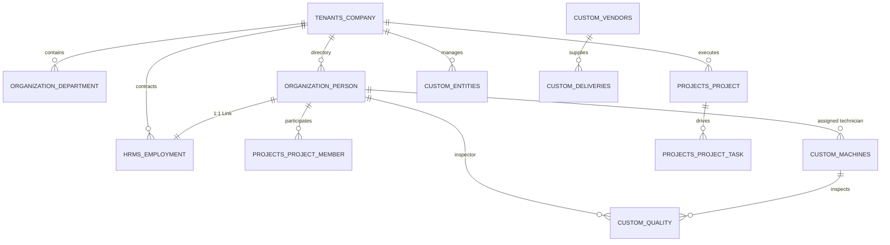
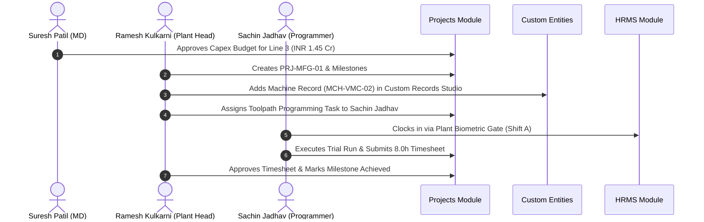

# Demo Data — Manufacturing Company

Independent demo dataset for **Aether Precision Components Private Limited**, a Pune / Chennai industrial manufacturer.
Configure a separate Pulse company workspace; do not mix these field definitions with the technology or retail tenants.

Emails use `@aetherprecision.example`. Phones are synthetic Indian mobiles. Dates are `YYYY-MM-DD`. Monetary values are INR in `number` fields.

---

## A. Company Profile

| Attribute | Value |
| --- | --- |
| Demo company ID | `CO-MFG-001` |
| Display name | Aether Precision |
| Legal name | Aether Precision Components Private Limited |
| Slug | `aether-precision` |
| Industry | Manufacturing (automotive & industrial CNC components) |
| Company size | 201-1000 |
| Website | `https://www.aetherprecision.example` |
| Founded year | 2009 |
| About | Aether Precision machines metal components for automotive OEMs and industrial equipment makers. Primary plant is in Pune (Chakan); a secondary finishing plant operates in Chennai (Sriperumbudur). |
| Support email | `support@aetherprecision.example` |
| WhatsApp business | `9876502001` |
| Country / timezone | IN / Asia/Kolkata |
| Company status | `active` |
| Business locations | Pune Plant (Chakan); Chennai Finishing Plant; Pune Corporate Office |
| Approximate headcount | ~220 plant + office staff (demo shows 18 people) |

---

## B. Company Custom Fields

Entity `company` — tenant-local definitions only.

| Field name | Key | Type | Required | Options / config | Example | Purpose |
| --- | --- | --- | --- | --- | --- | --- |
| Industry | `industry` | select | yes | Technology, Manufacturing, Retail, Services, Other | Manufacturing | Segment |
| Company size | `company-size` | select | no | 1-10, 11-50, 51-200, 201-1000, 1000+ | 201-1000 | Scale |
| Website | `website` | url | no | — | `https://www.aetherprecision.example` | Public site |
| Founded year | `founded-year` | number | no | integer_only | 2009 | Age |
| About | `about` | long_text | no | — | (profile) | Description |
| Support email | `support-email` | email | no | — | `support@aetherprecision.example` | Contact |
| WhatsApp business | `whatsapp-business` | phone | no | indian_mobile | `9876502001` | WhatsApp |
| Plant count | `plant-count` | number | no | integer_only, min 1 | 2 | Multi-site scale |
| Primary end market | `primary-end-market` | select | no | Automotive, Industrial, Aerospace, Other | Automotive | Customer segment |
| ISO certification | `iso-certification` | multi_select | no | ISO 9001, IATF 16949, ISO 14001, None | ISO 9001, IATF 16949 | Quality posture |

---

## C. Organization Structure and Units

### Capabilities (same platform as other tenants)

- `Department` = organization unit with `parent`, `unit_type`, `manager` (Person), `status`, `custom_data`.
- Default types: `division`, `department`, `team`. This tenant can add manufacturing-oriented types.
- Person → **one** unit via `Person.department`.

### Suggested unit types for this tenant

| Key | Singular | Plural | Allowed parents |
| --- | --- | --- | --- |
| `division` | Division | Divisions | [] |
| `plant` | Plant | Plants | `division` |
| `department` | Department | Departments | `plant`, `division` |
| `team` | Team | Teams | `department` |
| `line` | Production line group | Production line groups | `department` |

(`plant` and `line` are optional custom types — fully supported via `OrganizationUnitType`.)

### Hierarchy

```
Aether Precision (company)
├── Corporate — Pune Office              [division]  OU-MFG-CORP
│   ├── Human Resources                  [department] OU-MFG-HR
│   ├── Finance                          [department] OU-MFG-FIN
│   └── Quality Assurance (corporate)    [department] OU-MFG-QA-C
├── Pune Plant — Chakan                  [plant]     OU-MFG-PUN
│   ├── Production                       [department] OU-MFG-PROD-P
│   │   ├── CNC Cell A                   [line]      OU-MFG-CNC-A
│   │   └── CNC Cell B                   [line]      OU-MFG-CNC-B
│   ├── Maintenance                      [department] OU-MFG-MNT-P
│   └── Stores & Logistics               [department] OU-MFG-STO-P
└── Chennai Plant — Sriperumbudur        [plant]     OU-MFG-CHN
    ├── Finishing Operations             [department] OU-MFG-FINSH
    └── Plant Quality                    [department] OU-MFG-QA-CHN
```

### Organization unit custom fields

| Field name | Key | Type | Required | Options | Purpose |
| --- | --- | --- | --- | --- | --- |
| Cost center code | `cost-center-code` | text | no | — | Finance |
| Floor / location | `floor-location` | text | no | — | Bay / shed label |
| Headcount budget | `headcount-budget` | number | no | integer_only | Planned headcount |
| Unit type tag | `unit-type-tag` | select | no | HQ, Branch, Remote, Support | Soft tag |
| Active from | `active-from` | date | no | — | Go-live |
| Production area | `production-area` | select | no | Machining, Finishing, Assembly, Stores, Office, N/A | Shop-floor area |
| Shift type | `shift-type` | select | no | General, A/B/C rotating, Night only, N/A | Default shift pattern |

### Unit records

| Demo ID | Name | Type | Parent | Manager | ~HC | Cost center | Location | Budget | Active from | Area / shift |
| --- | --- | --- | --- | --- | --- | --- | --- | --- | --- | --- |
| OU-MFG-CORP | Corporate — Pune Office | division | — | P-MFG-001 | 25 | CC-CORP | Baner · Floor 2 | 30 | 2009-04-01 | Office / General |
| OU-MFG-HR | Human Resources | department | OU-MFG-CORP | P-MFG-007 | 4 | CC-HR | Baner · 2B | 5 | 2009-04-01 | Office |
| OU-MFG-FIN | Finance | department | OU-MFG-CORP | P-MFG-008 | 5 | CC-FIN | Baner · 2C | 6 | 2009-04-01 | Office |
| OU-MFG-QA-C | Quality Assurance (corporate) | department | OU-MFG-CORP | P-MFG-006 | 6 | CC-QA | Baner · 2D | 8 | 2012-01-01 | Office |
| OU-MFG-PUN | Pune Plant — Chakan | plant | — | P-MFG-002 | 140 | CC-PUN | Chakan Shed 1–3 | 160 | 2010-08-01 | Machining / A/B/C |
| OU-MFG-PROD-P | Production | department | OU-MFG-PUN | P-MFG-003 | 90 | CC-PUN-PR | Shed 1 | 100 | 2010-08-01 | Machining / rotating |
| OU-MFG-CNC-A | CNC Cell A | line | OU-MFG-PROD-P | P-MFG-011 | 28 | CC-PUN-A | Shed 1 · Bay A | 32 | 2014-05-01 | Machining / rotating |
| OU-MFG-CNC-B | CNC Cell B | line | OU-MFG-PROD-P | P-MFG-012 | 26 | CC-PUN-B | Shed 1 · Bay B | 30 | 2016-09-01 | Machining / rotating |
| OU-MFG-MNT-P | Maintenance | department | OU-MFG-PUN | P-MFG-013 | 12 | CC-PUN-MT | Shed 2 | 14 | 2010-08-01 | Machining / General |
| OU-MFG-STO-P | Stores & Logistics | department | OU-MFG-PUN | P-MFG-014 | 10 | CC-PUN-ST | Shed 3 | 12 | 2010-08-01 | Stores / General |
| OU-MFG-CHN | Chennai Plant — Sriperumbudur | plant | — | P-MFG-009 | 55 | CC-CHN | SIPCOT Plot 12 | 70 | 2018-03-01 | Finishing / A/B/C |
| OU-MFG-FINSH | Finishing Operations | department | OU-MFG-CHN | P-MFG-015 | 35 | CC-CHN-F | Plot 12 · Hall 1 | 40 | 2018-03-01 | Finishing / rotating |
| OU-MFG-QA-CHN | Plant Quality | department | OU-MFG-CHN | P-MFG-016 | 8 | CC-CHN-Q | Plot 12 · Lab | 10 | 2018-03-01 | Finishing / General |

---

## D. People and Employee Custom Fields

### Person custom fields

| Field name | Key | Type | Required | Options / config |
| --- | --- | --- | --- | --- |
| Employee ID | `employee-id` | text | yes | — |
| Date of joining | `date-of-joining` | date | yes | — |
| Employment type | `employment-type` | select | yes | Full-time, Contract, Intern |
| Personal phone | `personal-phone` | phone | no | indian_mobile |
| Skills | `skills` | multi_select | no | CNC, Quality, Maintenance, Welding, Logistics, HR, Finance, Sales, Safety |
| Manager | `manager` | reference | no | person, multiple false |
| Shift | `shift` | select | no | General, Shift A, Shift B, Shift C |
| Safety certification | `safety-certification` | multi_select | no | Basic EHS, Forklift, Confined space, Electrical L1, None |
| Machine qualification | `machine-qualification` | multi_select | no | VMC, HMC, Lathe, Grinder, CMM, None |

Baseline skills from the shared guidance are replaced here with manufacturing-relevant options for this tenant only (per-company option lists).

### Sample people (18)

| Emp ID | Name | Work email | Joined | Type | Phone | Skills | Unit | Manager | Job title | App role |
| --- | --- | --- | --- | --- | --- | --- | --- | --- | --- | --- |
| EMP-M-001 | Suresh Patil | `suresh.patil@aetherprecision.example` | 2009-04-01 | Full-time | 9876502101 | Sales, Finance | OU-MFG-CORP | — | Managing Director | Owner |
| EMP-M-002 | Anita Kulkarni | `anita.kulkarni@aetherprecision.example` | 2010-08-01 | Full-time | 9876502102 | CNC, Safety | OU-MFG-PUN | EMP-M-001 | Plant Head — Pune | Department Manager |
| EMP-M-003 | Ramesh Jadhav | `ramesh.jadhav@aetherprecision.example` | 2011-02-15 | Full-time | 9876502103 | CNC | OU-MFG-PROD-P | EMP-M-002 | Production Manager | Department Manager |
| EMP-M-004 | Deepa Sharma | `deepa.sharma@aetherprecision.example` | 2012-06-01 | Full-time | 9876502104 | Quality | OU-MFG-QA-C | EMP-M-001 | Corporate QA Head | Employee |
| EMP-M-005 | Imran Qureshi | `imran.qureshi@aetherprecision.example` | 2013-09-01 | Full-time | 9876502105 | Sales | OU-MFG-CORP | EMP-M-001 | Sales Manager | Employee |
| EMP-M-006 | Kavitha Srinivasan | `kavitha.srinivasan@aetherprecision.example` | 2014-01-10 | Full-time | 9876502106 | Quality | OU-MFG-QA-C | EMP-M-004 | QA Lead | Employee |
| EMP-M-007 | Neha Joshi | `neha.joshi@aetherprecision.example` | 2015-03-01 | Full-time | 9876502107 | HR | OU-MFG-HR | EMP-M-001 | HR Manager | HR Manager |
| EMP-M-008 | Prakash Deshmukh | `prakash.deshmukh@aetherprecision.example` | 2015-07-01 | Full-time | 9876502108 | Finance | OU-MFG-FIN | EMP-M-001 | Finance Manager | Employee |
| EMP-M-009 | Murugan Selvam | `murugan.selvam@aetherprecision.example` | 2018-03-01 | Full-time | 9876502109 | Quality, Safety | OU-MFG-CHN | EMP-M-001 | Plant Head — Chennai | Department Manager |
| EMP-M-010 | Lakshmi Narayanan | `lakshmi.narayanan@aetherprecision.example` | 2018-04-15 | Full-time | 9876502110 | HR | OU-MFG-HR | EMP-M-007 | HR Executive | Employee |
| EMP-M-011 | Ganesh Pawar | `ganesh.pawar@aetherprecision.example` | 2016-05-01 | Full-time | 9876502111 | CNC | OU-MFG-CNC-A | EMP-M-003 | Cell Lead — A | Employee |
| EMP-M-012 | Sunita More | `sunita.more@aetherprecision.example` | 2017-08-01 | Full-time | 9876502112 | CNC | OU-MFG-CNC-B | EMP-M-003 | Cell Lead — B | Employee |
| EMP-M-013 | Ajay Chavan | `ajay.chavan@aetherprecision.example` | 2016-11-01 | Full-time | 9876502113 | Maintenance | OU-MFG-MNT-P | EMP-M-002 | Maintenance Supervisor | Employee |
| EMP-M-014 | Farhan Shaikh | `farhan.shaikh@aetherprecision.example` | 2019-02-01 | Full-time | 9876502114 | Logistics | OU-MFG-STO-P | EMP-M-002 | Stores In-charge | Employee |
| EMP-M-015 | Priya Rajendran | `priya.rajendran@aetherprecision.example` | 2019-06-01 | Full-time | 9876502115 | Quality | OU-MFG-FINSH | EMP-M-009 | Finishing Supervisor | Employee |
| EMP-M-016 | Karthik Subramanian | `karthik.subramanian@aetherprecision.example` | 2020-01-15 | Full-time | 9876502116 | Quality | OU-MFG-QA-CHN | EMP-M-009 | Plant Quality Lead | Employee |
| EMP-M-017 | Vikas Mane | `vikas.mane@aetherprecision.example` | 2021-09-01 | Full-time | 9876502117 | CNC, Safety | OU-MFG-CNC-A | EMP-M-011 | CNC Operator | Employee |
| EMP-M-018 | Arun Kumar | `arun.kumar@aetherprecision.example` | 2024-02-01 | Contract | 9876502118 | Maintenance | OU-MFG-MNT-P | EMP-M-013 | Maintenance Contractor | Employee |

Person IDs `P-MFG-001` … `P-MFG-018` map to EMP-M-001 … EMP-M-018.

**Industry CF samples:** EMP-M-017 Shift B, safety Basic EHS + Forklift, machine VMC + Lathe; EMP-M-013 Shift General, Electrical L1; EMP-M-018 Temporary contractor, Shift A, Basic EHS.

Job titles ≠ application roles. Plant heads use Department Manager permission template, not Owner.

---

## E. Invitations and Invitation Custom Fields

Statuses: `pending`, `accepted`, `revoked`, `expired`. Custom data does not copy on accept. Default app role on accept is Employee.

| Field name | Key | Type | Options |
| --- | --- | --- | --- |
| Invite reason | `invite-reason` | select | New hire, Contractor, Partner, Other |
| Start date | `start-date` | date | — |
| Suggested role | `suggested-role` | text | Informal only |
| Onboarding buddy email | `onboarding-buddy-email` | email | — |
| Welcome note | `welcome-note` | long_text | — |

### Sample invitations (demo only)

| Demo ID | Email | Status | Reason | Start | Suggested role | Buddy | Note |
| --- | --- | --- | --- | --- | --- | --- | --- |
| INV-MFG-01 | `newhire.cnc@aetherprecision.example` | pending | New hire | 2026-11-10 | Employee | `ganesh.pawar@aetherprecision.example` | CNC Operator — Cell A |
| INV-MFG-02 | `temp.welder@contractor.example` | pending | Contractor | 2026-10-28 | Employee | `ajay.chavan@aetherprecision.example` | 6-month maintenance support |
| INV-MFG-03 | `auditor.iatf@partner.example` | pending | Partner | 2026-12-01 | Employee | `deepa.sharma@aetherprecision.example` | External IATF auditor access |
| INV-MFG-04 | `old.storekeeper@aetherprecision.example` | revoked | Other | 2026-08-01 | Employee | `neha.joshi@aetherprecision.example` | Offer withdrawn |
| INV-MFG-05 | `trainee.qa@aetherprecision.example` | expired | New hire | 2025-11-01 | Employee | `kavitha.srinivasan@aetherprecision.example` | Internship window lapsed |

---

## F. Memberships and Membership Custom Fields

| Field name | Key | Type | Options |
| --- | --- | --- | --- |
| Access level note | `access-level-note` | select | Standard, Elevated, Temporary |
| Probation end date | `probation-end-date` | date | — |
| Desk / seat | `desk-seat` | text | — |
| Preferred language | `preferred-language` | select | English, Hindi, Malayalam, Other |
| Internal notes | `internal-notes` | long_text | mark sensitive |

### Examples

| Person | App role | Access note | Probation | Desk / seat | Language | Notes |
| --- | --- | --- | --- | --- | --- | --- |
| EMP-M-001 | Owner | Elevated | — | CORP-MD | English | — |
| EMP-M-002 | Department Manager | Elevated | — | PUN-PH-01 | Marathi→Other | Plant head |
| EMP-M-007 | HR Manager | Elevated | — | CORP-HR-02 | Hindi | — |
| EMP-M-017 | Employee | Standard | — | CNC-A-17 | Hindi | Shop floor |
| EMP-M-018 | Employee | Temporary | — | MNT-C-03 | English | Contractor |
| EMP-M-010 | Employee | Standard | 2026-06-30 | CORP-HR-05 | English | Still documenting probation historically |

---

## G. Custom Entities and Sample Records

| Entity | Key | Why |
| --- | --- | --- |
| Company Assets | `company-assets` | Tools / devices (office + plant tablets) |
| Vendors | `vendors` | Material and tool suppliers |
| Contracts | `contracts` | Supplier MSAs / leases |
| Office Locations | `office-locations` | Plants and offices as locations |
| Production Lines | `production-lines` | Line masters linked to org units |
| Machines and Equipment | `machines-and-equipment` | CNC assets on the shop floor |
| Quality Inspections | `quality-inspections` | Sample QC events |
| Supplier Deliveries | `supplier-deliveries` | Inbound lots |

Projects entity is optional here; production work is better modelled via lines and inspections for this industry demo.

### 1. Company Assets (`company-assets`)

Baseline fields + manufacturing extras:

| Field | Key | Type | Req | Options |
| --- | --- | --- | --- | --- |
| Asset tag | `asset-tag` | text | yes | primary |
| Category | `category` | select | yes | Laptop, Phone, Monitor, Other |
| Serial number | `serial-number` | text | no | |
| Status | `status` | select | yes | In use, In storage, Retired |
| Purchase date | `purchase-date` | date | no | |
| Assigned employee | `assigned-employee` | reference | no | person |

Samples: AST-M-001 Laptop → EMP-M-002; AST-M-002 Phone → EMP-M-001; AST-M-003 Monitor In storage.

### 2. Vendors (`vendors`)

Baseline fields; extend category options for this tenant: IT, Facilities, Marketing, **Raw material**, **Tooling**, Other.

Samples: Deccan Steels (Raw material, end 2027-06-30); ToolCraft India (Tooling); SecureGuard Facilities (Facilities).

### 3. Contracts (`contracts`)

| Field | Key | Type | Req | Options |
| --- | --- | --- | --- | --- |
| Contract ID | `contract-id` | text | yes | primary |
| Counterparty | `counterparty` | text | yes | |
| Type | `type` | select | yes | NDA, MSA, SOW, Lease |
| Expiry date | `expiry-date` | date | no | |
| Value | `value` | number | no | INR |
| Linked vendor | `linked-vendor` | reference | no | custom_entity → vendors |

Samples: CTR-M-100 Deccan Steels MSA, expiry 2027-06-30, value 45000000; CTR-M-101 Chakan shed Lease 12000000; CTR-M-102 ToolCraft SOW 2500000.

### 4. Office Locations (`office-locations`)

Baseline: location-code, city, address, seats, opened-on.

Samples: `LOC-PUN-OFF` Pune Baner; `LOC-PUN-PLT` Pune Chakan; `LOC-CHN-PLT` Chennai Sriperumbudur.

### 5. Production Lines (`production-lines`)

| Field | Key | Type | Req | Config |
| --- | --- | --- | --- | --- |
| Line code | `line-code` | text | yes | primary |
| Title | `title` | text | yes | |
| Status | `status` | select | yes | Active, Downtime, Decommissioned |
| Org unit | `org-unit` | reference | yes | organization_unit |
| Target OEE % | `target-oee` | number | no | 0–100 |
| Active from | `active-from` | date | no | |

Samples: LINE-A CNC Cell A → OU-MFG-CNC-A, OEE 82; LINE-B CNC Cell B → OU-MFG-CNC-B, OEE 80; LINE-F Finishing Hall → OU-MFG-FINSH, OEE 75.

### 6. Machines and Equipment (`machines-and-equipment`)

| Field | Key | Type | Req | Options |
| --- | --- | --- | --- | --- |
| Machine code | `machine-code` | text | yes | primary |
| Name | `name` | text | yes | |
| Category | `category` | select | yes | VMC, HMC, Lathe, Grinder, CMM, Other |
| Maintenance status | `maintenance-status` | select | yes | OK, Due, Overdue, Under repair |
| Last inspection date | `last-inspection-date` | date | no | |
| Production line | `production-line` | reference | no | custom_entity → production-lines |
| Responsible technician | `responsible-technician` | reference | no | person |

Samples: MCH-VMC-01 OK, 2026-09-15, LINE-A, EMP-M-013; MCH-LAT-04 Due, 2026-08-01, LINE-B; MCH-CMM-01 OK, QA lab, EMP-M-016.

### 7. Quality Inspections (`quality-inspections`)

| Field | Key | Type | Req | Options |
| --- | --- | --- | --- | --- |
| Inspection ID | `inspection-id` | text | yes | primary |
| Lot / batch | `lot-batch` | text | yes | |
| Result | `result` | select | yes | Pass, Fail, Conditional |
| Inspected on | `inspected-on` | date | yes | |
| Inspector | `inspector` | reference | no | person |
| Machine | `machine` | reference | no | custom_entity → machines-and-equipment |
| Notes | `notes` | long_text | no | |

Samples: QI-2026-001 Pass EMP-M-006 MCH-VMC-01; QI-2026-002 Fail EMP-M-016 MCH-LAT-04; QI-2026-003 Conditional EMP-M-006.

### 8. Supplier Deliveries (`supplier-deliveries`)

| Field | Key | Type | Req | Config |
| --- | --- | --- | --- | --- |
| Delivery ID | `delivery-id` | text | yes | primary |
| Vendor | `vendor` | reference | yes | custom_entity → vendors |
| Material | `material` | text | yes | |
| Quantity kg | `quantity-kg` | number | yes | |
| Delivered on | `delivered-on` | date | yes | |
| Receiving plant | `receiving-plant` | reference | no | organization_unit |
| QC status | `qc-status` | select | yes | Pending, Accepted, Rejected |

Samples: DLV-9001 Deccan Steels, EN8 bar, 12000 kg, 2026-10-01, OU-MFG-PUN, Accepted.

---

## H. Industry-Specific Custom Field Options

- Person: Shift, Safety certification, Machine qualification; manufacturing Skills list.
- Org unit: Production area, Shift type.
- Machines: Maintenance status, Last inspection date.
- Entities: Production Lines, Machines, Quality Inspections, Supplier Deliveries.

---

## I. Realistic Relationships Checklist

- Operators belong to CNC Cell A/B units, not both.
- Cell leads are unit managers and Person.manager for operators.
- Machines reference production-line records; lines reference org units.
- Inspections reference inspectors (people) and machines.
- Deliveries reference vendors and plant org units.
- Contracts may reference vendors via custom_entity reference.
- No cross-tenant links to Nimbus Labs or retail company.

---

## J. Demo Scenarios

1. **Hire a CNC operator** — Person with shift, safety certs, machine qualifications; department CNC Cell A; role Employee.
2. **Invite a maintenance contractor** — Invitation reason Contractor; after accept set membership Temporary.
3. **Add a production line group** — New org unit type `line` under Production with production-area Machining.
4. **Log machine maintenance** — Update machine maintenance-status to Due; filter machines by status.
5. **Record a failed inspection** — Create QI record Fail linked to machine and inspector.
6. **Tenant isolation** — Confirm Aether vendors/machines invisible from other company workspaces.

Future / unsupported:

- Real-time PLC / IoT machine telemetry.
- Automatic OEE calculation from events.
- Attaching inspection photo files.
- Multi-plant person assignment without changing `department`.

---

## K. Implementation Compatibility and Gaps

| Requirement | Supported? | Model/API/UI | Gap |
| --- | --- | --- | --- |
| Custom unit types (plant, line) | Yes | `OrganizationUnitType` | Defaults are division/department/team only until customized |
| Parent-child org hierarchy | Yes | `Department.parent` | Cycles blocked; optional `allowed_parent_keys` |
| Person single unit | Yes | `Person.department` | Cannot assign one operator to two cells |
| Shift / certification as CF | Yes | Person custom fields select/multi_select | No built-in attendance module for shifts |
| Machine entity + references | Yes | Custom entities + reference | No native CMMS |
| Vendor ↔ contract link | Yes | reference → custom_entity | Must create vendors entity first |
| INR contract value | Partial | `number` | No currency type or tax breakdown |
| Invitation CF persistence | Yes on invitation | `MembershipInvitation.custom_data` | Not copied to membership/person |
| Filter inspections by result | Yes | filterable flag | Must enable `filterable` on field |
| Industry hardcoding | No (by design) | — | All via tenant config |
| RLS | Planned | docs/06 | Demo relies on app-level company scoping |

---

---

## L. Installed Module Matrix & Entitlements

Aether Precision subscribes to the **Enterprise Plan** (`enterprise`) billed annually at INR 2,49,999. Under this subscription tier, the company is entitled to all 4 available Pulse modules with up to a 250-person directory cap.

```
┌─────────────────────────────────────────────────────────────────────────────┐
│                 AETHER PRECISION MODULE INSTALLATION STATE                  │
├─────────────────────┬──────────────┬─────────────┬──────────────────────────┤
│ Module Slug         │ Status       │ Version     │ Notes                    │
├─────────────────────┼──────────────┼─────────────┼──────────────────────────┤
│ hrms                │ INSTALLED    │ 2.5.0       │ Multi-shift factory ops  │
│ projects            │ INSTALLED    │ 1.0.0       │ Line expansions & capex  │
│ crm                 │ INSTALLED    │ 1.0.0       │ Tier-1 OEM accounts      │
│ commerce            │ NOT INSTALLED│ 1.0.0       │ Custom B2B contract mfg  │
│ finance             │ COMING SOON  │ —           │ Modeled via CF / Custom  │
│ inventory           │ COMING SOON  │ —           │ Plant assets via Custom  │
│ procurement         │ COMING SOON  │ —           │ Vendors via Parties      │
│ sales / helpdesk    │ COMING SOON  │ —           │ Plant safety desk in HRMS│
└─────────────────────┴──────────────┴─────────────┴──────────────────────────┘
```

### Module Entitlement & Licensing Parameters
- **Plan Code**: `enterprise`
- **Max People Cap**: 250 active people (Current seed uses 18 employees, ~7% utilization).
- **Installed Modules**: `hrms`, `projects`, `crm`.
- **Installed By**: `suresh.patil@aetherprecision.example` (Managing Director & Owner).
- **Custom Entities In Use**: 8 of 20 entity quota consumed.

---

## M. Module Configuration & Domain Master Data

### 1. Legal Entity & Factory Registrations
- **Legal Entity ID**: `LE-MFG-01`
- **Legal Name**: Aether Precision Components Private Limited
- **Registration / CIN**: `U29253PN2015PTC154321`
- **Tax Identifier (GSTIN)**: `27AABCA4321K1Z2`
- **Permanent Account Number (PAN)**: `AABCA4321K`
- **Statutory Accounts & Licences**:
  - Factories Act License Number: `PUN-FAC-2015-8841`
  - Provident Fund (EPF) Establishment Code: `MH/BAN/0074128/000`
  - Employees' State Insurance (ESIC) Code: `31000847210000606`
  - Maharashtra Professional Tax Registration: `27412398765P`

### 2. Work Locations & Factory Plants
| Location Code | Location Name | Address | Coordinates | Geofence | HQ? |
| :--- | :--- | :--- | :--- | :--- | :--- |
| `LOC-PUN-HQ` | Baner Corporate Office | 6th Floor, Synergy IT Park, Baner, Pune 411045 | 18.5590° N, 73.7868° E | 100m | Yes |
| `LOC-CHK-PLT` | Chakan Machining Plant | Plot B-14, Chakan MIDC Phase II, Pune 410501 | 18.7560° N, 73.8440° E | 300m | No |
| `LOC-CHN-PLT` | Chennai Finishing Plant | SIPCOT Industrial Park, Sriperumbudur 602106 | 12.9800° N, 79.9500° E | 250m | No |

### 3. Designations & Industrial Grading
| Code | Designation Title | Grade / Track | Min CTC (LPA) | Max CTC (LPA) |
| :--- | :--- | :--- | :--- | :--- |
| `DES-MD` | Managing Director | Executive (E8) | 50.0 | 85.0 |
| `DES-PLANT-HEAD` | General Manager & Plant Head | Operations (M7) | 36.0 | 50.0 |
| `DES-PROD-MGR` | Production Manager | Operations (M6) | 22.0 | 32.0 |
| `DES-CNC-LEAD` | CNC Cell Lead & Supervisor | Shop Floor (T5) | 12.0 | 18.0 |
| `DES-SR-CNC-PRG` | Senior CNC Programmer | Shop Floor (T5) | 10.0 | 16.0 |
| `DES-CNC-OPR` | CNC Machine Operator | Shop Floor (T3) | 4.8 | 8.0 |
| `DES-MAINT-HEAD` | Plant Maintenance Head | Engineering (M6) | 20.0 | 28.0 |
| `DES-MECH-TECH` | Mechanical Maintenance Tech | Shop Floor (T3) | 4.5 | 7.5 |
| `DES-QA-LEAD` | Quality Assurance Lead | Quality (M6) | 18.0 | 26.0 |
| `DES-CMM-INSP` | CMM Quality Inspector | Quality (T4) | 6.0 | 10.0 |
| `DES-TOOL-SPEC` | Tooling & Fixture Specialist | Shop Floor (T4) | 7.5 | 12.0 |
| `DES-PLN-LEAD` | Production Planning Lead | Operations (M5) | 14.0 | 20.0 |
| `DES-SCM-MGR` | Supply Chain Manager | Commercial (M6) | 18.0 | 26.0 |
| `DES-HR-LEAD` | Head of Plant HR & IR | Administration (M6) | 18.0 | 25.0 |
| `DES-HR-OFFICER` | Personnel & IR Officer | Administration (M4) | 6.0 | 9.5 |
| `DES-FIN-HEAD` | Chief Financial Officer | Finance (M7) | 32.0 | 45.0 |
| `DES-COST-ACC` | Senior Plant Cost Accountant | Finance (M5) | 12.0 | 18.0 |
| `DES-SAFETY-OFF` | Environmental Safety Officer | EHS (T5) | 9.0 | 14.0 |

### 4. Rotating Shift Rosters & Factory Attendance Policies
- **Shift `SHIFT-A-MORN`**: Morning Shift (06:00 – 14:00 IST). Mandatory 30-min tea/breakfast break. Min 7.5 hours for full credit.
- **Shift `SHIFT-B-EVE`**: Evening Shift (14:00 – 22:00 IST). Mandatory 30-min dinner break. Shift allowance: INR 150/shift.
- **Shift `SHIFT-C-NIGHT`**: Night Shift (22:00 – 06:00 IST). Mandatory 30-min midnight meal. Shift allowance: INR 250/shift.
- **Shift `SHIFT-GEN`**: General Office Shift (09:00 – 17:30 IST) with 60-min lunch.
- **Attendance Policy `POL-MFG-BIO`**:
  - Verification Modes: Biometric kiosk integration (zkTeck / eSSL face & thumb terminal) and GPS factory gate punch.
  - Grace Period: 15 minutes. Deductions applied for > 3 late punches in a calendar month.
  - Continuous Overtime (OT): Automatically calculated for logged floor hours > 8.5 hours at 2.0x normal hourly rate.

### 5. Leave Policies (Factories Act Compliant)
| Code | Policy Name | Entitlement / Year | Accrual Method | Carry Forward | Encashable |
| :--- | :--- | :--- | :--- | :--- | :--- |
| `LP-CASUAL` | Casual Leave (CL) | 10 days | 0.83 days/month | No (Lapses Dec 31) | No |
| `LP-SICK` | Sick Leave (SL) | 10 days | Upfront on Jan 1 | Max 30 days | No |
| `LP-EARNED` | Factory Earned Leave (EL) | 21 days | 1 day per 20 worked | Max 60 days | Yes (Factories Act) |
| `LP-COMP-OFF` | Compensatory Off (CO) | As earned | Breakdown support | 60 days validity | No |

### 6. Salary Structures & Industrial Wage Formulation
- **Structure Code `SAL-STRUCT-MFG-STAFF`**: Salaried engineering & managerial staff (Basic 45%, HRA 20%, Special 25%, Conveyance 10%, EPF 12%, PT).
- **Structure Code `SAL-STRUCT-MFG-OPERATOR`**: Shop floor hourly wage & allowance structure:
  - Basic + Dearness Allowance (DA): 50%
  - House Rent Allowance (HRA): 15%
  - Machine Hazard & Heat Allowance: 15%
  - Attendance Bonus: INR 1,500/month (for 100% scheduled presence)
  - Statutory: EPF (12%), ESIC (0.75% employee + 3.25% employer), Maharashtra PT (INR 200).

### 7. Project Management Configuration
- **Global Settings**:
  - Task Identifier Prefix: `MFG`
  - Allow Cross-Department Collaborators: `True`
  - Require Manager Timesheet Approval: `True`
  - Live Start/Stop Timer Enabled: `True`

---

## N. HRMS Sample Data

### 1. 18 Core Employments Linked 1:1 to People
| Person Code | Employee Name | Work Location | Designation | Joining Date | Confirmation Date | Annual CTC (INR) |
| :--- | :--- | :--- | :--- | :--- | :--- | :--- |
| `EMP-M-001` | Suresh Patil | `LOC-PUN-HQ` | `DES-MD` | 2015-08-01 | 2015-08-01 | 65,00,000 |
| `EMP-M-002` | Ramesh Kulkarni | `LOC-CHK-PLT` | `DES-PLANT-HEAD` | 2016-03-01 | 2016-09-01 | 42,00,000 |
| `EMP-M-003` | Vikas Shinde | `LOC-CHK-PLT` | `DES-PROD-MGR` | 2017-06-15 | 2017-12-15 | 28,00,000 |
| `EMP-M-004` | Amit Deshmukh | `LOC-CHK-PLT` | `DES-CNC-LEAD` | 2018-01-10 | 2018-07-10 | 16,00,000 |
| `EMP-M-005` | Sachin Jadhav | `LOC-CHK-PLT` | `DES-SR-CNC-PRG` | 2018-09-01 | 2019-03-01 | 14,00,000 |
| `EMP-M-006` | Sunita Rao | `LOC-CHK-PLT` | `DES-QA-LEAD` | 2017-11-01 | 2018-05-01 | 24,00,000 |
| `EMP-M-007` | Mahesh Pawar | `LOC-CHK-PLT` | `DES-MAINT-HEAD` | 2018-04-15 | 2018-10-15 | 25,00,000 |
| `EMP-M-008` | Ganesh Gaikwad | `LOC-CHK-PLT` | `DES-CNC-OPR` | 2019-02-01 | 2019-08-01 | 6,50,000 |
| `EMP-M-009` | Nitin More | `LOC-CHK-PLT` | `DES-CNC-OPR` | 2020-01-15 | 2020-07-15 | 5,80,000 |
| `EMP-M-010` | Deepak Chavan | `LOC-CHK-PLT` | `DES-TOOL-SPEC` | 2019-07-01 | 2020-01-01 | 11,00,000 |
| `EMP-M-011` | Snehal Kadam | `LOC-CHK-PLT` | `DES-HR-LEAD` | 2018-10-01 | 2019-04-01 | 22,00,000 |
| `EMP-M-012` | Rahul Bhosale | `LOC-CHK-PLT` | `DES-PLN-LEAD` | 2020-08-01 | 2021-02-01 | 17,00,000 |
| `EMP-M-013` | Santosh Mane | `LOC-CHK-PLT` | `DES-MECH-TECH` | 2021-03-15 | 2021-09-15 | 6,00,000 |
| `EMP-M-014` | Sanjay Jagtap | `LOC-PUN-HQ` | `DES-FIN-HEAD` | 2017-01-01 | 2017-07-01 | 38,00,000 |
| `EMP-M-015` | Anand Kale | `LOC-PUN-HQ` | `DES-SCM-MGR` | 2019-11-15 | 2020-05-15 | 24,00,000 |
| `EMP-M-016` | Pooja Thorat | `LOC-CHK-PLT` | `DES-CMM-INSP` | 2021-06-01 | 2021-12-01 | 8,50,000 |
| `EMP-M-017` | Vilas Salunkhe | `LOC-CHK-PLT` | `DES-SAFETY-OFF` | 2022-01-10 | 2022-07-10 | 12,00,000 |
| `EMP-M-018` | Vijay Ghorpade | `LOC-CHN-PLT` | `DES-CNC-OPR` | 2022-09-01 | 2023-03-01 | 5,50,000 |

### 2. Factory Biometric Punch Logs (Sample October 2026 Day)
| Employee | Shift | In Punch | Out Punch | Total Hours | Verification Terminal | Status |
| :--- | :--- | :--- | :--- | :--- | :--- | :--- |
| `EMP-M-008` (Ganesh Gaikwad) | Shift A | 05:54:12 | 14:05:30 | 8h 11m | Biometric Terminal Gate 2 | PRESENT |
| `EMP-M-009` (Nitin More) | Shift A | 05:58:45 | 14:02:10 | 8h 03m | Biometric Terminal Gate 2 | PRESENT |
| `EMP-M-004` (Amit Deshmukh) | Shift A | 05:48:00 | 15:30:00 | 9h 42m | Biometric Terminal Gate 1 | PRESENT (+1.2h OT) |
| `EMP-M-013` (Santosh Mane) | General | 09:05:10 | 17:35:00 | 8h 30m | Facial Recognition Main | PRESENT |
| `EMP-M-016` (Pooja Thorat) | General | 08:55:00 | 17:32:00 | 8h 37m | Facial Recognition QA Lab | PRESENT |
| `EMP-M-018` (Vijay Ghorpade) | Shift B | 13:50:00 | 22:08:15 | 8h 18m | Chennai Kiosk #1 | PRESENT |

### 3. Leave Requests & Approvals
- **Request `LR-MFG-001`**:
  - Employee: `EMP-M-009` (Nitin More) | Policy: `LP-CASUAL` (2 days: 2026-10-14 to 2026-10-15)
  - Reason: "Agricultural harvesting at ancestral village in Satara"
  - Approver: `EMP-M-004` (Amit Deshmukh) | Status: `APPROVED`
- **Request `LR-MFG-002`**:
  - Employee: `EMP-M-005` (Sachin Jadhav) | Policy: `LP-EARNED` (4 days: 2026-11-04 to 2026-11-07)
  - Reason: "Diwali family festival"
  - Approver: `EMP-M-003` (Vikas Shinde) | Status: `PENDING`

### 4. October 2026 Factory Payroll Execution & Payslips
- **Payroll Period**: `2026-10-01` to `2026-10-31`
- **Payroll Run Code**: `PR-MFG-2026-10`
- **Execution Status**: `COMPLETED` (Approved by Suresh Patil, Processed by Snehal Kadam)
- **Total Gross Payroll**: INR 34,75,000
- **Total Net Disbursed**: INR 29,48,200
- **Total EPF Remittance**: INR 2,82,000
- **Total ESIC Remittance**: INR 28,450
- **Sample Payslip (`PS-MFG-2026-10-008` — Ganesh Gaikwad, CNC Operator)**:
  - Basic + DA: INR 27,083
  - HRA: INR 8,125
  - Machine Hazard Allowance: INR 8,125
  - Attendance Incentive Bonus: INR 1,500
  - Overtime (6.5 hours @ 2x rate): INR 2,150
  - Gross Earnings: INR 46,983
  - Deductions: EPF (INR 1,800) + ESIC (INR 352) + PT (INR 200) = INR 2,352
  - Net Pay Disbursed: **INR 44,631**

---

## O. Projects & Work Management Sample Data

```
┌─────────────────────────────────────────────────────────────────────────────┐
│                    AETHER PRECISION ENGINEERING PROJECTS                    │
├────────────┬─────────────────────────────┬───────────┬─────────────┬────────┤
│ Project    │ Name                        │ Priority  │ Budget      │ Owner  │
├────────────┼─────────────────────────────┼───────────┼─────────────┼────────┤
│ PRJ-MFG-01 │ Chakan Plant CNC Line 3     │ HIGH      │ ₹1,45,00,000│ EMP-004│
│ PRJ-MFG-02 │ IATF 16949 Recertification  │ URGENT    │ ₹24,00,000  │ EMP-006│
│ PRJ-MFG-03 │ Aerospace Titanium Machining│ MEDIUM    │ ₹65,00,000  │ EMP-003│
└────────────┴─────────────────────────────┴───────────┴─────────────┴────────┘
```

### 1. Project `PRJ-MFG-01`: "Chakan Plant CNC Line 3 Expansion"
- **Code**: `CNC3` | **Status**: `ACTIVE` | **Is Billable**: `False` (Internal Capex)
- **Owning Organization Unit**: `OU-MFG-PUN` (Chakan Plant)
- **Project Manager**: `EMP-M-004` (Amit Deshmukh)
- **Dates**: `2026-03-01` to `2026-12-30` | **Progress**: 72%
- **Milestones**:
  - `M1`: Civil Foundation & Heavy Power Cabling (Achieved: 2026-05-30)
  - `M2`: Machine Delivery & Rigging for Mazak 5-Axis VMC (Achieved: 2026-08-15)
  - `M3`: Tooling Calibration, Trial Run & First Article Inspection (Due: 2026-11-15)
- **Work Tasks**:
  - `TSK-MFG-101` — "Level and anchor Mazak VTC-800 machine bed to 0.005mm tolerance"
    - Assignee: `EMP-M-007` (Mahesh Pawar) | Status: `COMPLETED` | Est: 40h | Act: 38h
  - `TSK-MFG-102` — "Program Fanuc CNC macro subroutines for hydraulic manifold roughing"
    - Assignee: `EMP-M-005` (Sachin Jadhav) | Status: `IN_PROGRESS` | Priority: `HIGH` | Est: 35h | Act: 24h
  - `TSK-MFG-103` — "Run 50-piece pilot batch on EN8 alloy steel and log CMM deviations"
    - Assignee: `EMP-M-016` (Pooja Thorat) | Status: `TODO` | Priority: `URGENT` | Est: 20h | Act: 0h

### 2. Project `PRJ-MFG-02`: "ISO 9001:2015 & IATF 16949 Recertification"
- **Code**: `ISO9` | **Status**: `ACTIVE` | **Owning Unit**: `OU-MFG-QA`
- **Project Manager**: `EMP-M-006` (Sunita Rao) | **Progress**: 85%
- **Tasks**:
  - `TSK-MFG-201` — "Internal audit of calibration records for Vernier calipers and micrometers" (Status: `COMPLETED`)
  - `TSK-MFG-202` — "Update Failure Mode and Effects Analysis (FMEA) for transmission flanges" (Status: `IN_REVIEW`)

### 3. Plant Timesheet Entries
- **Entry `TE-MFG-001`**:
  - Worker: `EMP-M-005` (Sachin Jadhav) | Task: `TSK-MFG-102`
  - Work Date: `2026-10-20` | Duration: 480 minutes (8.0h)
  - Description: "Optimized toolpaths in Mastercam for 5-axis helical milling to reduce cycle time by 14%."
  - Status: `APPROVED` by Amit Deshmukh.

---

## P. Other Module Data (CRM)

Aether Precision acts as a Tier-1 and Tier-2 precision engineering supplier to automotive and industrial OEMs. Accounts and opportunities reside in `apps.crm`, linked to `parties.Party`:

### 1. OEM Accounts & Master Parties
| Account Code | Account Name | Master Party | Industry Sector | Annual Contract Value | Key Contact |
| :--- | :--- | :--- | :--- | :--- | :--- |
| `ACC-MFG-001` | Tata Motors Commercial Vehicle Div | `Tata Motors Limited` (Org) | Automotive OEM | INR 1,80,00,000 | Rajesh Gokhale (VP Sourcing) |
| `ACC-MFG-002` | Bharat Heavy Forgings Limited | `Bharat Heavy Forgings` (Org) | Heavy Industrial | INR 95,00,000 | K. Venkataraman (Head SCM) |
| `ACC-MFG-003` | Mahindra Precision Systems | `Mahindra Precision Systems` (Org) | Auto Transmission | INR 1,20,00,000 | Milind Tambe (General Manager) |

### 2. CRM Opportunities & Pipeline Deals
- **Opportunity `OPP-MFG-2026-01`**:
  - Name: "Tata Motors — EV Gearbox Aluminum Housing Machining (60,000 pcs/yr)"
  - Account: `ACC-MFG-001` (Tata Motors)
  - Stage: `NEGOTIATION`
  - Amount: **INR 1,80,00,000** (Amount minor: `1800000000`)
  - Close Date: `2026-11-30` | Owner: `EMP-M-001` (Suresh Patil)
- **Opportunity `OPP-MFG-2026-02`**:
  - Name: "Bharat Heavy Forgings — High-Pressure Flange Subcontract"
  - Account: `ACC-MFG-002` (Bharat Heavy Forgings)
  - Stage: `WON` | Amount: **INR 95,00,000** (Amount minor: `950000000`)
  - Close Date: `2026-08-31` | Owner: `EMP-M-001` (Suresh Patil)
- **Opportunity `OPP-MFG-2026-03`**:
  - Name: "Mahindra Precision — Tractor Transmission Spline Shafts"
  - Account: `ACC-MFG-003` (Mahindra Precision)
  - Stage: `PROPOSAL` | Amount: **INR 1,20,00,000** (Amount minor: `1200000000`)

---

## Q. Cross-Module Relationships & Entity Linkages



### Traceability Mapping Table
| From Entity | Field | Target Entity | Functional Linkage |
| :--- | :--- | :--- | :--- |
| `organization.Person` | 1:1 ID | `hrms.Employment.person` | Connects employee identity with biometric punches and factory payroll. |
| `custom_entity.machines` | `assigned-technician` | `organization.Person` | Assigns mechanical technician responsible for preventative maintenance. |
| `custom_entity.quality-inspections` | `inspector` | `organization.Person` | QA technician certifying batch tolerance compliance. |
| `projects.ProjectTask` | `assignee` | `organization.Person` | Tooling / maintenance lead executing machine bed rigging and calibration. |
| `crm.Account` | `party` | `parties.Party` | External master record for OEM client legal entity and GST billing. |

---

## R. Role-Based End-to-End Scenarios & Persona Walkthroughs

### Persona 1: Suresh Patil (Managing Director)
- **Login**: `suresh.patil@aetherprecision.example` | **Role**: Company Owner
- **Daily Walkthrough**:
  1. Opens **Company Overview**: Inspects plant operational summary (18 active employees, 100% attendance on Shift A).
  2. Opens **CRM Module**: Reviews the INR 1.8 Cr EV Gearbox RFP with Tata Motors; notes technical clarification needed on CMM tolerance.
  3. Checks **HRMS Payroll Tab**: Reviews October payroll run total (INR 29.48L net); authorizes bank disbursement file.

### Persona 2: Ramesh Kulkarni (Plant Head & GM)
- **Login**: `ramesh.kulkarni@aetherprecision.example` | **Role**: Department Manager (`OU-MFG-PUN`)
- **Daily Walkthrough**:
  1. Inspects **Plant Projects Dashboard**: Checks `PRJ-MFG-01` milestone M3 status; reviews progress on Mazak 5-axis installation.
  2. Reviews **Timesheets**: Approves 8.0 hours logged by Sachin Jadhav on CNC toolpath programming.
  3. Verifies Shift Handover: Confirms Shift A completed 250 units before handing over line to Shift B.

### Persona 3: Sunita Rao (Quality Assurance Lead)
- **Login**: `sunita.rao@aetherprecision.example` | **Role**: QA Lead (`OU-MFG-QA`)
- **Daily Walkthrough**:
  1. Reviews **Quality Inspections**: Checks lot QI-2026-001 (Pass) on VMC-01.
  2. Opens **Projects Module**: Manages tasks under `PRJ-MFG-02 (IATF 16949 Recertification)`.
  3. Submits leave request for upcoming ISO auditor training conference.

### Persona 4: Amit Deshmukh (CNC Cell Lead & Programmer)
- **Login**: `amit.deshmukh@aetherprecision.example` | **Role**: Cell Lead / Shift Supervisor
- **Daily Walkthrough**:
  1. Arrives at Chakan factory at 05:48 AM; clocks in via Biometric Terminal Gate 1.
  2. Opens **Projects Kanban**: Moves task `TSK-MFG-102` to `In Progress`.
  3. Supervises operators Ganesh and Nitin on CNC Cell A; logs 1.2 hours approved overtime.

---

## S. Cross-Module Workflows

### Workflow 1: New Production Line Capex from Procurement to Shift Handover


---

## T. Seed Execution Order & Dependencies

```
1. Platform Catalogs (Permissions, Modules, Standard Role Templates)
   ↓
2. Billing Plan & Price Setup (Ensure 'enterprise' plan with included_module_slugs)
   ↓
3. Tenant Company Creation (Aether Precision, slug='aether-precision', legal entity, billing profile)
   ↓
4. Custom Unit Types & Org Tree (Divisions, Plants, Production Areas, Lines, Cells)
   ↓
5. People Directory & User Accounts (18 Person records, Memberships, Roles)
   ↓
6. External Parties Master (OEM Clients, Raw Material Vendors, Subcontractors)
   ↓
7. Custom Fields & Custom Entities (Production Lines, Machines, Quality Inspections, Deliveries)
   ↓
8. Module Installation (Call install_module for 'hrms', 'projects', 'crm')
   ↓
9. HRMS Domain Master (LegalEntity, WorkLocations, Designations, Shift Rosters, Policies)
   ↓
10. HRMS Core Records (18 Employments, Biometric Punch Sessions, Leave Balances, Payroll Run)
   ↓
11. Projects Domain Records (ProjectSettings, Projects, Members, Milestones, Tasks, Timesheets)
   ↓
12. CRM Domain Records (Accounts linked to Parties, Contacts, Leads, Opportunities)
   ↓
13. Post-Seed Validation Assertions & Audit Trail
```

---

## U. Validation Queries & Known Limitations

### 1. Database Verification Queries (PostgreSQL / Django ORM)
```python
from apps.tenants.models import Company
from apps.organization.models import Department, Person
from apps.modules_registry.models import CompanyModuleInstallation
from apps.hrms.models import Employment, AttendanceSession, LeaveRequest, PayrollRun
from apps.projects.models import Project, ProjectTask, ProjectTimeEntry
from apps.crm.models import Account, Opportunity

co = Company.objects.get(slug="aether-precision")

# Assert Core Counts
assert Department.objects.filter(company=co).count() == 10
assert Person.objects.filter(company=co).count() == 18
assert CompanyModuleInstallation.objects.filter(company=co, status="installed").count() == 3

# Assert HRMS Counts
assert Employment.objects.filter(company=co).count() == 18
assert AttendanceSession.objects.filter(company=co).count() >= 18
assert LeaveRequest.objects.filter(company=co).count() >= 2
assert PayrollRun.objects.filter(company=co).count() >= 1

# Assert Projects Counts
assert Project.objects.filter(company=co).count() == 3
assert ProjectTask.objects.filter(company=co).count() >= 5
assert ProjectTimeEntry.objects.filter(company=co).count() >= 1

# Assert CRM Counts
assert Account.objects.filter(company=co).count() == 3
assert Opportunity.objects.filter(company=co).count() == 3
print("AETHER PRECISION ALL SEED ASSERTIONS PASSED!")
```

### 2. Known Platform Limitations & Architectural Boundaries
1. **Direct PLC/IoT Telemetry**: Pulse HRMS and Projects track human labor, shifts, and task milestones; live MQTT/OPC-UA telemetry from CNC machines is connected via external middleware or custom entity API endpoints.
2. **ESIC Digital Return Sync**: ESIC wage contributions are accurately calculated according to Indian statutory rules, but XML return generation is an enterprise export feature.

---

*Document version: 2.0 (Comprehensive Multi-Module Platform Integration — Aligned with Pulse Platform Matrix).*
