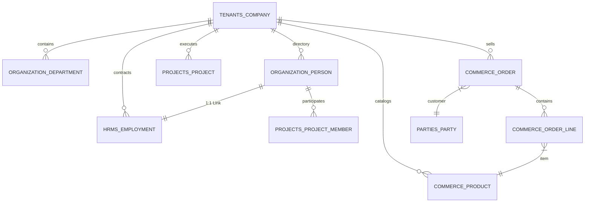
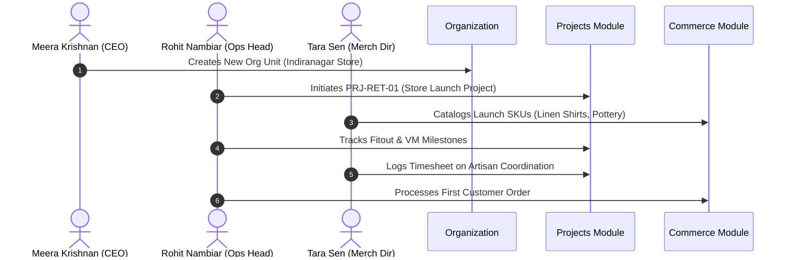

# Demo Data — Retail Company

Independent demo dataset for **Lotus Lane Retail Private Limited**, a multi-store specialty retail chain with presence in Mumbai, Bengaluru, and Kochi.
Configure as a **separate** Pulse company so retail custom fields and entities do not pollute technology or manufacturing tenants.

Emails: `@lotuslane.example`. Synthetic Indian mobiles. Dates: `YYYY-MM-DD`. Money: INR via `number`.

---

## A. Company Profile

| Attribute | Value |
| --- | --- |
| Demo company ID | `CO-RET-001` |
| Display name | Lotus Lane |
| Legal name | Lotus Lane Retail Private Limited |
| Slug | `lotus-lane` |
| Industry | Retail (lifestyle & home specialty) |
| Company size | 51-200 |
| Website | `https://www.lotuslane.example` |
| Founded year | 2015 |
| About | Lotus Lane operates specialty lifestyle stores across western and southern India, with a small central merchandising team in Mumbai and flagship stores in Mumbai, Bengaluru, and Kochi. |
| Support email | `care@lotuslane.example` |
| WhatsApp business | `9876503001` |
| Country / timezone | IN / Asia/Kolkata |
| Company status | `active` |
| Business locations | Mumbai HQ; Stores in Bandra (Mumbai), Indiranagar (Bengaluru), Marine Drive (Kochi); Shared warehouse in Navi Mumbai |
| Approximate headcount | ~95 (demo shows 15 people) |

---

## B. Company Custom Fields

Entity `company` for this tenant only.

| Field name | Key | Type | Required | Options / config | Example | Purpose |
| --- | --- | --- | --- | --- | --- | --- |
| Industry | `industry` | select | yes | Technology, Manufacturing, Retail, Services, Other | Retail | Segment |
| Company size | `company-size` | select | no | 1-10, 11-50, 51-200, 201-1000, 1000+ | 51-200 | Scale |
| Website | `website` | url | no | — | `https://www.lotuslane.example` | Site |
| Founded year | `founded-year` | number | no | integer_only | 2015 | Age |
| About | `about` | long_text | no | — | (profile) | Description |
| Support email | `support-email` | email | no | — | `care@lotuslane.example` | Customer care |
| WhatsApp business | `whatsapp-business` | phone | no | indian_mobile | `9876503001` | Commerce WhatsApp |
| Store count | `store-count` | number | no | integer_only | 3 | Active stores |
| Retail format | `retail-format` | select | no | Specialty, Department, Convenience, Online-only, Other | Specialty | Format |
| GSTIN (display) | `gstin-display` | text | no | pattern digits optional — prefer billing profile for real GST | 27AAAAA0000A1Z5 | Demo-only display; billing GSTIN remains on `CompanyBillingProfile` |

Do not replace billing profile GSTIN with a custom field for real tax flows — billing uses `CompanyBillingProfile.gstin`.

---

## C. Organization Structure and Units

### Capabilities

Same platform primitives: organization units (`Department`) with parent hierarchy, unit types, manager Person, custom_data. One Person → one unit.

### Suggested unit types

| Key | Singular | Plural | Allowed parents |
| --- | --- | --- | --- |
| `division` | Division | Divisions | [] |
| `region` | Region | Regions | `division` |
| `department` | Department | Departments | `division`, `region` |
| `store` | Store | Stores | `region` |
| `team` | Team | Teams | `store`, `department` |

### Hierarchy

```
Lotus Lane (company)
├── Headquarters — Mumbai                 [division]   OU-RET-HQ
│   ├── Merchandising                     [department] OU-RET-MERCH
│   ├── Human Resources                   [department] OU-RET-HR
│   ├── Finance                           [department] OU-RET-FIN
│   └── Warehouse — Navi Mumbai           [department] OU-RET-WH
├── West Region                           [region]     OU-RET-WEST
│   └── Store — Bandra                    [store]      OU-RET-ST-BAN
│       ├── Front of House                [team]       OU-RET-BAN-FOH
│       └── Stock Room                    [team]       OU-RET-BAN-STK
└── South Region                          [region]     OU-RET-SOUTH
    ├── Store — Indiranagar               [store]      OU-RET-ST-IND
    │   └── Floor Team                    [team]       OU-RET-IND-FL
    └── Store — Kochi Marine Drive        [store]      OU-RET-ST-COK
        └── Floor Team                    [team]       OU-RET-COK-FL
```

### Organization unit custom fields

| Field name | Key | Type | Required | Options | Purpose |
| --- | --- | --- | --- | --- | --- |
| Cost center code | `cost-center-code` | text | no | — | Finance |
| Floor / location | `floor-location` | text | no | — | Mall / floor |
| Headcount budget | `headcount-budget` | number | no | integer_only | Planned HC |
| Unit type tag | `unit-type-tag` | select | no | HQ, Branch, Remote, Support | Soft tag |
| Active from | `active-from` | date | no | — | Opened |
| Store code | `store-code` | text | no | — | POS / ERP code |
| Region label | `region-label` | select | no | West, South, Central, N/A | Sales region |
| Store type | `store-type` | select | no | Flagship, Standard, Pop-up, Warehouse, Office | Format |

### Unit records

| Demo ID | Name | Type | Parent | Manager | ~HC | Cost center | Floor / location | Budget | Active from | Store CF |
| --- | --- | --- | --- | --- | --- | --- | --- | --- | --- | --- |
| OU-RET-HQ | Headquarters — Mumbai | division | — | P-RET-001 | 18 | CC-HQ | Lower Parel · L12 | 22 | 2015-05-01 | Office |
| OU-RET-MERCH | Merchandising | department | OU-RET-HQ | P-RET-004 | 5 | CC-MRCH | L12 · Cubes | 6 | 2015-06-01 | — |
| OU-RET-HR | Human Resources | department | OU-RET-HQ | P-RET-005 | 3 | CC-HR | L12 · HR | 4 | 2015-06-01 | — |
| OU-RET-FIN | Finance | department | OU-RET-HQ | P-RET-006 | 3 | CC-FIN | L12 · Fin | 4 | 2015-06-01 | — |
| OU-RET-WH | Warehouse — Navi Mumbai | department | OU-RET-HQ | P-RET-007 | 8 | CC-WH | Taloja Shed B | 10 | 2017-01-01 | Warehouse |
| OU-RET-WEST | West Region | region | — | P-RET-002 | 28 | CC-W | — | 35 | 2016-01-01 | West |
| OU-RET-ST-BAN | Store — Bandra | store | OU-RET-WEST | P-RET-008 | 14 | CC-ST-BAN | Linking Road · G+1 | 16 | 2016-04-01 | ST-BAN · Flagship · West |
| OU-RET-BAN-FOH | Front of House | team | OU-RET-ST-BAN | P-RET-010 | 9 | CC-ST-BAN | Ground floor | 10 | 2016-04-01 | — |
| OU-RET-BAN-STK | Stock Room | team | OU-RET-ST-BAN | P-RET-011 | 4 | CC-ST-BAN | Basement | 5 | 2016-04-01 | — |
| OU-RET-SOUTH | South Region | region | — | P-RET-003 | 32 | CC-S | — | 40 | 2018-08-01 | South |
| OU-RET-ST-IND | Store — Indiranagar | store | OU-RET-SOUTH | P-RET-009 | 12 | CC-ST-IND | 100 Feet Rd | 14 | 2018-09-01 | ST-IND · Standard · South |
| OU-RET-IND-FL | Floor Team | team | OU-RET-ST-IND | P-RET-012 | 10 | CC-ST-IND | L1 sales floor | 12 | 2018-09-01 | — |
| OU-RET-ST-COK | Store — Kochi Marine Drive | store | OU-RET-SOUTH | P-RET-013 | 10 | CC-ST-COK | Marine Drive | 12 | 2021-11-01 | ST-COK · Standard · South |
| OU-RET-COK-FL | Floor Team | team | OU-RET-ST-COK | P-RET-014 | 8 | CC-ST-COK | Ground | 10 | 2021-11-01 | — |

**Note:** Store identity can live as an org unit (above) **and/or** a custom entity `retail-stores` for richer store attributes (hours, seats). Prefer org units for people placement; use the entity for operational attributes that are not org hierarchy. Do not invent a second home for the same employee.

---

## D. People and Employee Custom Fields

### Person custom fields

| Field name | Key | Type | Required | Options / config |
| --- | --- | --- | --- | --- |
| Employee ID | `employee-id` | text | yes | — |
| Date of joining | `date-of-joining` | date | yes | — |
| Employment type | `employment-type` | select | yes | Full-time, Contract, Intern |
| Personal phone | `personal-phone` | phone | no | indian_mobile |
| Skills | `skills` | multi_select | no | Sales, Visual merchandising, Inventory, Customer care, HR, Finance, Logistics |
| Manager | `manager` | reference | no | person, multiple false |
| Assigned store | `assigned-store` | reference | no | organization_unit **or** custom_entity retail-stores — pick one; demo uses organization_unit, multiple false |
| Shift | `shift` | select | no | Morning, Afternoon, Split, General |
| Sales region | `sales-region` | select | no | West, South, Central, HQ |

`assigned-store` duplicates information already on `Person.department` when the person sits under a store team. Use it only for HQ staff who support a store while belonging to Merchandising, **or** skip it and rely on department alone. Demo: store associates use department only; two HQ merchandisers set `assigned-store` for store visits.

### Sample people (15)

| Emp ID | Name | Work email | Joined | Type | Phone | Skills | Unit | Manager | Job title | App role |
| --- | --- | --- | --- | --- | --- | --- | --- | --- | --- | --- |
| EMP-R-001 | Rhea Kapoor | `rhea.kapoor@lotuslane.example` | 2015-05-01 | Full-time | 9876503101 | Sales, Finance | OU-RET-HQ | — | Founder & CEO | Owner |
| EMP-R-002 | Amit Shah | `amit.shah@lotuslane.example` | 2016-02-01 | Full-time | 9876503102 | Sales | OU-RET-WEST | EMP-R-001 | Regional Manager — West | Department Manager |
| EMP-R-003 | Divya Nambiar | `divya.nambiar@lotuslane.example` | 2018-08-01 | Full-time | 9876503103 | Sales | OU-RET-SOUTH | EMP-R-001 | Regional Manager — South | Department Manager |
| EMP-R-004 | Karan Malhotra | `karan.malhotra@lotuslane.example` | 2016-06-01 | Full-time | 9876503104 | Visual merchandising | OU-RET-MERCH | EMP-R-001 | Head of Merchandising | Employee |
| EMP-R-005 | Sana Iqbal | `sana.iqbal@lotuslane.example` | 2017-01-15 | Full-time | 9876503105 | HR | OU-RET-HR | EMP-R-001 | HR Manager | HR Manager |
| EMP-R-006 | Nitin Rao | `nitin.rao@lotuslane.example` | 2017-04-01 | Full-time | 9876503106 | Finance | OU-RET-FIN | EMP-R-001 | Finance Lead | Employee |
| EMP-R-007 | Meena Iyer | `meena.iyer@lotuslane.example` | 2017-02-01 | Full-time | 9876503107 | Logistics, Inventory | OU-RET-WH | EMP-R-001 | Warehouse Manager | Employee |
| EMP-R-008 | Rohit Bhandari | `rohit.bhandari@lotuslane.example` | 2016-04-15 | Full-time | 9876503108 | Sales, Customer care | OU-RET-ST-BAN | EMP-R-002 | Store Manager — Bandra | Employee |
| EMP-R-009 | Ananya Krish | `ananya.krish@lotuslane.example` | 2018-09-01 | Full-time | 9876503109 | Sales | OU-RET-ST-IND | EMP-R-003 | Store Manager — Indiranagar | Employee |
| EMP-R-010 | Priyanka Desai | `priyanka.desai@lotuslane.example` | 2019-03-01 | Full-time | 9876503110 | Sales, Visual merchandising | OU-RET-BAN-FOH | EMP-R-008 | Senior Sales Associate | Employee |
| EMP-R-011 | Imtiaz Ali | `imtiaz.ali@lotuslane.example` | 2020-07-01 | Full-time | 9876503111 | Inventory | OU-RET-BAN-STK | EMP-R-008 | Stock Associate | Employee |
| EMP-R-012 | Harini Prasad | `harini.prasad@lotuslane.example` | 2021-01-10 | Full-time | 9876503112 | Sales | OU-RET-IND-FL | EMP-R-009 | Sales Associate | Employee |
| EMP-R-013 | Jose Mathew | `jose.mathew@lotuslane.example` | 2021-11-01 | Full-time | 9876503113 | Sales, Customer care | OU-RET-ST-COK | EMP-R-003 | Store Manager — Kochi | Employee |
| EMP-R-014 | Aisha Rahman | `aisha.rahman@lotuslane.example` | 2022-05-02 | Full-time | 9876503114 | Sales | OU-RET-COK-FL | EMP-R-013 | Sales Associate | Employee |
| EMP-R-015 | Varun Sethi | `varun.sethi@lotuslane.example` | 2025-08-01 | Intern | 9876503115 | Visual merchandising | OU-RET-MERCH | EMP-R-004 | Merchandising Intern | Employee |

Person IDs `P-RET-001` … `P-RET-015` ↔ EMP-R-001 … EMP-R-015.

**Industry CF:** EMP-R-010 Morning shift, West; EMP-R-014 Afternoon, South; EMP-R-015 General, HQ; EMP-R-004 assigned-store → OU-RET-ST-BAN (merch visits).

Store managers remain **Employee** (or Department Manager only if you choose to grant leave-decision permissions). Job title “Store Manager” ≠ Administrator.

---

## E. Invitations and Invitation Custom Fields

Same invitation model: statuses `pending` | `accepted` | `revoked` | `expired`; custom_data not copied on accept; default role Employee.

| Field name | Key | Type | Options |
| --- | --- | --- | --- |
| Invite reason | `invite-reason` | select | New hire, Contractor, Partner, Other |
| Start date | `start-date` | date | — |
| Suggested role | `suggested-role` | text | Informal |
| Onboarding buddy email | `onboarding-buddy-email` | email | — |
| Welcome note | `welcome-note` | long_text | — |

### Sample invitations (demo only)

| Demo ID | Email | Status | Reason | Start | Suggested role | Buddy | Note |
| --- | --- | --- | --- | --- | --- | --- | --- |
| INV-RET-01 | `new.associate@lotuslane.example` | pending | New hire | 2026-11-05 | Employee | `priyanka.desai@lotuslane.example` | Bandra FOH hire |
| INV-RET-02 | `vm.freelancer@partner.example` | pending | Contractor | 2026-10-22 | Employee | `karan.malhotra@lotuslane.example` | Festival visual merch contractor |
| INV-RET-03 | `mall.ops@partner.example` | pending | Partner | 2026-12-01 | Employee | `amit.shah@lotuslane.example` | Mall operations liaison |
| INV-RET-04 | `ex.offer@lotuslane.example` | revoked | New hire | 2026-09-01 | Employee | `sana.iqbal@lotuslane.example` | Candidate withdrew |
| INV-RET-05 | `seasonal.kochi@lotuslane.example` | expired | Contractor | 2025-12-15 | Employee | `jose.mathew@lotuslane.example` | Seasonal hire window closed |

---

## F. Memberships and Membership Custom Fields

| Field name | Key | Type | Options |
| --- | --- | --- | --- |
| Access level note | `access-level-note` | select | Standard, Elevated, Temporary |
| Probation end date | `probation-end-date` | date | — |
| Desk / seat | `desk-seat` | text | — |
| Preferred language | `preferred-language` | select | English, Hindi, Malayalam, Other |
| Internal notes | `internal-notes` | long_text | sensitive OK |

### Examples

| Person | App role | Access note | Probation | Desk / seat | Language | Notes |
| --- | --- | --- | --- | --- | --- | --- |
| EMP-R-001 | Owner | Elevated | — | HQ-CEO | English | — |
| EMP-R-002 | Department Manager | Elevated | — | REG-W | Hindi | Regional |
| EMP-R-005 | HR Manager | Elevated | — | HQ-HR-1 | English | — |
| EMP-R-010 | Employee | Standard | — | BAN-FOH-04 | Hindi | — |
| EMP-R-002 style contractor after INV-RET-02 accept | Employee | Temporary | — | Remote VM | English | Festival only |
| EMP-R-015 | Employee | Standard | 2026-01-31 | HQ-MRCH-03 | English | Intern probation |

---

## G. Custom Entities and Sample Records

| Entity | Key | Purpose |
| --- | --- | --- |
| Retail Stores | `retail-stores` | Operational store master (hours, capacity) |
| Product Categories | `product-categories` | Merchandising taxonomy |
| Store Equipment | `store-equipment` | POS / fixtures (assets at store) |
| Vendors | `vendors` | Brand / fixture suppliers |
| Projects | `projects` | Store opening / remodel projects |
| Contracts | `contracts` | Lease / brand MSAs |
| Company Assets | `company-assets` | HQ devices |

Office Locations can be skipped if `retail-stores` covers sites; warehouse can remain an org unit only.

### 1. Retail Stores (`retail-stores`)

| Field | Key | Type | Req | Options / config |
| --- | --- | --- | --- | --- |
| Store code | `store-code` | text | yes | primary |
| Display name | `display-name` | text | yes | |
| City | `city` | text | yes | |
| Address | `address` | long_text | no | |
| Opening hours | `opening-hours` | text | no | e.g. 10:00–21:00 |
| Store manager | `store-manager` | reference | no | person, multiple false |
| Org unit | `org-unit` | reference | no | organization_unit → store unit |
| Seating / capacity | `capacity` | number | no | footfall planning seats/capacity |
| Opened on | `opened-on` | date | no | |

Samples:

| Code | Name | City | Hours | Manager | Org unit | Capacity | Opened |
| --- | --- | --- | --- | --- | --- | --- | --- |
| ST-BAN | Bandra Flagship | Mumbai | 10:00–22:00 | EMP-R-008 | OU-RET-ST-BAN | 120 | 2016-04-01 |
| ST-IND | Indiranagar | Bengaluru | 10:30–21:30 | EMP-R-009 | OU-RET-ST-IND | 90 | 2018-09-01 |
| ST-COK | Kochi Marine Drive | Kochi | 10:00–21:00 | EMP-R-013 | OU-RET-ST-COK | 70 | 2021-11-01 |

### 2. Product Categories (`product-categories`)

| Field | Key | Type | Req | Options |
| --- | --- | --- | --- | --- |
| Category code | `category-code` | text | yes | primary |
| Name | `name` | text | yes | |
| Status | `status` | select | yes | Active, Seasonal, Retired |
| Merch owner | `merch-owner` | reference | no | person |

Samples: CAT-HOME Home décor Active EMP-R-004; CAT-GIFT Gifting Seasonal; CAT-TXT Textiles Active.

### 3. Store Equipment (`store-equipment`)

| Field | Key | Type | Req | Options / config |
| --- | --- | --- | --- | --- |
| Equipment tag | `equipment-tag` | text | yes | primary |
| Category | `category` | select | yes | POS, Display fixture, Security, Other |
| Status | `status` | select | yes | In use, In storage, Retired |
| Store | `store` | reference | no | custom_entity → retail-stores |
| Purchase date | `purchase-date` | date | no | |

Samples: SEQ-POS-BAN-01 POS In use ST-BAN; SEQ-DISP-IND-03 Display fixture In use ST-IND; SEQ-CCTV-COK-02 Security In use ST-COK.

### 4. Vendors (`vendors`)

Baseline + retail categories: IT, Facilities, Marketing, **Brand**, **Logistics**, Other.

Samples: Coastal Crafts Co (Brand); SwiftMove Logistics (Logistics); MallTech POS (IT).

### 5. Projects (`projects`)

Baseline + owning unit + owner references.

| Code | Title | Status | Start | Budget INR | Unit | Owner |
| --- | --- | --- | --- | --- | --- | --- |
| PRJ-LL-01 | Kochi store launch | Done | 2021-06-01 | 6500000 | OU-RET-ST-COK | EMP-R-003 |
| PRJ-LL-02 | Bandra remodel | Active | 2026-07-01 | 4200000 | OU-RET-ST-BAN | EMP-R-002 |
| PRJ-LL-03 | Diwali VM kit 2026 | Planned | 2026-10-01 | 850000 | OU-RET-MERCH | EMP-R-004 |

### 6. Contracts (`contracts`)

Baseline fields + optional `linked-vendor` reference.

Samples: CTR-R-200 Bandra mall Lease 18000000 expiry 2028-03-31; CTR-R-201 Coastal Crafts MSA 5000000; CTR-R-202 SwiftMove SOW 1200000.

### 7. Company Assets (`company-assets`)

Baseline laptop/phone/monitor for HQ staff.

Samples: AST-R-001 Laptop EMP-R-004; AST-R-002 Phone EMP-R-001; AST-R-003 Monitor In storage.

---

## H. Industry-Specific Custom Field Options

- Person: Assigned store (optional), Shift, Sales region; retail Skills list.
- Org unit: Store code, Region label, Store type.
- Retail Stores entity: Opening hours, Store manager, Capacity.
- Store Equipment linked to Retail Stores records.

---

## I. Realistic Relationships Checklist

- Floor associates’ `department` is the store team (FOH / Floor), not HQ.
- Store managers are unit managers on store units and managers of floor staff.
- Retail Stores entity `org-unit` points at the matching store organization unit.
- Equipment references store entity records.
- Projects reference store or merch units and person owners.
- Vendors/contracts link only when reference fields are configured.
- Malayalam preferred language on Kochi memberships is valid select option.

---

## J. Demo Scenarios

1. **Add a store associate** — Person with shift Afternoon, sales-region South, department Kochi Floor Team, skills Sales; role Employee.
2. **Invite a VM contractor** — Invitation Contractor + welcome note; after accept set membership Temporary.
3. **Open a new store unit** — Create region child store unit with store-code, store-type Pop-up, then optional Retail Stores entity row with hours and manager.
4. **Assign store equipment** — Create Store Equipment linked to ST-BAN; filter by category POS.
5. **Track remodel project** — Update PRJ-LL-02 status/budget; link owning unit Bandra store.
6. **Tenant isolation** — Lotus Lane store records must not appear in Nimbus Labs or Aether Precision workspaces.

Unsupported / future:

- POS transaction sync or inventory quantities as first-class modules.
- Geo-fencing / clock-in by store.
- Person assigned to two stores at once.
- Map embed or image gallery field types.

---

## K. Implementation Compatibility and Gaps

| Requirement | Supported? | Model/API/UI | Gap |
| --- | --- | --- | --- |
| Store as org unit | Yes | `Department` + custom unit type `store` | Not a dedicated Store model |
| Store as custom entity | Yes | `CustomEntity` retail-stores | Dual modelling possible; document single source of truth |
| Opening hours as text | Yes | text CF | No structured time-range type |
| Person → one store team | Yes | `Person.department` | Multi-store roster unsupported |
| Reference store from equipment | Yes | reference → custom_entity | Requires entity_id in field config |
| Lease contracts INR | Partial | number | No currency / GST line items on entity |
| Invitation states | Yes | InvitationStatus + revoke/resend | Expired usually via `expires_at` |
| Suggested role → CompanyRole | No | text CF only | Roles assigned on membership after join |
| Filter associates by shift | Yes | filterable person CF | Enable `filterable` on Shift |
| Billing GSTIN vs CF | Built-in vs CF | `CompanyBillingProfile` | Prefer billing profile for tax |
| Cross-tenant isolation | Yes (app) | company_id on all rows | RLS still planned |

---

---

## L. Installed Module Matrix & Entitlements

Lotus Lane subscribes to the **Growth Plan** (`growth`) billed monthly at INR 9,999. Under this subscription tier, the company is entitled to all 4 available Pulse modules up to a 50-person directory cap.

```
┌─────────────────────────────────────────────────────────────────────────────┐
│                   LOTUS LANE MODULE INSTALLATION STATE                      │
├─────────────────────┬──────────────┬─────────────┬──────────────────────────┤
│ Module Slug         │ Status       │ Version     │ Notes                    │
├─────────────────────┼──────────────┼─────────────┼──────────────────────────┤
│ hrms                │ INSTALLED    │ 2.5.0       │ Multi-store retail staff │
│ projects            │ INSTALLED    │ 1.0.0       │ Store launches & displays│
│ commerce            │ INSTALLED    │ 1.0.0       │ Lifestyle catalog/orders │
│ crm                 │ NOT INSTALLED│ 1.0.0       │ Retail B2C via Commerce  │
│ finance             │ COMING SOON  │ —           │ Store capex via Custom   │
│ inventory           │ COMING SOON  │ —           │ Store POS via Custom     │
│ procurement         │ COMING SOON  │ —           │ Vendors via Parties      │
│ sales / helpdesk    │ COMING SOON  │ —           │ Store requests in HRMS   │
└─────────────────────┴──────────────┴─────────────┴──────────────────────────┘
```

### Module Entitlement & Licensing Parameters
- **Plan Code**: `growth`
- **Max People Cap**: 50 active people (Current seed uses 15 employees, ~30% utilization).
- **Installed Modules**: `hrms`, `projects`, `commerce`.
- **Installed By**: `meera.krishnan@lotuslane.example` (Founder & CEO).
- **Custom Entities In Use**: 5 of 20 entity quota consumed.

---

## M. Module Configuration & Domain Master Data

### 1. Legal Entity & Tax Registrations
- **Legal Entity ID**: `LE-RET-01`
- **Legal Name**: Lotus Lane Retail Private Limited
- **Registration / CIN**: `U52100MH2020PTC345678`
- **Tax Identifier (GSTIN)**: `27AABCL9876M1Z8`
- **Permanent Account Number (PAN)**: `AABCL9876M`
- **Statutory Accounts & Licences**:
  - Maharashtra Shops & Establishments Registration: `MH-MUM-SE-2020-09812`
  - Karnataka Shops & Commercial Establishments: `KA-BLR-SE-2022-04519`
  - Kerala Shops & Commercial Establishments: `KL-EKM-SE-2023-01824`
  - Provident Fund (EPF) Establishment Code: `MH/BAN/0082194/000`
  - Maharashtra Professional Tax Registration: `27981234567P`

### 2. Work Locations & Retail Stores
| Location Code | Location Name | Address | Coordinates | Geofence | HQ? |
| :--- | :--- | :--- | :--- | :--- | :--- |
| `LOC-BOM-HQ` | Lower Parel Corporate Office | 3rd Floor, Peninsula Business Park, Mumbai 400013 | 18.9950° N, 72.8310° E | 100m | Yes |
| `LOC-BAN-STR` | Bandra Flagship Store | 42 Linking Road, Bandra West, Mumbai 400050 | 19.0600° N, 72.8330° E | 120m | No |
| `LOC-BLR-STR` | Indiranagar High Street Store | 100 Feet Road, HAL 2nd Stage, Bengaluru 560038 | 12.9716° N, 77.6412° E | 120m | No |
| `LOC-COK-STR` | Kochi Boutique Store | Panampilly Nagar Main Avenue, Kochi 682036 | 9.9650° N, 76.2950° E | 120m | No |

### 3. Designations & Retail Roles
| Code | Designation Title | Grade / Track | Min CTC (LPA) | Max CTC (LPA) |
| :--- | :--- | :--- | :--- | :--- |
| `DES-CEO` | Founder & Chief Executive Officer | Executive (L7) | 40.0 | 65.0 |
| `DES-OPS-HEAD` | Head of Retail Operations | Management (L6) | 22.0 | 32.0 |
| `DES-MERCH-DIR` | Creative & Merchandising Director | Design (L6) | 20.0 | 30.0 |
| `DES-STORE-MGR` | Store General Manager | Store Operations (L5) | 9.0 | 14.0 |
| `DES-ASST-MGR` | Assistant Store Manager | Store Operations (L4) | 6.5 | 9.5 |
| `DES-SR-STYLIST` | Senior Fashion & Living Stylist | Store Sales (L4) | 5.5 | 8.0 |
| `DES-SALES-ASSOC` | Retail Sales Associate | Store Sales (L3) | 3.6 | 5.5 |
| `DES-VM-LEAD` | Visual Merchandising Specialist | Creative (L4) | 6.0 | 9.0 |
| `DES-STOCK-EXEC` | Store Inventory & Stock Executive | Logistics (L3) | 4.0 | 6.0 |
| `DES-HR-HEAD` | Head of People Operations | Administration (L6) | 16.0 | 24.0 |
| `DES-HR-ASSOC` | HR & Training Associate | Administration (L3) | 4.5 | 7.0 |
| `DES-FIN-MGR` | Finance & Commercial Manager | Finance (L5) | 14.0 | 20.0 |
| `DES-CASHIER` | Chief Store Cashier | Store Operations (L3) | 3.8 | 5.5 |
| `DES-ECOM-LEAD` | E-Commerce Sales Coordinator | Digital (L4) | 6.5 | 10.0 |
| `DES-LOG-ASSOC` | Fulfilment & Dispatch Associate | Logistics (L3) | 3.5 | 5.2 |

### 4. Retail Store Shifts & Geofenced Attendance Policies
- **Shift `SHIFT-STR-MORN`**: Store Morning Shift (09:30 – 18:30 IST). Opening checklist, morning cash float count, morning footfall greeting.
- **Shift `SHIFT-STR-EVE`**: Store Evening Shift (12:30 – 21:30 IST). Evening peak footfall, closing reconciliation, store lockup.
- **Shift `SHIFT-HQ-GEN`**: Corporate Office Shift (10:00 – 19:00 IST).
- **Attendance Policy `POL-RET-GEO`**:
  - Verification Modes: Mobile device GPS geofence punch at store boundary (120m radius).
  - Grace Period: 20 minutes.
  - Sunday Working / Weekly Off: Rotating 6-day roster with scheduled compensatory weekday off.

### 5. Leave Policies
| Code | Policy Name | Entitlement / Year | Accrual Method | Carry Forward | Encashable |
| :--- | :--- | :--- | :--- | :--- | :--- |
| `LP-CASUAL` | Casual Leave (CL) | 12 days | 1.0 day/month | No (Lapses Dec 31) | No |
| `LP-SICK` | Sick Leave (SL) | 10 days | Upfront on Jan 1 | Max 20 days | No |
| `LP-EARNED` | Store Privilege Leave (PL) | 18 days | 1.5 days/month | Max 45 days | Yes on Exit |
| `LP-FESTIVE-SWAP` | Festive Swap Off | 4 days | National Holiday Swap | Valid 90 days | No |

### 6. Salary Structures & Retail Compensation
- **Structure Code `SAL-STRUCT-RET-HQ`**: Corporate retail staff (Basic 50%, HRA 25%, Special 15%, Conveyance 10%, EPF 12%, PT).
- **Structure Code `SAL-STRUCT-RET-STORE`**: Store frontline associate structure:
  - Basic Pay: 50%
  - House Rent Allowance (HRA): 20%
  - Store Sales Target Incentive: 20% (tied to store monthly revenue achievement)
  - Grooming & Uniform Allowance: 10%
  - Deductions: EPF (12%), Professional Tax (Karnataka INR 200, Maharashtra INR 200, Kerala INR 1,250 half-yearly).

### 7. Project Management Configuration
- **Global Settings**:
  - Task Identifier Prefix: `LL`
  - Allow Cross-Department Collaborators: `True`
  - Require Manager Timesheet Approval: `True`
  - Live Start/Stop Timer Enabled: `True`

---

## N. HRMS Sample Data

### 1. 15 Core Employments Linked 1:1 to People
| Person Code | Employee Name | Work Location | Designation | Joining Date | Confirmation Date | Annual CTC (INR) |
| :--- | :--- | :--- | :--- | :--- | :--- | :--- |
| `EMP-R-001` | Meera Krishnan | `LOC-BOM-HQ` | `DES-CEO` | 2020-10-01 | 2020-10-01 | 48,00,000 |
| `EMP-R-002` | Rohit Nambiar | `LOC-BOM-HQ` | `DES-OPS-HEAD` | 2021-02-15 | 2021-08-15 | 26,00,000 |
| `EMP-R-003` | Tara Sen | `LOC-BOM-HQ` | `DES-MERCH-DIR` | 2021-04-01 | 2021-10-01 | 24,00,000 |
| `EMP-R-004` | Vikram Singhania | `LOC-BAN-STR` | `DES-STORE-MGR` | 2021-06-01 | 2021-12-01 | 13,00,000 |
| `EMP-R-005` | Arjun Kapoor | `LOC-BLR-STR` | `DES-STORE-MGR` | 2022-01-15 | 2022-07-15 | 12,50,000 |
| `EMP-R-006` | Priya Nair | `LOC-COK-STR` | `DES-STORE-MGR` | 2022-08-01 | 2023-02-01 | 11,00,000 |
| `EMP-R-007` | Natasha D'souza | `LOC-BAN-STR` | `DES-SR-STYLIST` | 2022-03-01 | 2022-09-01 | 7,20,000 |
| `EMP-R-008` | Rahul Shetty | `LOC-BLR-STR` | `DES-SR-STYLIST` | 2022-09-15 | 2023-03-15 | 6,80,000 |
| `EMP-R-009` | Ananya Hegde | `LOC-BOM-HQ` | `DES-HR-HEAD` | 2021-08-01 | 2022-02-01 | 18,00,000 |
| `EMP-R-010` | Farhan Merchant | `LOC-BOM-HQ` | `DES-FIN-MGR` | 2021-11-01 | 2022-05-01 | 16,00,000 |
| `EMP-R-011` | Shalini Menon | `LOC-COK-STR` | `DES-SALES-ASSOC` | 2023-02-01 | 2023-08-01 | 4,20,000 |
| `EMP-R-012` | Devendra Rathore | `LOC-BAN-STR` | `DES-STOCK-EXEC` | 2023-04-10 | 2023-10-10 | 4,80,000 |
| `EMP-R-013` | Alisha Khan | `LOC-BOM-HQ` | `DES-VM-LEAD` | 2023-06-01 | 2023-12-01 | 8,00,000 |
| `EMP-R-014` | Joseph Kurien | `LOC-COK-STR` | `DES-CASHIER` | 2023-09-01 | 2024-03-01 | 4,00,000 |
| `EMP-R-015` | Preeti Desai | `LOC-BLR-STR` | `DES-SALES-ASSOC` | 2024-01-15 | 2024-07-15 | 4,20,000 |

### 2. Geofenced Store Attendance Logs (October 2026 Sample Day)
| Employee | Store Location | Shift | In Time | Out Time | Geofence Status | Daily Status |
| :--- | :--- | :--- | :--- | :--- | :--- | :--- |
| `EMP-R-004` (Vikram Singhania) | Bandra Flagship | Morning | 09:22:10 | 18:35:00 | Verified (Linking Rd GPS) | PRESENT |
| `EMP-R-007` (Natasha D'souza) | Bandra Flagship | Morning | 09:28:40 | 18:30:15 | Verified (Linking Rd GPS) | PRESENT |
| `EMP-R-005` (Arjun Kapoor) | Indiranagar | Morning | 09:18:00 | 18:40:00 | Verified (100ft Rd GPS) | PRESENT |
| `EMP-R-008` (Rahul Shetty) | Indiranagar | Evening | 12:25:10 | 21:35:20 | Verified (100ft Rd GPS) | PRESENT |
| `EMP-R-006` (Priya Nair) | Kochi Boutique | Morning | 09:20:00 | 18:32:00 | Verified (Panampilly GPS) | PRESENT |
| `EMP-R-011` (Shalini Menon) | Kochi Boutique | Evening | 12:28:00 | 21:30:00 | Verified (Panampilly GPS) | PRESENT |

### 3. Leave Requests & Balances
- **Request `LR-RET-001`**:
  - Employee: `EMP-R-011` (Shalini Menon) | Policy: `LP-CASUAL` (1 day: 2026-10-19)
  - Reason: "Family temple function in Thrissur"
  - Approver: `EMP-R-006` (Priya Nair) | Status: `APPROVED`
- **Request `LR-RET-002`**:
  - Employee: `EMP-R-007` (Natasha D'souza) | Policy: `LP-EARNED` (3 days: 2026-11-12 to 2026-11-14)
  - Reason: "Post-Diwali personal trip"
  - Approver: `EMP-R-004` (Vikram Singhania) | Status: `PENDING`

### 4. October 2026 Store Payroll Execution & Payslips
- **Payroll Period**: `2026-10-01` to `2026-10-31`
- **Payroll Run Code**: `PR-RET-2026-10`
- **Execution Status**: `COMPLETED` (Approved by Meera Krishnan, Processed by Ananya Hegde)
- **Total Gross Payroll**: INR 17,39,166
- **Total Net Disbursed**: INR 14,92,400
- **Total EPF Remittance**: INR 1,48,200
- **Sample Payslip (`PS-RET-2026-10-007` — Natasha D'souza, Senior Stylist)**:
  - Basic Pay: INR 30,000
  - HRA: INR 12,000
  - Store Sales Target Incentive: INR 12,000
  - Grooming & Uniform Allowance: INR 6,000
  - Gross Earnings: INR 60,000
  - Deductions: EPF (INR 1,800) + PT (INR 200) + TDS (INR 2,200) = INR 4,200
  - Net Pay Disbursed: **INR 55,800**

---

## O. Projects & Work Management Sample Data

```
┌─────────────────────────────────────────────────────────────────────────────┐
│                      LOTUS LANE RETAIL WORK REPO                            │
├────────────┬─────────────────────────────┬───────────┬─────────────┬────────┤
│ Project    │ Name                        │ Priority  │ Budget      │ Owner  │
├────────────┼─────────────────────────────┼───────────┼─────────────┼────────┤
│ PRJ-RET-01 │ Indiranagar Store Launch    │ URGENT    │ ₹45,00,000  │ EMP-005│
│ PRJ-RET-02 │ Festive Winter 2026 Merch   │ HIGH      │ ₹28,00,000  │ EMP-003│
│ PRJ-RET-03 │ Bandra Flagship Remodel     │ MEDIUM    │ ₹18,00,000  │ EMP-004│
└────────────┴─────────────────────────────┴───────────┴─────────────┴────────┘
```

### 1. Project `PRJ-RET-01`: "Indiranagar Store Launch & Visual Merchandising"
- **Code**: `IND` | **Status**: `COMPLETED` | **Is Billable**: `False`
- **Owning Organization Unit**: `OU-RET-BLR` (Bengaluru Store Team)
- **Project Manager**: `EMP-R-005` (Arjun Kapoor)
- **Dates**: `2026-01-10` to `2026-06-30` | **Progress**: 100%
- **Milestones**:
  - `M1`: Store Fitout & Lighting Architecture Signoff (Achieved: 2026-03-15)
  - `M2`: POS Hardware & Inventory Stocking (Achieved: 2026-05-20)
  - `M3`: VIP Launch Gala & Press Preview (Achieved: 2026-06-25)

### 2. Project `PRJ-RET-02`: "Festive Winter Collection 2026 Merchandising"
- **Code**: `FW26` | **Status**: `ACTIVE` | **Is Billable**: `False`
- **Owning Organization Unit**: `OU-RET-HQ`
- **Project Manager**: `EMP-R-003` (Tara Sen) | **Progress**: 78%
- **Work Tasks**:
  - `TSK-RET-201` — "Coordinate artisan handloom batch shipment from Maheshwar cluster"
    - Assignee: `EMP-R-003` (Tara Sen) | Status: `COMPLETED` | Est: 25h | Act: 22h
  - `TSK-RET-202` — "Design and produce festive window display props for Bandra & Indiranagar"
    - Assignee: `EMP-R-013` (Alisha Khan) | Status: `IN_PROGRESS` | Priority: `HIGH` | Est: 35h | Act: 20h
  - `TSK-RET-203` — "Create Instagram Lookbook & WhatsApp customer campaign assets"
    - Assignee: `EMP-R-013` (Alisha Khan) | Status: `TODO` | Priority: `MEDIUM` | Est: 16h | Act: 0h

### 3. Retail Project Timesheets
- **Entry `TE-RET-001`**:
  - Worker: `EMP-R-013` (Alisha Khan) | Task: `TSK-RET-202` (Window Displays)
  - Work Date: `2026-10-20` | Duration: 420 minutes (7.0h)
  - Description: "Supervised installation of handmade brass lotus lamps and silk hangings in Bandra store window."
  - Status: `APPROVED` by Tara Sen.

---

## P. Other Module Data (Commerce)

Lotus Lane retails artisanal fashion, home decor, and lifestyle goods through `apps.commerce`, directly linked to `parties.Party`:

### 1. Product Catalog (`apps.commerce.models.Product`)
| SKU | Product Name | Category | Retail Price (INR) | Price Minor | Status |
| :--- | :--- | :--- | :--- | :--- | :--- |
| `LS-001` | Handcrafted Pure Linen Shirt (Indigo) | Apparel | 4,500.00 | 450000 | `ACTIVE` |
| `SS-002` | Mulberry Silk Handprinted Floral Scarf | Accessories | 2,800.00 | 280000 | `ACTIVE` |
| `BP-003` | Hand-Hammered Antique Brass Planter | Living | 3,200.00 | 320000 | `ACTIVE` |
| `SC-004` | Organic Wild Jasmine Soy Wax Candle | Living | 1,400.00 | 140000 | `ACTIVE` |
| `CP-005` | Studio Pottery Teapot & Cup Set (Terracotta) | Dining | 3,800.00 | 380000 | `ACTIVE` |
| `CT-006` | Handloom Woven Ikat Cotton Throw | Living | 2,400.00 | 240000 | `ACTIVE` |

### 2. Retail Customer Orders (`apps.commerce.models.Order` & `OrderLine`)
- **Order `ORD-RET-2026-001`**:
  - Customer Party: `Arundhati Roychowdhury` (Individual B2C Client)
  - Status: `PLACED` | Currency: `INR`
  - Order Lines:
    - 2x `LS-001` (Pure Linen Shirt @ INR 4,500 = INR 9,000)
    - 1x `SS-002` (Silk Scarf @ INR 2,800 = INR 2,800)
  - Total: **INR 11,800** (Minor: `1180000`)
- **Order `ORD-RET-2026-002`**:
  - Customer Party: `The Taj Mahal Palace Boutique` (Hospitality Client)
  - Status: `PLACED` | Currency: `INR`
  - Order Lines:
    - 10x `BP-003` (Brass Planter @ INR 3,200 = INR 32,000)
    - 15x `SC-004` (Soy Candle @ INR 1,400 = INR 21,000)
  - Total: **INR 53,000** (Minor: `5300000`)
- **Order `ORD-RET-2026-003`**:
  - Customer Party: `Kabir Mehta` (Individual Client)
  - Status: `DRAFT` | Currency: `INR`
  - Order Lines: 1x `CP-005` (Pottery Set @ INR 3,800) | Total: **INR 3,800** (Minor: `380000`)

---

## Q. Cross-Module Relationships & Entity Linkages



### Traceability Mapping Table
| From Entity | Field | Target Entity | Functional Linkage |
| :--- | :--- | :--- | :--- |
| `organization.Person` | 1:1 ID | `hrms.Employment.person` | Connects store stylists and managers to HR payroll and attendance records. |
| `commerce.Order` | `party` | `parties.Party` | External master record for retail shoppers and corporate gift clients. |
| `commerce.OrderLine` | `product` | `commerce.Product` | SKU pricing and item association for retail receipts. |
| `projects.Project` | `owner_person` | `organization.Person` | Merchandising director or store manager running seasonal rollout. |
| `custom_entity.retail-stores` | `org-unit` | `organization.Department` | Bridges retail store custom entity with organizational hierarchy. |

---

## R. Role-Based End-to-End Scenarios & Persona Walkthroughs

### Persona 1: Meera Krishnan (Founder & CEO)
- **Login**: `meera.krishnan@lotuslane.example` | **Role**: Company Owner
- **Daily Walkthrough**:
  1. Opens **Workspace Overview**: Inspects total retail headcount (15 employees), store attendance (100% verified on shift), and gross payroll run.
  2. Opens **Commerce Module**: Reviews recent orders (`ORD-RET-2026-002` for Taj Palace, INR 53,000); checks active SKU pricing.
  3. Authorizes October payroll run `PR-RET-2026-10` (INR 14.92L net).

### Persona 2: Rohit Nambiar (Head of Retail Operations)
- **Login**: `rohit.nambiar@lotuslane.example` | **Role**: Retail Operations Lead (`OU-RET-OPS`)
- **Daily Walkthrough**:
  1. Verifies Store Openings: Confirms Bandra, Indiranagar, and Kochi store managers completed morning geofenced check-in by 09:30 AM.
  2. Reviews `PRJ-RET-02 (Festive Merchandising)`: Checks window display installation timeline with Alisha Khan.
  3. Approves store supply requisition ticket.

### Persona 3: Ananya Hegde (Head of People Operations)
- **Login**: `ananya.hegde@lotuslane.example` | **Role**: HR Lead
- **Daily Walkthrough**:
  1. Reviews Geofence Punch Logs: Verifies all store staff punched in within 120m of store locations.
  2. Approves leave request `LR-RET-001` for Shalini Menon (Kochi Store).
  3. Finalizes store sales target incentive calculations for frontline staff.

### Persona 4: Vikram Singhania (Bandra Store Manager)
- **Login**: `vikram.singhania@lotuslane.example` | **Role**: Store General Manager (`OU-RET-BAN`)
- **Daily Walkthrough**:
  1. Arrives at Linking Road store at 09:22 AM; performs mobile GPS check-in (verified).
  2. Checks store staff presence (Natasha D'souza and Devendra Rathore present).
  3. Superintends store visual display installation; approves timesheet entry.

---

## S. Cross-Module Workflows

### Workflow 1: New Store Opening to Retail Launch


---

## T. Seed Execution Order & Dependencies

```
1. Platform Catalogs (Permissions, Modules, Standard Role Templates)
   ↓
2. Billing Plan & Price Setup (Ensure 'growth' plan with included_module_slugs)
   ↓
3. Tenant Company Creation (Lotus Lane, slug='lotus-lane', legal entity, billing profile)
   ↓
4. Org Hierarchy Setup (Corporate HQ, Retail Operations, Store Units)
   ↓
5. People Directory & User Identity (15 Person records, Memberships, Roles)
   ↓
6. External Parties Master (Retail Shoppers, Artisan Weavers, Landlords)
   ↓
7. Custom Fields & Custom Entities (Retail Stores, Store Equipment, Lease Contracts)
   ↓
8. Module Installation (Call install_module for 'hrms', 'projects', 'commerce')
   ↓
9. HRMS Domain Master (LegalEntity, WorkLocations, Designations, Roster Shifts, Policies)
   ↓
10. HRMS Core Records (15 Employments, Geofenced Attendance Sessions, Payroll Run)
   ↓
11. Projects Domain Records (ProjectSettings, Projects, Members, Milestones, Tasks, Timesheets)
   ↓
12. Commerce Domain Records (Products, Orders, Order Lines linked to Parties)
   ↓
13. Post-Seed Validation Assertions & Audit Trail
```

---

## U. Validation Queries & Known Limitations

### 1. Database Verification Queries (PostgreSQL / Django ORM)
```python
from apps.tenants.models import Company
from apps.organization.models import Department, Person
from apps.modules_registry.models import CompanyModuleInstallation
from apps.hrms.models import Employment, AttendanceSession, LeaveRequest, PayrollRun
from apps.projects.models import Project, ProjectTask, ProjectTimeEntry
from apps.commerce.models import Product, Order

co = Company.objects.get(slug="lotus-lane")

# Assert Core Counts
assert Department.objects.filter(company=co).count() == 6
assert Person.objects.filter(company=co).count() == 15
assert CompanyModuleInstallation.objects.filter(company=co, status="installed").count() == 3

# Assert HRMS Counts
assert Employment.objects.filter(company=co).count() == 15
assert AttendanceSession.objects.filter(company=co).count() >= 15
assert LeaveRequest.objects.filter(company=co).count() >= 2
assert PayrollRun.objects.filter(company=co).count() >= 1

# Assert Projects Counts
assert Project.objects.filter(company=co).count() == 3
assert ProjectTask.objects.filter(company=co).count() >= 3

# Assert Commerce Counts
assert Product.objects.filter(company=co).count() == 6
assert Order.objects.filter(company=co).count() == 3
print("LOTUS LANE ALL SEED ASSERTIONS PASSED!")
```

### 2. Known Platform Limitations & Architectural Boundaries
1. **POS Hardware Integration**: Pulse provides the master product catalog, order line records, and store employee attendance; direct POS thermal printer / barcode scanner integrations are managed via webhooks or external point-of-sale middleware.
2. **Multi-Store Floating Staff**: Frontline sales associates are assigned to a primary home store unit (`Person.department`); cross-store temporary coverage is recorded via shifts or project assignment.

---

*Document version: 2.0 (Comprehensive Multi-Module Platform Integration — Aligned with Pulse Platform Matrix).*
